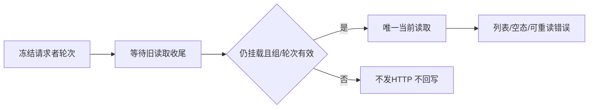

# T1105 独立 SPEC 初审

结论建议：**PASS，0 findings**。当前规格覆盖已确认StrictMode读取终态缺口，并保持原权限、写锁、撤销与版本确认边界；未发现本次准入前必须修正的范围问题。正式verdict由root的reviewctl录入计算，本报告不改审核状态、事件或产品。

- 时间：2026-10-09T04:40:46.844015+00:00。
- 基点：main `d35f7d57ff952d306071eb40d34127956b067906`。
- SPEC SHA256：`c1a7a32d35237826a6fa4b15af25e58c4bf60cc1b150bf98512056844d695fc0`。
- 原产品SHA256：`0162e6c0e73a73e856b4f58dec067abdd7721577d5ca4fa284c459480b6785a4`；独立核当前字节与d35f7d57 Git blob全等，尚未实施。
- packet：`SPEC_REVIEW_INPUT.json`，SHA256 `729c0f013702365fb2b68e0100e952eed7446e74027dd2e56078be6e1bb653e2`；严格spec-review-round/v2 initial四字段、findings[]。

先读BACKLOG/SPEC/诊断和项目记忆，沿已加载product-to-code-orchestrator、阶段路由与物理架构做BUILD前置初审；技能与项目stamp均3.29.0。已读项目内oil-ui-pro0.10.0、交互与状态参考和账号组UI_RULES，只保留既有方向，不新增视觉探索、评分或设计审批。

大白话：旧读取迟到时，既不能把旧组内容填回，也不能把当前合法读取永久卡在加载。旧请求收尾后，只有仍在当前组、当前轮次的请求者才能继续。

## 实际诊断核验

隔离alias指向当前真实frontend/src与原vitest配置，实际7例为6原PASS/新增1FAIL：旧Promise经React act解决后仍有“正在读取共享资源…”，不是以定时器猜终态。probe正文从const mock起的完整6原例与原测试正文逐字相同，外部仅修必要import和追加StrictMode例。receipt/log SHA吻合。

这是组件读取mock的隔离行为RED，不冒称正式API或公共浏览器已验证。前两次依赖/alias失败均0 test、exit1，原记录保留，不能算产品RED。来源Chrome组上下文错误仍为原失败背景，不推断其所有拒绝都已由StrictMode解释。

## 并发、StrictMode与归属

| 核查 | 判断/实施验收点 |
| --- | --- |
| StrictMode | 原reading只存Promise，新mount复用旧ticket；旧finally因epoch过期不结束当前loading。epoch记录+排队可闭合，不能无条件返回旧Promise后丢当前终态。 |
| 请求队列 | 请求者ticket必须在调用/等待前冻结；等待旧Promise全部收尾后再次校验alive/current-group/epoch。同epoch调用共享当前请求，旧finally只释放自己持有的reading，不能清掉新记录；最多1在途。 |
| 开始前/等待中过期 | 微任务尚未开始就过期不得HTTP；等待中过期不得在队列解除后重签最新epoch。旧响应/错误/finally不回写当前数据或loading。跳过不冒充当前空列表。 |
| 卸载/切组 | 旧请求允许真实结束但不可回写；过期排队不发送。完全卸载的新组件有新refs，单在途按面板读取生命周期记录，不新增全应用注册表或第二执行器。 |
| 显示状态 | 当前挂载建立明确加载状态，清旧scope rows/plan/deletion/message/error。同组手动刷新保留原布局和合法信息，切组必须清旧数据。失败结束loading、保原错误及重新读取入口。 |
| 权限/写锁 | HTTP仍冻结真实groupId/accountId:null；不自动切组、不读旧账号权限。原current/check、working/writeEpoch/busy、foreground release、preview/digest/expected版本、撤销验证/onChanged不改；load的await合同兼容原revoke后读取。 |
| 期限 | 等待原请求结束，不重置原请求期限或缩短预算；观察至少120秒，外层覆盖旧+新读取及串行/清理。外部诊断test360000/hook120000/retry0；实际6ms断言不是6ms预算。 |

这些是当前规格已要求的实现核查点，不是扩大写集或新增授权。尚无代码候选，不能提前签实现满足。

## 验收、视觉与范围

仅一个产品路径；原6例正文保留，追加StrictMode、旧Promise真实延迟、切组/卸载/过期队列/同epoch复用验证。公共Chrome正常读取必须经正式service与隔离DB；仅错误恢复的一次明确HTTP失败替身按SPEC标明，不能所有读取mock。须实际公共页面RED→GREEN，保存两视口、刷新/重读/后退/键盘、可见状态和截图。

UI保留原SectionCard/Button、语义tokens、Noto字体及密度。此轮没有新截图/操作，**视觉与公共旅程待验**，不给分数或操作PASS。LED047/组边界、真实frontend typecheck、三门卫/diff及完整reconcile按规格执行，原失败保留。

初审时modules无T1105、reconcile无新旅程key：这是待准入绑定，不是已发生Gate。root后续只增规格精确模块绑定与一个旅程allowlist key，不放宽原门或改旧断言。源码提交、统一包和安装仍需当场事实；T1101扫码PASS或隔离组件RED不替代共享面板完成。

## SHA256与只读边界

只读检索、Git blob和内存比较/hash；未运行测试、App/浏览器、CLI/DB/模型/网络、构建或进程操作。仓库产品/原测试/控制面零写，仅写本报告/packet。首次报告生成脚本在Python解析前因引号错误退出，未写文件或执行产品；已纠正，不计产品RED。

| 项目规格/源/配置 | SHA256 |
| --- | --- |
| `docs/features/t1105-shared-resource-loading.md` | `c1a7a32d35237826a6fa4b15af25e58c4bf60cc1b150bf98512056844d695fc0` |
| `docs/features/t1105-shared-resource-loading-diagnosis.md` | `f268ac110310f13acf6aa8ea541775d7529cb48dfae8e5cd06cf0daf961b844d` |
| `frontend/src/features/platform-account/resource-grants-panel.tsx` | `0162e6c0e73a73e856b4f58dec067abdd7721577d5ca4fa284c459480b6785a4` |
| `frontend/src/features/platform-account/resource-grants-panel.test.tsx` | `40b30eeeb265f66b30597950c645be10e823322b05172a04c1179d13d52ec301` |
| `docs/产品定位.md` | `86bc2c8add6a01ebf5b2ecf9de05d448770ca14a4e0bdbbf376fffc6387e3800` |
| `orchestrator/process/modules.config.json` | `00f64db5c8b56de2eac287681b33b452d48d7c943beae0f5a11090f1c6d3d9d6` |
| `orchestrator/process/reconcile.config.json` | `6fc0866462ea4571eafb4d36708b8fe1062e9e5834d14670decf596565a2524f` |
| `orchestrator/SYSTEM_ARCHITECTURE.md` | `eb1826d4c09054df622d9718c38ca372bd19833e72bd1a752757631a5747c1df` |
| `orchestrator/process/reviewctl.mjs` | `dde682e0ad114048daa5cfd8686a1450ccf902a8ab56a48411e88399a51ccc15` |
| `orchestrator/process/.skill-version` | `059101410c6bd35df37979a7fc91d59aa840a79aa794736772fe04c45a43838d` |
| `.agents/skills/oil-ui-pro/SKILL.md` | `a623059117b5afdeaf437a6ac0944040ba666b0847e520cfe4fa42cc1ea1cec2` |
| `.agents/skills/oil-ui-pro/references/interaction-and-state.md` | `34e8961d11f70522e3b10d18f2f59263a3e9eaf4662a3940dcef3ea7ba6f7915` |
| `docs/features/t1022-account-group-workspace/UI_RULES.md` | `a19d209281fe1a51463c7c2b8a063c3fa117d53679762f33d8c9637004bc8d76` |

| 外部实际探针证据 | SHA256 |
| --- | --- |
| `diagnostic-probe-binding.json` | `77f29f7d6dbd82420b397aafbafc74b553f81b744a789aeb99b8a95c62f03ede` |
| `diagnostic-vitest.config.ts` | `064aa11ffe92b175e3c6b87992deb542d99778b450f2f19724b01072cbe0734e` |
| `resource-grants-red-probe.test.tsx` | `452bf2a858126003c41f51719799e082c666ef222e44bb821b8c5f6982a19899` |
| `strictmode-diagnostic-red.json` | `c298b60c0735b48b203f62fe5446d48d21463dbad76c3ed0eee6354cccccfa0f` |
| `strictmode-diagnostic-red.log` | `42eedc9ef5992c25f47b3ec03538d1cf3ff35261a9ad759ff7dc6066da0a9b47` |
| `strictmode-diagnostic-red-loaded.json` | `edec119ba0e1c628ea54287e65ae2c2a38e8fbc3293d93c2037306b4537d4f4b` |
| `strictmode-diagnostic-red-loaded.log` | `aedd91bc6f46f35b52b5d219932475648d0a296e153706ed493a4e4c6a5d5c23` |
| `strictmode-diagnostic-red-aliased.json` | `97771595d3ad5d6fff460bec867aad9b7b7aad6589ed2acf57f2335ec20bd4bb` |
| `strictmode-diagnostic-red-aliased.log` | `74117a11990cbae87ca38e626a6abc0d89d8715e307882905e03568146b49904` |
| `diagnostic-load-failure.json` | `dd7772cc6a61cbac77a648850734d3912961eca34aaacf80433394a108052799` |

# T1105 证据叙述窄复审

结论：PASS，0 findings。当前 SPEC SHA256 `4a49467fc9eb340708f845f3f14634bec4a9e8cfbb531c7f76aba2ebbe71d072`；宪法 `docs/产品定位.md` SHA256 `86bc2c8add6a01ebf5b2ecf9de05d448770ca14a4e0bdbbf376fffc6387e3800`。这是原 initial lineage 的 recheck，只审真实证据校准。

独立逆向核验：把新增的“公共基线实际 PASS、未复现 spinner、有效前置 RED 为组件 StrictMode/延迟切组、实施后公共 GREEN”替换回原句，全文 SHA256 精确恢复原初审 `c1a7a32d35237826a6fa4b15af25e58c4bf60cc1b150bf98512056844d695fc0`。功能、归属、权限、写集、预算、公共旅程及 Gate 均没有变化。DEC-T1105-EVIDENCE 保留原 browser-red 名称与实际 exit0，不把它追记成 RED。

真实公共基线已通过；同一正式旅程的实现后运行也通过。组件隔离探针 6 PASS/1 FAIL 和 mockReset 后 8 PASS/4 FAIL 是已发生的有效行为 RED。前两次 0 test 依赖/别名失败、第一次受残留 mock 污染的 6 PASS/6 FAIL 仍保留，均没有被冒充成新增有效公共 RED。这个校准遵守“不补拍历史证据”，没有要求人为制造页面失败。

证据回执、日志与当前源码的精确 SHA 见同目录 IMPLEMENTATION_REVIEW.json。该窄复审不签安装版、全局 reconcile 或父任务完成。
