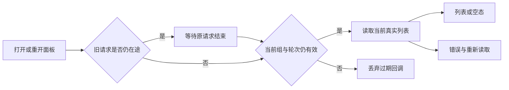

# T-1105 修复共享资源读取生命周期与加载终态

用户要求全功能验证、发现问题及时建task并修复。本任务来自T1101额外真实Chrome走查失败及main d35f7d57的隔离诊断，不新增产品方向、IA、服务合同、权限或数据归属。原失败保存，T1101范围内PASS不代签共享资源。

## 真实缺陷与用户结果

当前组件在React StrictMode的挂载→清理→重新挂载后复用reading.current中的旧Promise；清理增加epoch，而新挂载未发起当前epoch读取。旧Promise即使成功，旧ticket也不能更新loading；最终面板继续转圈且“重新读取”禁用。实际诊断6个原测试PASS/新增1FAIL，等待已解决mock Promise经React act刷新仍存在“正在读取共享资源…”。前两次探针是外部依赖/别名加载失败、0test，不算产品RED。

用户应能打开、重开或刷新当前组共享资源，得到真实列表/空态或错误；读取失败后保留可用的重新读取入口。切组/卸载不能显示旧资源或旧影响，当前合法读取不能因旧Promise失去终态。

## 限定修复

- 只调整ResourceGrantsPanel的读取生命周期。仍最多一个在途读取；reading记录请求的epoch，同epoch调用复用。新epoch调用等待真实旧请求完成后只启动该次仍有效的当前读取；过期排队回调不得发请求或回写。旧请求在开始前已过期时不发HTTP。
- 当前组首次挂载/重开建立明确加载状态；旧scope列表/影响/消息清理，错误/空态依据真实返回。alive/current-group/epoch校验保持，非当前组仍拒绝，不自动切组、放宽服务权限或使用旧账号回执。
- 原撤销、影响预览、删除预览、版本digest、前台活动和busy写锁完全不变。不得删除历史、自动撤销、取消后台任务或添加自动无限重试。
- 纯机械请求scope/生命周期判断，不作任何语义或素材选择。

## 页面与体验

按oil-ui-pro 0.10.0和账号组UI_RULES保留既有SectionCard/Button、品牌紫、Noto Sans SC与页面布局；无新风格或控件。加载只表示有实际读取，失败显示原恢复反馈，空态来自正式API。正常1366×900、窄窗900×900，键盘重读与前进/后退保留。实际截图与操作结果取自隔离Chrome/PGlite，不声称安装版或真实用户库通过。



## 写集与实际验证

产品仅frontend/src/features/platform-account/resource-grants-panel.tsx；保留原6例正文，仅追加StrictMode、真实旧Promise待完成/切组和卸载回写回归；新增frontend/tests/e2e/shared-resource-lifecycle.spec.ts与docs/verification/t1105/run-journey.mjs。reconcile.config.json只增加该旅程命令allowlist，不改Gate/预算或现有断言。根会话串行改产品；独立只读先审SPEC、后审实现/体验。

先正式记录独评再start/实施；已有外部诊断RED原始保留，不补拍历史。公共页面先运行实现前基线：实际正常页面已PASS，未复现原spinner，不计公共RED；修复前置RED使用已实际复现的组件StrictMode及延迟切组行为，不人为制造浏览器失败。实施后再运行公共GREEN，原组件6例及当前新例全部过；组边界/LED047、frontend typecheck、boundary/semantic/orphan/diff和完整reconcile实际执行。测试正观察至少120秒且外层覆盖串行预算；不缩短旧预算。浏览器正常/重读走正式服务与隔离DB，只有错误恢复一次响应是明确HTTP失败替身，不改真实权限或访问用户库。保存运行时间/命令/退出码/日志SHA、可见文案和截图，源码提交后taskctl当前旅程完成；全局既有失败保留并关联原task。

父任务T1080/T1062已授权main无备份构建安装；本任务修复提交后统一打包，不单独push、tag、发布或替换真实Cookie。

```frontend-journey-contract
{
  "schema": "frontend-journey-contract/v2",
  "task_id": "T-1105",
  "copy_guard": {
    "forbid_internal_ids": true
  },
  "watched_paths": [
    "frontend/src/features/platform-account/resource-grants-panel.tsx",
    "frontend/src/features/platform-account/resource-grants-panel.test.tsx",
    "frontend/tests/e2e/shared-resource-lifecycle.spec.ts"
  ],
  "required_checks": [
    {
      "id": "AC-READ",
      "test_id": "TEST-T1105-RESOURCE"
    },
    {
      "id": "AC-RECOVERY",
      "test_id": "TEST-T1105-RESOURCE"
    }
  ],
  "required_conditions": [
    "refresh",
    "repeat",
    "back"
  ],
  "viewports": [
    {
      "width": 1366,
      "height": 900
    },
    {
      "width": 900,
      "height": 900
    }
  ],
  "coherence_groups": []
}
```
