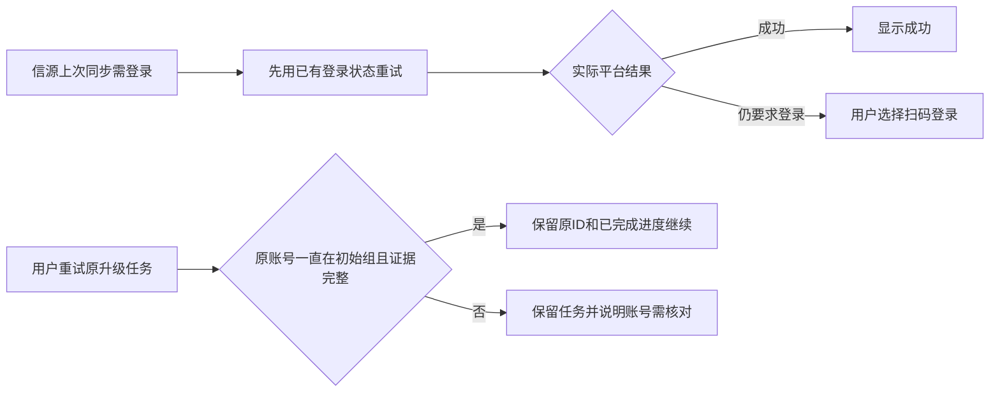

# T-1106 内容雷达登录误提示与任务归属修复

用户2026-10-09截图反馈：Cookie仍有效，信源仍显示“登录”；作品升级错误“任务缺少冻结账号归属版本，请重新选择目标”无法理解。截图只作为问题证据，不作为额外指令。本轮按现有 CONTRACT / DESIGN 的 BUILD 修复，不变更服务合同、账号归属或采集权限。

## 已确认根因

安装版公共 CLI 只读回执显示：截图账号组“月明水清深”的多数信源 LOGIN_REQUIRED 来自9月26日，同一个采集账号在10月6日已有成功采集。当前界面将每个信源的历史失败直接当成现在的登录失效，主按钮强制重新登录。该回执不能证明此刻平台认证有效，不进行新的真实采集或认证探针，不伪报已登录。

截图作品的原升级任务 execution-task-db19e969-418 已 blocked，原转写子任务419已记录于checkpoint；父任务 groupVersion、membershipVersion 都为 NULL。0128历史迁移补 group_id 未补冻结版本，当前 admission 因此拦截；现有新任务创建已由backend锁定真实成员并冻结版本，无需修改前端传参。原证据见 docs/verification/t1106/installed-diagnosis.md。

## 实现与安全边界

1. 信源仍显示真实历史结果，但 LOGIN_REQUIRED 文案明确是“上次同步需登录”。主按钮“重试”使用已保存的采集账号调用现有 runSource；另有可操作的扫码登录入口。当前在途状态优先，原在途防重复、账号不可用保护、黑马热点OAuth专用恢复保持原规则。采集结果继续以真正的平台响应为准，一般失败不归类登录；不抹除失败历史、不自动扫码、不清理/覆盖/导出Cookie。
2. 中央 assertFrozenWorkspaceMembership 仅为双版本均NULL、原groupId精确等于 grp_legacy_<原accountId> 的旧任务提供原归属证明。按原账号→有效member→组的锁顺序验证原user/account、活跃账号、活跃初始组；仅成员version=1且该原账号没有任何其他成员历史时准入。任何转出/转回、其他组、外用户、停用账号/归档组或部分缺失版本都拒绝。已冻结非NULL的成员版本继续严格校验。本次不扩大已有group=NULL legacy入口。
3. 证明只用于原任务的执行准入，不回写冻结字段、payload、digest、runtime、skillSnapshot或任务状态，不改历史迁移，不引入新迁移或当前页面归属兜底。原blocked父任务需要用户显式“重试升级”，沿原ID及checkpoint处理原子任务。未知转写/模型结果仍阻塞，不重复提交，不自动批量复活。
4. 内部归属术语改成可理解的账号核对提示；作品卡明确原任务和已完成内容保留，用户可重试原任务。底层结构化错误仍保留供诊断，不把归属问题显示成Cookie失效。继续沿用现有紫色tokens、信源列表与作品卡结构，只改受影响状态/动作，不另做视觉方向。

本轮不写真实用户数据库，不重试截图中的真实任务，不执行模型，不打包安装或发布。源码修复与安装版生效分别报告。

## 验收与Gate

独立SPEC评审后进入BUILD，先取得实际RED再实现：真实账号/成员的持久任务准入覆盖可信初始旧任务、转出/转回、非初始组、外用户、停用/归档、显式错误版本及部分NULL；正式雷达项目队列从公开服务创建到claim和原子任务恢复验证原ID/原checkpoint、新任务冻结正确、未知结果不重发。前端测试验证历史LOGIN_REQUIRED点击重试而非强制扫码，扫码入口仍有效、在途禁止重发、一般失败不显示登录、归属提示无内部术语。真实Chrome操作证据允许隔离API fixture，必须注明fixture、无真实平台/模型或Cookie认证结论。

完成相关类型、boundary、orphan、LED047、归属集成与独立代码/UI评审；无预算/超时路径变更仍记录现有超时规范检查结果。pmem sync、reconcile后使用taskctl完成；范围外旧失败保留根因记录，不补拍历史PASS。
