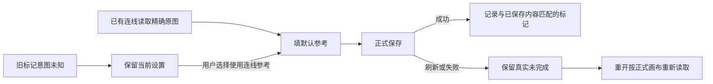

# T-1108 画布公共回读与有限观察验证缺口

用户要求发现问题及时建task并修。main188c52c0真实Chrome两条旅程1PASS/1FAIL，第一条连线引用保存回读为undefined，poll实际默认5秒；第二条三平台绑定入口PASS。原browser-current-head.log/json及trace保留，不用此前d35两条PASS代签本次。

当前仅登记/诊断：先核网络保存/回读/前台组状态与原运行引用，明确120秒规范观察的真实消费者。不能把5000ms失败直接断为产品丢数据，也不能只删断言或人为返回保存成功。合法连线必须把精确真实文件ID保存到正式canvas并重开读取，且不自动采纳/运行。修复前有SPEC与独立复核，产品或测试任何调整单列写集。完整API探针只看隔离测试，不接真实库/模型。

## 实际根因与限定修复

完整trace中23个画布请求已取证。04:59:17.385的正式canvas.save携带正确asset/file却未取得回执；刷新后canvas.get仍rev2且无引用，后续没有save。源码将自动填入的edge提前加入localStorage，与手动清空共用标记；重载据此跳过。仅延长poll不能恢复该写入。

- 本窗口仍使用Set防止重复默认填入；持久化只发生在正式save成功、归属和epoch核对后，使用请求发起时冻结的document与已处理edge集合，晚到/失败回执不持久化。
- 新格式绑定已保存edge的id/source/target及目标type/mode/referenceAssetId/referenceFileId精确机械指纹。载入时以当前正式document核对，匹配才恢复抑制；不使用旧缓存当数据真相。
- 旧flat edge数组无法区分自动填入与用户清空，保留仍存在的旧edge为legacy抑制，不删除旧key或猜意图。保存新格式仍保留legacy集合；用户手改模式/参考后才转成可核对的新标记。对历史抑制且缺参考的生成节点，在既有右侧连线区提供次要按钮“使用连线参考”，说明“保留当前设置，可重新使用连线参考”。仅明确按下才解除对应抑制并按原连线与exact selector填默认。无可用原图片时保留设置并给就地真实反馈；不自动采纳、提交生成、下载或改旧任务。
- 原保存幂等/expectedRevision、归属、跨scope、手选参考、候选保留和生成锁不变；不新增后端服务、数据库或质量门。机械指纹不理解语义或选择素材。



## 写集、原体验及验收

产品仅frontend/src/features/creative-canvas/canvas-editor.tsx。测试保留frontend/src/features/creative-canvas/canvas-editor.test.tsx原全部案例并追加中断重开、成功保存手动空值、缓存不匹配、旧抑制显式恢复、跨scope迟到回执。frontend/tests/e2e/creative-canvas.spec.ts仅T1101两例有限观察预算及第一个流程追加保存一次明确中断/重开；同文件共用dispatch/upload HTTP helper原SDK默认30秒，提高到120秒，原请求/断言不变，其它旧case直接请求不改。不删精确referenceFileId API回读、原生成锁/手选/图库/扫码断言。不改全局测试配置或缩短旧预算。模块精确绑定同三路径，根串行写、独立只读SPEC及实现复核。

UI加载oil-ui-pro0.10.0与UI_RULES：保留既有紫色、Button outline、详情连线区与布局，不新造视觉方向。历史恢复按钮正常/不可用/键盘与900窄窗需要真实走查截图，不把截图当保存成功。正向观察至少120秒，两例外层按串行预算保留更长余量；共享helper现有更長的预算不缩短。先原组件追加实际RED，再产品GREEN；公共一次中断是真实HTTP错误替身，canvas.save/get、文件上传、组归属走正式HTTP/隔离DB，模型候选明确替身。保存必须正式get精确文件且第二次重开再get，不以本地DOM假成功。

原失败trace/log/截图外部保留；运行命令/时间/exit/SHA和来源同时记录。实际单测、当前T1101公共旅程、T1105组合、LED047、类型、timeout-policy、boundary/semantic/orphan和完整reconcile逐项记录，不用旧PASS代签。全局范围外既有失败登记原task，不声称全绿。父T1062/T1080授权本地main无备份构建安装仍适用，修复提交后统一打包，不push/tag/发布，不访问真实模型或用户库。

```frontend-journey-contract
{
  "schema": "frontend-journey-contract/v2",
  "task_id": "T-1108",
  "copy_guard": {"forbid_internal_ids": true},
  "watched_paths": ["frontend/src/features/creative-canvas/canvas-editor.tsx", "frontend/src/features/creative-canvas/canvas-editor.test.tsx", "frontend/tests/e2e/creative-canvas.spec.ts"],
  "required_checks": [{"id": "AC-PERSIST", "test_id": "TEST-T1101-CANVAS"}, {"id": "AC-LEGACY", "test_id": "TEST-T1101-CANVAS"}],
  "required_conditions": ["refresh", "repeat", "back"],
  "viewports": [{"width": 1366, "height": 900}, {"width": 900, "height": 900}],
  "coherence_groups": []
}
```

实际log SHA cac68610ee3386b5fe80df2a30f85f96292462cf5282fc9c57424c55c1f15b6f。文件frontend/tests/e2e/creative-canvas.spec.ts第401行expect.poll未显式timeout；同两例还含其它默认有限观察。LED053规定执行/有限观察最短120秒，正测试外层需覆盖串行和余量；测试批次与包构建入口不加独立短帽子。本登记不预签根因或GREEN。
