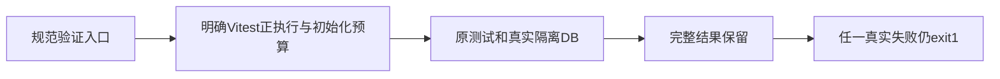

# T-1109 超时验证入口遗漏真实测试预算

用户要求全功能验证发现问题及时建task修复。T1108完整timeout-policy实际exit1，原静态27项保留；另backend调用账本beforeAll默认10秒超时，25例全skip，不能算产品通过或归为原静态欠债。日志在本地验收根t1108/timeout-policy.log，SHA39cdd8bb6bfca9a64ccc64f79b6d31448bf4fe5e10507496ab4634c7f8d4850f。

## 问题与结果

tools/timeout-policy/verify.mjs实际Vitest入口只有--retry=0，未设置test/hook预算；原消费者beforeAll报Hook timed out in10000ms。测试需给真实隔离数据库准备与正执行至少120秒；更长已有局部预算保留。观察不能取消原合法任务，失败要保留且其余检查继续执行。不是删除Gate、skip测试、删历史或忽略退出码。

## 范围和写集

产品/测试源仅tools/timeout-policy/verify.mjs，在该入口的Vitest argv中明确--testTimeout=120000和--hookTimeout=120000；mcp-server的pnpm test透传同选项。已有文件更长局部超时不覆盖。Node原生有限探针与spawn循环的执行/退出行为不变，无新增外层上限。不改测试文件、公共接口、任务期限、数据库、运行时、静态扫描allowlist或构建流程；串行root写、先独立SPEC复核再start和实现。

原beforeAll10秒失败是当场RED；改后首先原同三个backend文件、--retry=0、真实PGlite全部执行且0skip，命令仅增加规范预算；再实际完整node tools/timeout-policy/verify.mjs，其余原静态27若仍失败真实exit1并关联T1081，不洗绿。boundary/semantic/orphan、git diff --check及最终reconcile如实执行；源码必须独立最终复核并提交。没有UI变化、不新增镜像参数单测。父T1062/T1080本地main无备份出包授权仍适用；本修复不发模型任务，不push/tag/发布。
