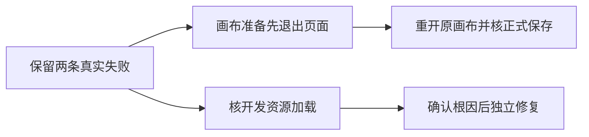

# T-1110 浏览器开发资源与测试状态准备失败登记

用户2026-10-09要求发现问题及时建task、修复。源码fa09f0ff的真实浏览器旅程于05:33:52—05:44:54 UTC执行661.533秒，退出1，两例失败。外部原始日志、完整trace、截图和error-context存于本机验收目录t1108/chunk-failure；不把此轮记成通过。

## 已有事实

- 三平台绑定页停在“This page couldn’t load”，console和服务日志有ChunkLoadError，包含开发HMR资源与node_modules分块。尚未建立具体资源失配/响应/并发的根因；不能据此声称安装包同样损坏，也不能因多个worktree存在便猜成缓存互相覆盖。
- 第一例在“使用连线参考”按钮观察120秒失败。实际正式保存回读已恢复原图成功至rev3；测试在编辑页面仍运行时外部写入旧版空引用到rev4，随后原页面自动保存又写回有引用，重开正式get为rev5。因此此轮不能验收旧标记按钮，问题首先是测试准备顺序，修订属于T1108现有写集，不改产品权限/保存机制。
- 当前W开发服务进程在终态已退出，其他工作树、当前安装版与Activity服务仍在运行；禁止按名称批量杀进程或删除其他缓存。

## 接下来

保留原失败；T1108测试真实退出编辑器到画布库后，再写隔离旧版状态并由原画布卡片重开，显式恢复后再次返回画布库、重开并按正式get核精确原图。公共HTTP poll外层保留360秒以覆盖内层120秒请求及余量，不改变合法任务期限。

开发资源问题先在当前隔离库/测试服务核trace和复测。如果只经生成缓存重新创建恢复，应记录恢复和原根因仍未知；需要修改产品、配置或runner时先补SPEC、独立评审，不删除断言、自动重跑失败或绕过页面错误。其余已授权本地出包可按真实已验证源继续，开发测试失败与安装版首次启动分别记录。

## 当场只读核对

独立读取第二旅程trace：60个Next静态请求HTTP200，10个失败为status=-1、net::ERR_NETWORK_CHANGED，首个node_modules分块失败后产生ChunkLoadError。没有HTTP错误响应；当前证据不支持404、哈希失配或跨worktree缓存覆盖。OS网络事件/Chromium netlog未收集，底层触发仍UNKNOWN。没有删缓存或改网络配置；072ad源码修正画布准备顺序后，本次同两条旅程实际2PASS/87.681秒，证明本轮恢复，不证明底层触发已修。有限原始核对见docs/verification/t1110/READ_ONLY_DIAGNOSIS.md。
