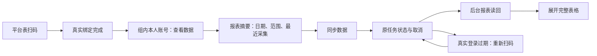

# T1110 微信原生数据页契约（实现中、真实浏览器待验）

本文件是当前实现的局部页面契约。依据已通过的 `docs/features/t1110-wechat-browser-collection.md`，范围为两微信平台的绑定、原生报表回读、立即同步/恢复/取消及五平台默认错峰。不声称真实账号绑定、浏览器采集、视觉和操作已经通过。

## 用户结果与现有方向

用户在账号组的平台能力表点击公众号或视频号的真实扫码按钮，绑定自己的账号；在组成员卡点击“查看数据”，直接看到该账号后台原生报表，随后可以同步、取消或继续原任务。日期/范围、人数/次数、推荐/喜欢、比例/秒、负净增和未知各自保留。

沿用用户已经确认的丰富工作台和项目内 oil-ui-pro 0.10.0、账号组UI_RULES。品类为桌面创作者数据工具，首屏主角为真实账号身份、最近报表与“同步数据”。复用品牌紫、白色面板、标准文字与圆角tokens；不另开风格探索或设计系统。平台能力表、AccountBindingPanel、Button、Dialog、现有账号管理和 `/accounts/works` 路由继续复用。报表card采用标准tokens和独立可访问标题，避免多个历史同类报告标题生成重复DOM ID。

## 入口与接口

- 当前账号组能力表：`accounts.bindingCapabilities` 返回真实装配状态；两微信平台为 `wechatOfficial` / `wechatVideo`。可用的bind.method=qr才出现扫码按钮；候选不将缺少identity witness的端口标记ready，也不新增能力刷新按钮/重复扫码框。
- 原扫码弹窗：`accounts.bind.start/status/cancel`；AccountBindingPanel冻结原group/version/idempotencyKey，并在真实成功后读回 `accounts.get`。沿用原临时profile、持久任务与归属守卫。
- 微信成员卡：“查看数据”链接 `/accounts/works?accountId=<真实成员ID>`。转组按钮仅在微信行收进原“账号管理与能力”details，保持每行一个直接动作。其它三平台行和旧组件不借本任务改版。
- 服务端页面：读取当前真实账号组成员，核对显式accountId，使用对应member.version和group.version构造scope；不沿用默认号membershipVersion。URL参数不授予权限。微信分支调用 `platforms.reports.list`，不先要求catalog，不调旧metrics字典。
- 浏览器数据操作：通过 `createHttpTransport('/api/v1',{groupId,accountId})` 冻结所选成员scope。`platforms.collections.start` 请求nativeReports；get/cancel沿原attempt。报表读取使用 `platforms.reports.list` 分页，不公开原export URL、Cookie、profile路径或内部归属版本。



## 首屏和按需展开

标题为“账号名的作品与数据”，副文为具体微信平台与“后台原生报表”。首屏一个主要动作“同步数据”，显示最近实际报表的采集时间。原生报告摘要给出报告类别、开始/结束日期、每日统计或按发布时间选择的作品范围、真实行数与采集时间。作品报表明确“平台未说明每项指标的累计范围”，不称全历史目录，不把近30天选择范围充当每项指标的增量窗口。

“查看完整报表”展开后才挂载完整table/rows，初始页面不渲染上万单元格。原列名保留并显示单位，0显示0，null显示“—”，ratio按百分数显示，seconds显示秒，平台ID不数值化，描述保留换行。单元格title保留原始字符串。长列在报表内部横滚，可聚焦，不撑破页面。

## 任务和恢复状态

- queued/running：显示“等待同步/正在同步数据”，主要同步按钮disabled；同一次状态读取仅一个在途请求，上一请求结束才安排下一轮。
- complete：停止轮询，回读报表，不重复start。
- partial：停止自动提交，保留原clientRequestId/attempt，提供“继续同步”。只有服务真实确认TASK_TIMEOUT时显示“本次同步等待结束，已取得数据保留”和“重新同步”；用户明确点击才新建请求，等待/刷新不新建。
- failed：显示“数据同步未完成，请重试”；保留已加载/已提交报表，不显示扫码。
- needsAuth：只有真实状态才显示“登录已过期，请重新扫码”，同步按钮disabled；原AccountBindingPanel确认成功后复用原key恢复原manual attempt。backend须重新验证更新后的真实binding，不新建任务冒充恢复。
- cancelled：只采纳原cancel响应的真实状态；取消结果未知时保留原attempt并核对，不宣称已停止。
- start明确业务拒绝：按实际错误码显示可理解原因；SCOPE_MISSING显示“请先扫码绑定这个账号，再同步数据。”并使用原平台扫码弹窗，真实绑定读回后沿同意图提交。普通业务拒绝不提示登录失效；本地拒绝标记只帮助展示，不授予凭据。
- start响应未知：localStorage只保非敏感任务索引与请求key，“核对上次同步请求”沿同key确认，不生成第二次意图。
- 刷新/重新进入：读取原attempt，不自动start；原记录尚未读清时先核对原任务。
- 状态读取失败：可核对原任务，不把普通网络错误当登录过期。报表读取失败保留已显示内容，提供“重试读取”；complete发生于读请求在途时排队一次后续重读。
- 卸载/切组：scope epoch拒绝迟到结果；停止页面轮询，切组事件立即清旧数据可见区，后台持久任务保留。重新扫码弹窗关闭/Esc回焦原触发按钮。

## 调度候选

默认self.metrics按北京时间每2小时0/5/10/15/20分钟分别排抖音/小红书/快手/视频号/公众号。只有缺失job使用模板；既有job（包括旧默认时刻）、关闭状态、自定义cron、ID和target不重写。真实绑定后初始化原job，startup需平台能力与真实凭据同时满足。微信collector只请求nativeReports；三平台仍原有流程；recoveryOnly不成为第二周期producer，也不再领取服务已确认TASK_TIMEOUT的微信原run。调度本次遇到原期限耗尽会诚实结束原owner，停止无限continue；数据及原attempt保留，下次真正调度时点仍经原scheduler产生自己的唯一owner。

## 待实际验收

候选behavior tests覆盖五平台错峰、关闭/自定义保留、startup凭据准入、微信原nativeReports task键、扫码平台/成员链接、显式组/账号读取、真实状态取消、在途去重、未知响应重试、终态停止、卸载/切组竞态、报表按需渲染与0/null/率/秒/ID。新增页面需真实Chrome在1366×900与1024×800走入口、同步/状态、报表展开、取消、普通错误、真实登录恢复及Tab/Esc回焦，检查中文长文本、表格局部滚动和无页面水平溢出。截图必须实际查看后才登记结果。

本候选没有整合创作者总览publication累计指标，也没有真实扫码/profile/browser导出证据；原生报表不应加入现“文章累计阅读（次）”或平台作品累计比較。缺真人稳定identity witness时不得标记能力ready或任务完成。服务端按实际nativeReports capability装配状态设置同步可用性；未就绪时“同步数据”禁用，仍可展开已有报表，显示“当前平台的数据同步暂不可用，已有报表仍可查看。”

## 当场页面旅程的机器契约

报表代表数据与执行状态夹具只核页面交互，不代签真人扫码或真实平台采集。完整Next原路由和账号组服务、当前归属守卫实际执行；没有绕过已批准SPEC的身份与落库验收。

```frontend-journey-contract
{
  "schema":"frontend-journey-contract/v2",
  "task_id":"T-1110",
  "copy_guard":{"forbid_internal_ids":true},
  "watched_paths":[
    "frontend/src/features/platform-account/account-group-manager.tsx",
    "frontend/src/features/platform-account/account-binding-panel.tsx",
    "frontend/src/features/platform-account/native-report-panel.tsx",
    "frontend/src/app/(creator)/accounts/works/page.tsx",
    "frontend/src/server/persistence-client.ts",
    "frontend/src/components/shell/account-switcher.tsx",
    "frontend/src/lib/http-transport.ts",
    "frontend/src/app/globals.css",
    "frontend/src/styles/tokens.css",
    "backend/src/modules/platform-collection",
    "backend/src/modules/platform-account/membership-lock.service.ts",
    "contract/src/resources/platform-native-reports.ts",
    "docs/verification/t1110/browser/prepare-next.mjs",
    "docs/verification/t1110/browser/materialize-shadow-dependencies.mjs",
    "docs/verification/t1110/browser/normalize-witness.mjs",
    "docs/verification/t1110/browser/start-shadow-next.mjs",
    "docs/verification/t1110/browser/service-fixture.ts",
    "docs/verification/t1110/browser/run-ego-journey.mjs",
    "docs/verification/t1110/browser/execute-ego-journey.mjs"
  ],
  "required_checks":[
    {"id":"AC-WECHAT-ENTRY","test_id":"TEST-T1110-NEXT-EGO"},
    {"id":"AC-WECHAT-REPORT","test_id":"TEST-T1110-NEXT-EGO"},
    {"id":"AC-WECHAT-STATE","test_id":"TEST-T1110-NEXT-EGO"},
    {"id":"AC-WECHAT-SCOPE","test_id":"TEST-T1110-NEXT-EGO"}
  ],
  "required_conditions":["loading","refresh","repeat","back","empty","error","cancel","group-switch"],
  "viewports":[{"width":1366,"height":900},{"width":1024,"height":800}],
  "coherence_groups":[]
}
```

- AC-WECHAT-ENTRY：实际装配的扫码能力为qr才操作原表格按钮；Esc关闭后仍可操作并回焦。能力不可用要如实登记，不能拿报告fixture readiness造扫码入口。两平台实际不可用时，界面行为可测但绑定链待验。
- AC-WECHAT-REPORT：成员真实链接与显式账号scope经Next SSR读取五份脱敏代表报表；原日期、原列名/单位/全部raw、真实0/null保留；首屏不挂完整表格，展开后可聚焦局部横滚；返回和历史后退/刷新仍同账号。
- AC-WECHAT-STATE：执行fixture走真实公开start/get/cancel：开始一次、在途禁重、刷新原ID、取消同ID、complete停止轮询；502结果未知沿同key、普通partial继续同key、TASK_TIMEOUT仅显式用户新intent；needsAuth打开原弹窗/Esc回焦，未扫码成功不得签真实认证恢复；未就绪禁提交但仍可看已取得报告。
- AC-WECHAT-SCOPE：真实公开组/成员与归属守卫；旧A读请求在途时切B，A迟到响应不能覆盖B，B上下文读取A账号被真实404拒绝。没有将A的真实平台归属搬到B，测试报表按fixture投影到各自的测试成员，不冒称迁移历史报告。
