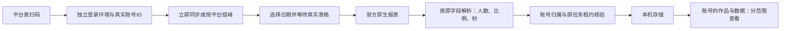

# T-1110 公众号与视频号本人后台采集接入

## 1. 用户结果与授权

用户2026-10-09要求研究微信两平台是否能通过浏览器后台取创作者数据，完成本人登录及T1108/T1109原生导出验证后明确说“那你开始推进”。本任务一次接通绑定、报表采集、存储回读、页面操作与错峰自动化；不需要再次确认实施方向。原三平台及T1101功能保留。

宪法为[产品定位](../产品定位.md)的R-ACCOUNT、R-INGEST、P-03与P-05；用户本次明确扩展微信本人后台采集。沿用账号组、单个本地操作者、本机存储及已有受管浏览器，不能借默认浏览器或研究空间凭据冒充产品绑定。不给他人账号采集，不执行发布、Cookie搬运、真实库手工迁移、打包或安装。

**FR-1110-01**：用户从平台能力表的公众号/视频号行直接扫码绑定本人账号；绑定真实平台稳定ID并保存隔离登录环境；只有本次真实登录过期才要求重新登录，普通导出或解析失败不能伪报掉登录。

**FR-1110-02**：立即或定期同步本人公众号内容分析及关注增长、视频号全部视频日汇总/关注增长/选定范围单篇视频报表，保留原生字段和可核查日期、原始值及单位。每日账号数据与单篇作品数据分开；近30天作品范围不声明全历史目录或指标累计窗口。

**FR-1110-03**：数据属于真实user/account及当前账号组。页面和公开API能选定该组成员回读数据；真实0和不可用分开，人数/次数、推荐/喜欢、百分比/秒、负净增都保真，不按标题猜作品归属。

**FR-1110-04**：使用已有唯一持久任务、scheduler和同账号串行队列，两微信平台各有自己的默认数据同步任务并与原三平台错峰；保留用户关闭、自定义时间、原ID、恢复和取消，不创建第二个周期生产者。

## 2. 数据事实与接入取舍

真实事实依据：[公众号实测](../research/2026-10-09-wechat-browser-export.md)、[视频号实测](../research/2026-10-09-channels-native-export.md)、[官方API边界](../research/2026-10-09-wechat-creator-data.md)。这些证明导出可得，尚未证明产品隔离profile绑定与身份读取已跑通；稳定ID协议需在普通账号页核实，昵称/session token不能作ID。

现有platformAccount capability组合、binding localStages及profile authority只接三平台；platform collection账户指标只容follower_count/lifetime/count，作品指标也只容非负count，缺微信人数、率、时长与账号日统计；调度admission/collector/startup也只认三平台。以上以CodeGraph刷新及实际动态装配检索核对。

因此新增 **nativeReports** 采集能力及原生报表资源，复用既有CollectionRun/lease/backend commit而不扩大旧字典或伪称workCatalog完整。公众号无稳定文章ID的趋势表保留原表，不按标题创建publication；视频号原生视频ID保留在单篇报表，不据有限导出删除/冻结其他作品。旧作品目录与指标API保持原语义。原生报表是可用创作者数据，页面明确区分两种范围，未来publication自动匹配不在本次承诺。

## 3. 服务契约（Source: FR-1110-01..04）

### 3.1 绑定与任务

复用`accounts.binding.begin/get/cancel`和当前前端AccountBindingPanel；微信进入既有AccountBindingStagePort和backend事务，platform分别为`wechatOfficial`/`wechatVideo`，创作alias`wechatOfficialAccount`不作采集身份。

临时profile按user/run隔离；扫码由受管Chrome打开官方后台，成功后仅正常当前页的真实稳定身份可成为externalAccountId。公众号优先普通账号信息的原始ID，视频号优先后台账号信息实际稳定ID；字段witness缺失时绑定明确失败，不用昵称、研究状态、随机/人工ID兜底。持久身份证明scope为`nativeReports`。仍保事务外profile准备、归属再核、账户/成员/原绑定任务事务提交、补偿和宿主停止确认；绑定到另组的身份不暗转组。

`platforms.collections.start`新增capability=`nativeReports`（accountId+clientRequestId），返回现有CollectionRun；get/cancel不变。backend只准已实际装配adapter及真实身份/scopes的账号进入；同账号同capability至多一个queued/running。任务状态仍queued/running/complete/partial/needsAuth/failed/cancelled；导出格式变化、网络、下载或依赖失败是普通failed/partial，实际登录页/明确会话无效才needsAuth。等待结束沿原ID，不自动重发。绑定proof不是永久证明Cookie有效；每次浏览器采集重读当前真实身份并与绑定比较。

### 3.2 原生报表资源与写入

新增`contract/src/resources/platform-native-reports.ts`；类型为严格、有限大小的DTO：

- platform只允许两微信枚举；kind固定为`officialContent`、`officialFollowers`、`channelsDaily`、`channelsFollowers`、`channelsWorks`，与平台绑定。
- selection保存startDate/endDate、Asia/Shanghai、meaning=`statisticsDates|publishedDates`。账号日报表示统计日期；视频作品列表表示发布时间选择范围，**accumulation=`sourceUnspecified`**，不当lifetime或30日增量。缺少可证明选择日期时拒绝成功，不猜日期。
- sourcePath仅脱敏官方pathname、filename仅basename、sha256为接收原始字节摘要；不持久化完整export URL/token/Cookie。
- tables保留原生表区块、列名、列类型/单位、完整行及原始字符串。规范化数值独立字段：人数people、次数count、比例ratio（0..1）、时长seconds、日期date、身份opaqueId、文本text；净增可以负值，未知`-`/空为null、原始0为0；不把不同单位相加。
- 单报表最多25MiB接收，最多10000行/32列，原始值有限长度；解析只接受已核对格式/列，不通过执行HTML/公式或宏取数。原始表标题/说明可保存有限纯文本。

`CollectionPageCommit`增加nativeReports分支，works/accountMetrics/workMetrics为空，nativeReports为上述报表数组；仅受控adapter经内部service port提交，公开API不能伪造报表/身份/租约。backend在原page事务内按现有user/account/platform/identity/lease/generation/scopes验证，然后写`platform_native_reports`，以user+group+account+platform+kind+sha256+selectionKey去重；selectionKey是按固定字段顺序对startDate/endDate/timeZone/meaning计算的内部摘要，不增加公开DTO或修改原字节sha256。空作品表在不同日期窗口可能有完全相同字节，必须保存不同窗口观察；同窗口同摘要的payload仍做完整冲突检测，原page摘要包含全部报表内容。多报表逐页提交；发生后续失败已提交证据仍能回读，最后一页完成才显示complete。不修改catalog generation。

新nativeReports run在start事务中经现有MembershipLock service冻结groupId/groupVersion/membershipVersion（必须来自当前实际成员），commit前按账号→成员→组→run锁顺序重验原冻结值；转组/归档变化阻断晚提交。持久资源增加service确定的id/userId/groupId/accountId/membershipVersion/observedAt/ingestedAt；报告payload包含selection/tables/source及sha。只有backend写库；worker只读下载、解析和交内部端口。schema迁移新增表及CollectionRun可空的冻结组/成员版本列，不重写旧数据，测试不得连接用户库。

### 3.3 回读

新增公开operation `platforms.reports.list`：GET `/accounts/:accountId/platform-reports`，分页pageSize<=100、cursor，与原native report资源契约响应。backend先真实账号/当前组有效成员归属校验，ctx.accountId若存在必须一致，只返回当前user/group/account报告；历史不同摘要可分页，默认最新。公开客户端/CLI按正式operation注册消费，不另设无鉴权本地文件端点。

页面按真实所选组成员accountId读取；所有参数仍由service校验，URL参数不授予跨组权限。报告冻结采集时的组，转组不重写或归入新组；新组只能看到转组后在本组采集的报告。旧报告在本机保留，本次默认成员入口不开放已退出组的账号历史读取；不删除或暗转历史事实。旧三平台继续原works/metrics读取；微信分支不先要求完整catalog。

## 4. 浏览器与文件可行性

worker浏览器驱动置于`ai-worker/src/runtime/platform/`，使用已有受管profile checkout/停止端口，不自行并发启动同profile。共享local binding stage与profile文件生命周期业务收敛到backend窄端口，frontend旧路径可仅兼容转出，不增加微信业务模块。

公众号从当前普通页实际原生下载链接接收文件；先下载事件，原生href popup问题可沿当前DOM实际链接、同会话fetch接收（限制同官方origin，不猜接口或记录sessionURL）。内容报表OLE/BIFF XLS，增长报表Excel兼容HTML需按内容检测。为避免自写不完整BIFF协议，新增SheetJS CE官方0.20.3依赖（官方[Node安装文档](https://docs.sheetjs.com/docs/getting-started/installation/nodejs/)），锁定tarball与lockfile完整性；HTML用现有jsdom无脚本模式或纯表解码。CSV用现有可复用标准解析能力或小型有限状态协议解析器，必须支持引号/逗号/内嵌换行，不能splitlines。

视频号分析在同源iframe。按可见的近30天控件选择实际日期，等待数据表日期/行数反映选择范围后再下载；标签变化不等于就绪。原生download事件前置监听；近30天单篇CSV本身包括跨页作品，不逐条猜接口。

执行统一继承任务剩余deadline和AbortSignal，各有限请求/观察预算至少120000ms，完整串行下载外层覆盖预算和清理；不按小时定时Job周期当执行上限。原profile授权/单所有者/stop-unconfirmed机制继续适用。所有文件临时放任务私有目录，解析/提交后清理，仅报告纯数据本机持久化；不把真实用户报表或Cookie提交Git。

| FR | 真实来源 | 存储 | 回读 | 判定 |
|---|---|---|---|---|
| 01 | 已验证官方QR后台；稳定ID字段待普通账号页核实 | 原绑定/账号/成员/独立profile | 原binding DTO/平台能力表 | 可实施；无身份证据不能称绑定成功 |
| 02 | T1108两XLS与T1109三CSV实文件 | nativeReports表+原collection pages | reports.list/作品与数据页 | feasible；窗口限制如上 |
| 03 | 原始日期/列/真实ID/字节摘要 | 所属账号报告、单位和原值 | 完整报表回显 | feasible |
| 04 | 既有job/bootstrap/admission/queue | 原scheduled jobs/run/execution/CollectionRun | 自动化页/真实run状态 | feasible |

## 5. 页面与调度

复用当前紫色tokens、平台能力表、AccountBindingPanel和`/accounts/works`；沿用oil-ui-pro 0.10.0及账号组UI_RULES，不换全局视觉。

平台能力表两微信行变为真实扫码按钮，未运行不声称已授权；没有额外能力刷新按钮/下方重复扫码框。组成员提供真实“查看数据”链接，显式accountId定位该成员。微信数据页展示“同步数据”按钮、原任务状态/取消或登录恢复、最近成功时间、日期/范围、报告类别及可读表格；不显示“冻结归属版本”等内部术语。表格横向溢出在本地滚动，窄屏仍可操作；未知显示“—”、0显示0，数据不画假曲线。用户进入报告时才展开完整行，避免初始挂载大对象。

加载/失败有重试；旧数据读取失败仍保已加载内容，普通导出失败显示“数据同步未完成，请重试”，登录证据失效才显示“登录已过期，请重新扫码”。立即同步在queued/running期间disabled并复用原attempt，单在途轮询、卸载/账号切换后禁止过期回写，终态停止。键盘焦点、Escape/恢复由原弹窗保证。

默认self.metrics任务在每2小时0/5/10/15/20分分别跑抖音/小红书/快手/视频号/公众号；多账号仍经现有队列和单profile租约排队。已有job沿原键复用，bootstrap不把用户自定义cron或enabled=false改回默认；首次实际绑定成功初始化该平台job，startup补齐已真实绑定平台，原recoveryOnly队列不再生产周期任务。微信collector只跑nativeReports，完成含各平台本轮全部所需报表，不能以普通catalog完成代签。

## 6. 验收（真实证据，不补拍历史）

- **AC-1110-01**（FR01）：隔离测试经公开binding.begin/get到backend原事务，两平台稳定身份/profile归属正确；双user、双组、错误身份、取消/补偿/停止未确认都不串号；普通下载错误不变needsAuth。普通后台稳定身份读的实际witness必须记录，不把模拟响应冒充真人扫码。
- **AC-1110-02**（FR02）：五种实测格式的脱敏/合成协议fixture与私人实文件解析均核表头/区块/行数/日期；CSV引号换行/跨页13条、百分比/秒/0/null、负净增；内容XLS三块不丢字段；原生表格延迟不下载7天冒称30天；格式漂移明确失败且不清Cookie。
- **AC-1110-03**（FR02/03）：公开collections.start→装配adapter→commitPage→reports.list闭环隔离DB真实写回；按lease、generation、当前身份/归属拒绝伪造及过期写；重放同page同摘要幂等、不同内容冲突；相同空作品原字节在两个不同发布时间窗口分别保留、各自回读正确日期，同窗口重放仍幂等；后续报告失败保已提交数据，且不会更新catalog或虚构publication；跨组读取被拒，转组前旧报告不在新组出现，原报告不被删除/改组；在途转组后旧lease不能写新数据。
- **AC-1110-04**（FR03）：实际页面在1366和1024宽度可选微信成员/同步/查看日期与原字段/未知值；加载、0、失败、登录恢复、取消、切号竞态、键盘有当场操作和截图证据；无假按钮/不可理解内部文案，native报告不会被误称“目录不完整”。真实绑定所需用户扫码是唯一人工动作，可在代码完成后请求；缺此证据必须保持待验，不作全绿。
- **AC-1110-05**（FR04）：五平台默认不同cron、新绑定和startup都接微信；保disabled/custom cron；同调度时点只有原run、重启恢复原ID、同账号串行、取消传到浏览器；公众号不能误走作品catalog，13条窗口不能标全56条。
- **AC-1110-06**：绑定/契约/报表解析/服务/调度的必要TDD当场RED→GREEN；合并回归、contract/frontend/backend/worker类型、boundary/orphan/semantic、LED047及timeout-policy；真实公共链路有限预算覆盖；pmem sync/reconcile/taskctl依证据收尾。旧全局失败登记根因，不虚称全绿，当前任务范围失败不complete。

## 7. 实施边界与Gate路由

当前项目4-build，新能力先走本SPEC独立评审（PLAN+CONTRACT），局部DESIGN PAGE_SPEC绑定以上操作后BUILD。方向、服务契约及新增报表实体依据本次授权记录DEC-WECHAT-1110。不改既有威胁模型、不引入新常驻浏览器runtime/第二任务权。

主要写集：contract报表资源/平台能力/operation/index/tests；backend schema/migration/platform-collection/profile-authority/account-binding/shared stage/application browser composition；worker微信browser-source/report parser和受管下载；frontend仅composition root、现有账号表/作品数据页及对应测试；现有bootstrap/admission/collector/startup的必要扩展。不得把backend业务新增在frontend，worker不得PG直写。完整Gate证据落docs/verification/t1110/，文档/看板/progress/module registry按事实更新。研究用户原始报表、完整账号ID、session URL及Cookie不进Git。
