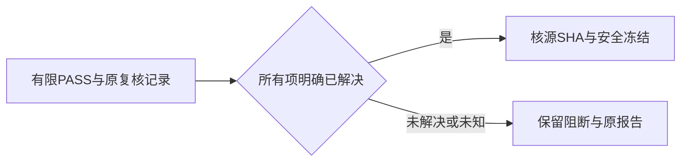

# T-1111 本地冻结辅助校验的已解决复核项

用户持续授权发现问题建task及时修复、本地main无备份构建。打包基本入口还未执行；冻结辅助预检实际退出1。已退出打包冻结流程处理本辅助问题，不在冻结期间修改产品。

## 事实与范围

私有验收工具t1101-package/freeze-source.py读取T1107的IMPLEMENTATION_REVIEW_FINAL.json，直接要求findings==[]。原报告明确PASS_LIMITED_T1107_IMPLEMENTATION_AND_PUBLISHING_REGRESSION，唯一IMP-001状态resolved：此前错误文件名未覆盖的测试已经用真实三文件27PASS补齐，原service44PASS保留，合计4文件71例。原报告不应为出包被删项或改成空数组。

只改该私有辅助脚本对T1107报告的读取：verdict必须是这份已实际认可的有限PASS，findings必须数组；每一项必须明确status=resolved且有id和非空resolution，空数组也允许；open、缺字段、未知状态均拒绝。原每个源SHA与当前实际字节比较、clean main、四版本、敏感文件/新增凭据检查保持。其余任务空findings检查保持，不改产品、仓库测试/构建脚本、workflow、版本、正式Gate或授权边界。

写集：本机私有t1101-package/freeze-source.py；仓库只有本SPEC、BACKLOG、独评和真实验证收据。先独立只读核当前报告、原补验与设计，再taskctl start。实际原冻结失败作为RED保留；调整后重跑同一冻结入口，真实PASS才继续四项打包基本测试与固定打包入口，不补造公证、安装或全局PASS。此为机械复核状态读取，不作产品语义判断；不新增与实现互相镜像的测试。

