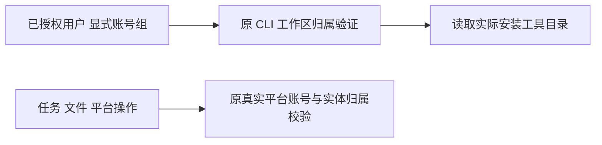

# T1112 纯账号组的工作台能力读取

用户持续明确要求账号组共享创作、全面验证 AI 工具，有缺口建 task 及时修复。新安装版源码 87964675 的正式 CLI 读取 18 项，17 PASS / 1 FAIL：中性空组的 `workbench.capabilities.list` 返回 HTTP 428，要求平台账号；没有提交新模型或采纳候选。原运行日志 SHA `ffeb483750a73289e64125108af6c08f1aa68e4aa2f1496d2db915a8def22465`，单项返回 SHA `488afd0fce3939a901927d7fd2239bd5cd6b16ab8b44a68dd4f39b6254140b1f`，本机私有 t1101-package/public-read-matrix.json 保留全部 18 项结果。

大白话：AI 查看本机有哪些工具，并不需要用户先绑定抖音等平台。纯账号组应能读取真实工具目录；具体任务、文件和平台操作继续按它们的真实归属校验。

## 已查明的两个入口

`contract/src/workspace-operation-scope.ts` 把工作台全部八项入口声明为 platform-account；实际 CLI gateway 据此要求账号。`backend/src/modules/execution/workbench-public.transport.ts` 又在分发前统一拒绝无 accountId。能力列表分支只调用现有 `deps.capabilities()` 并校验原 response，没有任务、文件、供应商参数或凭据读取。仅改声明仍会被第二入口拒绝。

## 限定实现与现有授权

仅把能力列表的操作声明改为 group，并让现有 transport 的这一个只读入口接受明确 groupId 或旧 accountId。空上下文、缺身份/工作区仍拒绝。CLI 原真实 user/group 归属验证、归档读规则与失败 envelope 保持；不造平台账号、不隐式切组。其余七项工作台入口保持原 platform-account 声明及账号要求；不借本修复开放任务回执、文件、渲染或 reconcile。不新增 operation、响应字段、存储、网络请求、模型执行或权限系统。目录仍返回安装包实际装配的能力，不硬编码可用性。

这是落实用户已确认的纯组共享创作和 AI 工具可用性修复；记录 DEC 的确认来源为本会话的账号组要求、全面 AI 工具验收与最新“有问题的创建 task 及时修复”。不把它当成用户已批准新的原始模型回执诊断合同；T1103 的 Pi 参数根因仍未知且保持未完成。

## 精确写集与验收

产品仅 `contract/src/workspace-operation-scope.ts` 与 `backend/src/modules/execution/workbench-public.transport.ts`。保留 `contract/tests/workspace-operation-scope.test.ts` 原三例，加能力列表/其余七项边界断言；新增 `backend/src/integration/group-workbench-capabilities.integration.test.ts`，隔离 PGlite、真实 CLI invocation service 与正式 workbench transport/原 response schema 组合，真实空组与归档组成功、旧账号成功、不同 user/错误组/非成员拒绝、缺工作区/缺认证拒绝、其余七项仍拒绝、回读原组/任务/稿件证明零业务写入。CLI invocation 表仅按原正式读取路径记录审计，不把原 gateway 已有的读取审计和过期结果清理错误称为零数据库写入；隔离库无过期结果时核审计只新增本次读取且不产生写任务。不能仅 helper 或 mock 成功代签公共链；这条回归不声称已安装包复验。

先独立只读 SPEC 复核、正式 record、taskctl start，再追加实际 RED 和实现 GREEN；不删旧失败或原断言。运行原 CLI gateway/dispatch、相关工作台回归、contract/backend 类型与 boundary/semantic/orphan；保存实际命令、退出码、时间与 SHA，独立实现复核。单次 test/hook 正预算至少 120 秒，外层无新增短帽子，原更长预算保留。完整 reconcile 保留原失败并登记新根因；pmem sync 后只用 taskctl 转状态。

本任务没有页面变化，无需换视觉风格。主会话串行写产品，独立 Agent 只读复核；不改启动/保存/生成/导出安全门，不访问用户库或真实 Cookie。main 提交后统一沿已授权固定入口无备份构建、安装，再用当前公开 CLI 描述和同一显式中性组读取目录/原数据，才可报告安装版已修复；不 push、tag 或发布。
