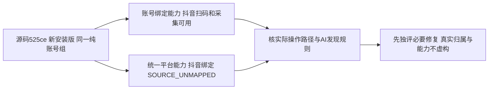

# T1113 安装版平台能力目录差异

用户要求“有问题的创建 task 及时修复”。本记录是新增当场诊断，不是实现 SPEC 或审核 PASS，不允许据此修改产品或宣判扫码失败。

大白话：同一个安装包，两份工具目录对抖音扫码给出了不同的信息。必须先弄清它们各自对应哪条真实操作，再确保 AI 找得到已经可用的入口。

## 当场可证明事实

同一源码525ce054852167d06bebb357ea6f639b6e12fafc，当前正式CLI/group=grp-58776bff-101。`accounts.bindingCapabilities` 返回抖音/快手/小红书 bind.available=true、method=qr、collect.available=true。`platforms.capabilities.list` 的抖音 bind 返回 supported=false、runtimeState=unavailable、reasonCode=SOURCE_UNMAPPED；快手和小红书 bind为supported=true/runtimeState=ready/authState=pending。原始读取已在本次18PASS矩阵中完成，不是为排查创建新模型/扫码任务。

账号绑定响应SHA256 7e551a184a6907511a8f2d47bcb04b1fd17489aaf16645a63076de0b5bb0f74e；平台能力响应SHA256 f0cf898a41904405bcd9f1b504af1500ffbac62c20e61fe4964b492a3e9ad35e。本机私有t1112-package/matrix-0-read.json和matrix-1-read.json保留响应。尚未执行抖音真实扫码，两份目录可能分别描述旧正式入口和新来源入口；不能仅凭差异签产品失败或硬改supported=true。

## 核对边界与后续准入

只读核对两目录的provider/legacy装配、正式operation/CLI说明、账号组UI与AI功能提示如何选择真实入口，区分服务本身不可用和发现规则缺口。若已有明确且可达的跨目录回退规则，保留事实并按真实证据处置；若存在缺口，先精确必要写集、SPEC/DEC和独立评审再改，追加覆盖真实装配/目录/公共操作与权限的回归。不得用模拟flag代表安装扫码，不新建真实绑定/采集、读取Cookie或密钥，不清历史，不借本任务修改T1103 parser。
