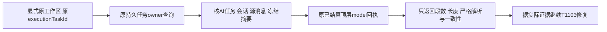

# T1114 已结算聊天模型调用的只读摘要

用户要求全面验证 AI 操作并及时建任务修复。T1103 的原 Pi task272 是纯账号组任务，三次提案缺图文，零候选、真实 partial。两次隔离实验已证明宽容解析能把非法原串修补成合法前缀，但没有原供应商 HTTP 字节，不能据此推定 task272 同因。现有 workbench.tasks.inspect 要平台账号并公开有界工具正文，不能拿它越过原边界。

大白话：只查看原任务已经保存的“参数分片”和“最终参数”是否一致，不重新生成，也不把完整文章或密钥显示出来。这个入口是诊断能力，不是联合生成已修好的证据。

## 范围和既有授权

新增独立 GET operation `workbench.modelCalls.summary`，path `/workbench/tasks/:taskId/model-calls/summary`；taskId 是原 executionTaskId，通过 ai.tasks.get 真实返回发现。分类 read、group，旧真实 account 上下文也经原工作区owner校验。仅此新增入口接受 group，原七个工作台入口和 T1112 目录门不变。没有页面、数据库结构、Worker、SDK、解析器或执行策略改动。不把目录加入模型可任意调用的工具，不绕过 CLI 审计。

DEC-READ-T1114 记录确认来源为用户已授权的“全面测试和优化 AI 助手…有gap及时支持”“有问题的创建task及时修复”和本地构建验收。这是已授权诊断所需的最小只读合同，不新增费用、生成、采用、发布或通用正文导出；仍先独立 SPEC/实现复核。T1103 研究卡禁止的盲改 parser/重发及第三实验保持；这里仅机械读取已结算证据，不是第三模型实验。

## 归属与闭包

先调用现有 persistentTask.get（userId+workspaceFilter，不取得租约）；再按同一个 owner 门读取原execution row。纯组 accountId=null 与旧账号都可读自己的任务；归档组保留历史读取；异user/group/account、无身份/工作区拒绝。execution.kind/ownerType 均为ai_task；payload.aiTaskId、ownerId、ai_tasks.id/executionTaskId双向相等，AI为copilot.assist且同user/workspace。严格chatWorkerInputSchema读取payload.modelInput，核其user/account/group与原execution一致；inputData.kind为chat.run，conversationId/sourceMessageId/modelInputDigest与冻结输入相等。复用只读 readChatTurnSnapshot 核会话所属、源消息是同会话用户消息、projectId一致、sourceMessage.modelMetadata.chatTaskId为该AI任务，并核冻结historyMessageIds/historyDigest。历史兼容沿原真实冻结：T1089/0130只补来源会话和稿件的group，不改execution/AI/modelInput的冻结范围。原NULL+account任务仍按相同NULL冻结读取，原legacy workspaceFilter允许它的同account NULL或实际canonical来源；canonical冻结任务则读取相同canonical。不得凭grp_legacy_字符串放宽任务映射。测试包括NULL冻结、canonical来源会话，以及完全canonical冻结，原payload/digest不变。任何错配拒绝，不能输出空诊断冒充不存在。只调用这些只读服务/查询，不使用lease/heartbeat/reserve/start/settle/恢复。

## DTO和分析边界

请求严格params taskId，严格query afterSequence>=0默认0、limit=1..20默认5。模型列表只取同execution、kind=model、parentCallId=NULL、status=settled；按sequence稳定分页，多取一行给hasMore/nextSequence。每个回执严格workerProviderReceiptSchema，缺失/无效时返回该调用unavailable，不影响其它调用或旧接口。

DTO严格只含taskId、aiTaskId、conversationId、sourceMessageId、calls、nextSequence、hasMore。call含callId、sequence、finishReason(unified)、receiptState(valid/invalid)、toolCount(nullable)、toolsTruncated(nullable)及tools。receipt无法严格解析时，finishReason=null、receiptState=invalid、toolCount=null、toolsTruncated=null、tools=[]；绝不宽松遍历未知providerResult的content/stream来填统计值。有效receipt中这些统计才是实际数字/布尔，finishReason是实际unified。最多分析并返回每模型100个content tool-call；toolsTruncated为真时不得称整模型工具都已分析。tool摘要含index、toolCallId(nullable)、streamPartCount、streamUtf8Bytes(nullable)、finalUtf8Bytes(nullable)、streamStrictObject(nullable)、finalStrictObject(nullable)、observedConsistency(equal/different/unavailable)、reason枚举严格为matched、different、no_stream、invalid_content、invalid_identity、missing_segments、duplicate_segments、unordered_segments、invalid_segments、stream_not_object、final_not_object。不返回toolName、输入字段名、参数值、digest、正文、headers、token、warnings、providerMetadata、原stream或其它未知JSON。不得从未知对象透传字段。

同一model中某tool仅在content唯一非空toolCallId、final input为string、同id有唯一start和end且start<delta*<end、start toolName与最终content身份相同、至少一个delta、每段id/delta类型有效、无重复/越序/额外同id最终tool-call冲突时，拼接已保存delta。只严格JSON.parse为非数组object才返回streamStrictObject=true；最终同样严格解析。两对象用深度JSON值等价性比较，不用字符串相似度，不补字段、不修JSON、不选择内容。合法非对象与非法串区分strictObject=false，不称已完成；只有两者都严格对象才给equal/different。无stream/缺段/重复/晚到身份导致不可覆盖/无delta/不合法身份等返回unavailable和真实closed reason。reason只说明保存证据，不推断供应商。

这不是raw wire证明：DTO不设“供应商完整”字段；任何equal都仅指已保存分片与已保存最终参数相等。SDK晚身份可能已丢上游片段、Responses可能最终替换、Anthropic初始object可能没有delta，不能从现有回执恢复不可见字节。诊断不证明参数满足创作schema，更不证明候选或作品完成。

## 公开错误与例子

无ctx沿原AuthenticationError；缺/异owner沿原OwnershipError；存在但源消息/摘要/双向绑定冲突沿原ConflictError；请求超界沿原严格合同输入错误，均不回传底层JSON或原输入。合法读取示例：params={taskId:"原公开executionTaskId"},query={afterSequence:0,limit:5}，不带body。重复读取不产生任何业务变化，只记录原公开CLI读取审计；不需要幂等执行键。无模型call的已验证聊天任务返回calls=[]、nextSequence=原afterSequence、hasMore=false，不把空结果解释成无任务。

## 精确写集与验证

产品六路径：contract/src/operations/workbench.ts、contract/src/cli-policy.ts、contract/src/workspace-operation-scope.ts、新backend/src/modules/execution/model-call-summary.ts、workbench-public.service.ts、workbench-public.transport.ts。现有persistence-client已装配同service/transport，只有真实类型证据证明需要时才重新评审纳入，不凭候选改装配。测试：原contract/tests/workbench-public.test.ts及workspace-operation-scope.test.ts追加严格DTO/分页/read分类/scope；新model-call-summary.test.ts；新backend/src/integration/owned-model-call-summary.integration.test.ts。

先独立SPEC、正式record、taskctl start，再追加实际RED/GREEN。helper覆盖完整中文分片、合法缺业务字段（不替模型判断）、截断非法前缀、合法对象值差异、没有stream/delta、重复/越序/start-end身份冲突、多个tool交错/不同model不混合、不合法content、超过100分页摘要及secret canary不外泄。公共PGlite组合真实chat submission→持久任务→CLI gateway→transport→service→严格response，覆盖空组/归档历史/旧账号成功，异user/group/account拒绝，源消息/AI双向/digest错配拒绝，多模型分页与parent/nonsettled不计入，原七项仍拒绝纯组。快照execution task/calls、AI task、conversation/message/results前后逐字相等，允许原CLI读取审计及加密缓存，不产生业务写、网络或新模型。

运行原工作台/CLI、contract/backend类型、dispatch及boundary/semantic/orphan；test/hook至少120秒，dispatch原180秒保留，外层不加短帽。保存真实命令/时间/退出码/SHA，独立实现复核。main提交后固定入口无备份出包安装，用当前公开CLI描述与原task272 executionTaskId读取摘要，再对照12原任务/4对象/3会话。不从helper测试或日志推定安装通过；本任务只完成只读诊断入口，不完成T1103/T1099/T1095，也不重发任务。收尾pmem/reconcile/taskctl，范围外既有41项失败明确保留。
