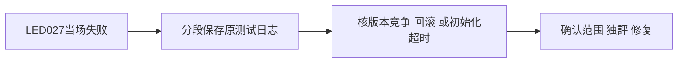

# T1116 稿件并发保存回归再次失败的实际诊断

本任务承接用户“有问题建task及时修复”及T1114实际完整对账；43项失败较T1112多LED052与LED027，本任务核LED027。当前没有内层失败日志，不能猜成CAS被破坏，也不能按测试重跑通过宣称修复。

原入口为backend的artifacts.repository.integration.test.ts与artifacts.service.test.ts成功后，frontend的chat-script-patch-card.test.tsx；完整对账仅报告检查返回非零，没有保存是前一段还是后一段失败。T1114没有改这些产品文件和测试，关联原因仍须实际核对。全局1650.020671秒、退出1，日志SHA `1e61e1761593475e5fbf3f867a4390ce15a59c8a344751731196fce48c6a5a71`。

先逐段执行相同原命令并保存输出，不触碰用户稿件或数据库、不删除竞争、回滚、previousVersionId或撤销断言。若需修复产品或验证入口，必须建立精确SPEC与独立复核；没有当场发生的RED/GREEN不得补拍。T1114的只读诊断与这项写入/CAS机制分开验收，原失败保留。

原两段命令逐段实际完成，未改参数或断言：backend90.878815秒、退出0，两文件44PASS/0SKIP，日志SHA256 `9796cb6f6bb00228680b9a4edc831cf90c3d2accb1eeeed18f23bcc2fe2e0655`；frontend1.823580秒、退出0，一文件5PASS/0SKIP，日志SHA256 `96827a9b4bf259442306e005bf654ff9b6d6211f4b3eadefab1a4a7a635a33ad`。两段均未重现内层错误，不能因此称产品修复或反推全局原因。createDb按真实options使用PGlite，未根据两种PG环境变量改数据库；不能把配置差异编作根因。原完整对账LED027失败保留，任务继续待核。

## 后续真实原门对照（不补造历史根因）

T1115只修Vitest真实初始化/执行预算，产品、CAS测试正文和原命令未变。之后独立backend44PASS、frontend5PASS，0SKIP；完整reconcile的原串行LED027命令也真实退出0，backend44PASS、frontend5PASS、0SKIP，执行时间2026-10-09T09:02:36.746Z至09:04:27.559Z。私有一次捕获保留原命令、cwd、env、预算、返回/异常；内层日志SHA256 c5d250d619e0f6afa25f9e05d91a054afd083ac32eabc93d8518b0300e1868c0。当前完整对账仍退出1/41errors，LED027恢复且无新增；其余41逐行保留。

这证明当前原门实际通过，没有证明前一轮未保存输出的失败原因。尤其配置修改前的原两段也44+5PASS，不能把历史LED027失败都归因于默认hook10秒。原失败和UNKNOWN保留，尚不声称产品修复或自动完成本任务。实际时间、退出码和每个日志SHA见docs/verification/t1116/current-evidence.json。
