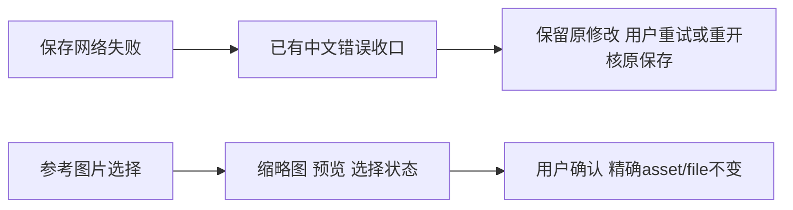

# T1117 修复画布保存英文反馈与参考选择器名称展示遗漏

用户要求发现问题及时建task修复，并已要求素材选择以预览呈现。当前main6a71a607两条真实Chrome旅程2PASS，保存/连线/精确文件恢复通过，但主会话实际看图发现两处可用性缺口：中断保存截图直接显示Failed to fetch；已选参考卡仍显示长技术文件名。源码确认CanvasEditor.errorText末尾直接返回Error.message，InfiniteCanvasNode及详情参考AssetPicker未传showIdentity=false；共享AssetPicker即使false仍在已选字段和底部已选摘要显示名称。素材库主gallery已使用false，本任务不猜其它截图缩略图文字来自源码还是媒体内容。

阶段为4-BUILD维护修复，使用既有product-to-code-orchestrator及oil-ui-pro0.10.0；这是用户既定紫色/tokens/Dialog/Button/AssetPicker方向的局部一致性修正，没有新视觉方向、业务契约、归属、模型或保存机制。独立SPEC复核通过后根会话串行实施。



## 行为与边界

FR01：保留errorText已明确的HTTP400/404/409与其它HttpTransport文案；其它异常复用frontend/src/lib/ai-error-humanize.ts的describeUserError及中文兜底，不直接吐英文异常、技术码或堆栈。只改显示，不吞异常、伪报已保存、自动retry、改变saveState/expectedRevision、页面数据或导航。共享humanize原实现及其规则不在本任务改动。

FR02：画布节点及详情中的参考图片选择器显式showIdentity=false。共享AssetPicker的该既有flag必须覆盖列表、预览、已选字段和弹窗底部：false时已选字段显示“已选素材”及实际缩略图，底部显示“已选，可预览后使用”；不显示文件名/规格。true默认仍保留原完整身份展示，其它文章/图文/剪辑入口保持默认。保留label、ARIA完整预览名、图片alt、搜索/筛选、取消、清除、不可选原因、确认busy和精确choiceKey/asset/file版本，不新增选择语义或自动采纳。已选图片看图识别，鼠标/键盘仍可打开大预览再选用。

FR03：先真实组件RED，后GREEN；原CanvasEditor23例、参考选择2例和共享AssetPicker原例全部保留。当前公共旅程的正式上传/组/canvas.save/get走隔离库；网络中断与模型/能力回执明确为替身。追加保存中断中文反馈及已选卡/弹窗不显示长文件名的断言，同时保留原精确fileId保存、重开、手选/默认、旧标记显式恢复、防重复与扫码入口全部断言。截图取1366×900和900×900，键盘Enter确认、取消不写/不采纳；不拿截图当落库成功。

## 精确写集

产品：frontend/src/features/creative-canvas/canvas-editor.tsx、frontend/src/features/creative-canvas/infinite-canvas-node.tsx、frontend/src/components/media/asset-picker.tsx。
测试：同CanvasEditor.test.tsx、infinite-canvas-node-reference.test.tsx、components/media/asset-picker.test.tsx、frontend/tests/e2e/creative-canvas.spec.ts。
文档/实际工件：本SPEC及初审、docs/verification/t1117/**，原runner实际生成的docs/verification/t1101/{journey.log,canvas-copy.json,binding-copy.json,visible-copy.json,screenshots/**}及docs/verification/t1108/visible-copy.json（保留旧工件于外部原验收目录）；BACKLOG/PROJECT/DECISION_LOG、modules、task/review审计和实际lessons-stats。
不改后端、contract、共享错误收口实现、SDK、模型、任务原payload/期限、真Cookie/账号/用户库、媒体原文件、构建脚本、扫描器和allowlist。先完成T1108当前冻结源码验收记录，避免新变更混写成其原证据。

## 验收与完成

- AC01：实际RED须看到英文或技术文件名仍显示，不能把既有保存恢复成功写成产品RED。组件修复后保存错误人话且saveState仍失败；保留成功保存、冲突、跨scope迟到回执和精确参考选择等原断言。flag=true默认老展示不变；flag=false字段/列表/预览/底部无可见名称，仍能真实确认精确文件且取消不采用。
- AC02：原两条真实Chrome流程仍2PASS/0retry；新增反馈/参考预览流程真实操作、normal/narrow截图与ARIA键盘证据，正式get精确file和第二次重开保持。模拟供应商/网络边界写明，不冒称真扫码/生图或原生客户端人工眼验。
- AC03：frontend typecheck、LED047原174例、boundary/semantic/orphan、git diff --check、pmem及完整reconcile真实记录；范围外原41错误及timeout静态27仍关联T1101-global-gates/T1081等，不删门或写全绿。只因本UI变更不触碰预算；若涉及新的超时消费者才执行规范完整回归。
- AC04：独立最终实现/视觉复核绑定本SPEC、确切源SHA、新截图、公共调用和原保留失败；taskctl只完成本任务可验范围。已授权main统一本地构建安装无备份适用，实际新包/启动/原任务回读必须另留父打包证据；本任务不代签AI联合生成或T1103未知wire。

```frontend-journey-contract
{"schema":"frontend-journey-contract/v2","task_id":"T-1117","copy_guard":{"forbid_internal_ids":true},"watched_paths":["frontend/src/features/creative-canvas/canvas-editor.tsx","frontend/src/features/creative-canvas/infinite-canvas-node.tsx","frontend/src/components/media/asset-picker.tsx","frontend/src/features/creative-canvas/canvas-editor.test.tsx","frontend/src/features/creative-canvas/infinite-canvas-node-reference.test.tsx","frontend/src/components/media/asset-picker.test.tsx","frontend/tests/e2e/creative-canvas.spec.ts"],"required_checks":[{"id":"AC-ERROR","test_id":"TEST-T1117-CANVAS"},{"id":"AC-PREVIEW","test_id":"TEST-T1117-CANVAS"}],"required_conditions":["refresh","repeat","back"],"viewports":[{"width":1366,"height":900},{"width":900,"height":900}],"coherence_groups":[]}
```
