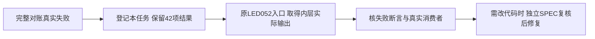

# T1121 核对本轮完整对账归档执行门再次失败

用户要求发现问题立即建task并及时修复。本轮T1117完整reconcile真实2026-10-09T10:16:32.044346至10:48:52.561062 UTC，1940.496898秒，exit1，42 ERROR/0 warning，日志SHA256 5a7dc597bbef244902c857fc708f2a8e4fbfe10583fb9d46624d709b7079ea5a。原T1115完整对账41项失败仍保留，本次额外出现LED-052；LED-027本轮没有错误。不能把原T1115归档59例PASS当成本轮已通过，也不能把这次对账只有门摘要的结果写成捕获了内层失败断言。

当前相对main05267的产品改动仅T1117三个前端文件，归档生产代码未改变；T1115两份测试预算修正已提交。隔离PG已因T1118原验收目录消失重新创建为本机55423；这些都是观察事实，不能直接猜测试失败源头或归因于负载/PG。确切内层失败与根因目前UNKNOWN。

先读取LED-052原命令node docs/verification/t1022/run-archive-guard.mjs及其真实消费者，保留原归档权限、四类collector、幂等/归属/隔离PG、初始化/执行预算及退出码，取得原入口当前逐段实际输出。若原runner未保留内层输出，只可用只读诊断包装记录实际命令结果，不能修改生产/Gate或补造上次未采集的日志。当前任务只是诊断准入；任何产品/测试/runner修复先补精确SPEC及独立评审，不删断言、skip、换假fixture或把单次当前PASS称原42错误已消失。原原始完整日志与收据保存在.codex/creatoros-verification/t1117-20261009/full-reconcile.*，T1118缺失的旧日志不重建。

完成需确认具体失败源头与必要修复范围、当前原公开入口及独立复核证据；只核该归档范围，不代签AI联合生成、当前UI或全功能稳定性。

## 当前根因与限定恢复

实际原入口10:55:55.583056至10:55:55.675121 UTC、exit1/0.091903秒，错误为“归档执行门只允许本任务55422隔离服务器”，日志SHA686d8fa6e01d5a79414775603fd3773af7e3f9647cabc0bd6c50759584f22731。已读原runner两个env均强制127.0.0.1:55422；本轮完整对账传55423，故在Vitest启动前拒绝，不是取得了归档产品断言失败。根会话重建隔离库时选错此入口规范端口，现已明确。实际lsof未找到55422 listener；pg_ctl确认当前55423 PID30403且data目录为本轮私有isolated-pg/data。

只温和停止这一个归属可证的自建PG，沿同一私有data目录、127.0.0.1、测试用户与DB重新启动在55422；不停止任何用户服务或改原runner/端口门/测试/生产。恢复后原LED052入口真实59例须执行且原断言/退出码保留；PG换端口不是重新创建用户库。其它41失败仍以新完整对账真实结果判断，不以本入口单次PASS抹除原42失败。没有任何产品、配置或测试代码修复。

## 规范环境完整对账真实终态

2026-10-09T11:19:21.575028至11:44:20.015045 UTC，原完整reconcile实际1498.420231秒、exit1、41 ERROR/0 warning，日志SHA256 `bf20c0f903ee7449fb654033fa8b134ff44198027843196f783923b21a9f01bd`。逐行对照T1115已提交retainedErrors的41项，added=0、removed=0、全部相同；LED052与LED027均明确PASS。证据见docs/verification/t1121/full-reconcile-canonical.json和同私有目录的实际完整日志。原42错误仍保留，本任务只解决隔离端口误配造成的新增LED052失败，不代表原41问题已修；归档产品与断言/runner未改。
