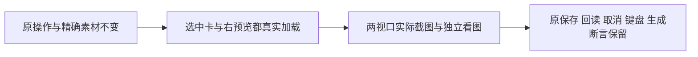

# T1122 补齐参考素材选择窄屏缩略图加载后的视觉验收

用户要求有问题建task及时修复。T1117/T1120原公共两条浏览器真实2026-10-09T10:57:10.025517至10:58:45.087889 UTC、exit0/95.061422秒、2PASS/0retry；日志SHA404cd16a076ee0f9b139351e21a74f161103e792f8a1b07a5f715e4d829de05d。保存、中文错误、回读、取消零写、精确文件、键盘、旧标记恢复及平台断言实际通过，记录保留。

根会话实际看了1366与900预览图：normal左缩略图/右预览均可见；900截图左选中卡片为空，右侧实际预览可见。新采证只等待右侧largePreview complete/naturalWidth，未等待左侧选择卡Thumbnail；不能把两条测试PASS称全部视觉已通过，也不能只凭该截图断定左缩略图永久加载失败。确切原因暂UNKNOWN；本次成功工件已独立复制到私有browser-dom-ready-passed，不覆盖它们。

阶段4-build测试采证维护，继承T1117已经确认的紫色/预览选择方向及原父契约，没有产品、接口、归属、布局、资源加载策略或模型变更。精确增量仅frontend/tests/e2e/creative-canvas.spec.ts的T1101第一例：在normal/narrow各原preview截图前，对本次实际选择的previewButton里的img等待可见，并用原observe.poll/120000ms确认complete&&naturalWidth>0。不是固定sleep、关闭lazy、改DOM或选择假图；仍真实正式上传原精确素材。若该图片实际未加载，新增断言必须保留真实失败，随后再诊断并另审必要产品修复；不得继续输出空白卡片截图并签视觉PASS。

写集：唯一上述e2e两处新增断言，本SPEC/独审/实际证据docs/verification/t1122/**、原T1117/1108/1101实际copy/截图/日志、BACKLOG/PROJECT/DECISION_LOG/modules/审计。保留全部原业务断言、真实API、替身声明、7200000/120000及更长观察预算和0retry；不改生产或图片源、不把加载等待做成用户生成/导出质量门。

验收：独立SPEC准入；当前源码typecheck；原两条公共流程2PASS/0retry且两处新增img断言真实执行；两视口左缩略图及右预览均有真实图像、可见长文件名/尺寸仍隐藏、ARIA名称保持；独立最终实现/视觉复核及T1117原正式前端报告。pmem与完整reconcile保留原41及本轮T1121端口误配42结果，必须按实际新完整结果陈述，不由本范围代签全功能或AI联合生成。本任务是测试维护，验收列—；产品验收仍在T1117/T1108，不造另一个产品契约。
