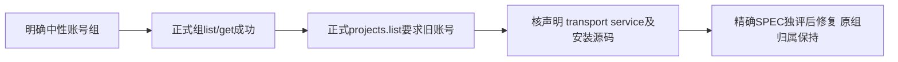

# T1123 核对纯账号组项目列表仍要求旧平台账号

用户要求发现问题及时创建task并修复。本轮准备新包安装对照时，经当前安装版公开CLI发现并describe `accountGroups.list/get`、`projects.list`，effect均为read。原已明确选择的中性验收组 `grp-58776bff-101` 在正式list中唯一精确回读，get成功；随后 `projects.list` 显式 `_creatoros.groupId`、query page1/pageSize100，无默认account、无写入，实际exit4/HTTP_428：`AccountRequiredError: legacy workspace requires a selected account (ctx.accountId missing)`。

大白话：账号组本身能读取，但找这个组内项目时，又被旧单平台账号条件拦住。尚未核对当前源码与安装包之间的消费者差异，不能只凭一个HTTP428就确定产品修复位置，也不自动挂一个真实账号来绕过权限。

实际安装源54af33d0，原调用2026-10-09T11:29:04.114796至11:29:04.915864 UTC，0.800745秒，exit4。原输出SHA256 `5348b62e1f35c2a90264dfdfcaa1ffaf0c0a678cf1bc7712d5f2cd527a260c97`，私有当场文件 `/Users/zyongzhu/.codex/creatoros-verification/t1117-20261009/pre-projects-list.{log,json}`；schema describe及输入同目录保留。只读诊断不重发模型、创建项目、改默认scope或连接用户库。

先核当前公开operation归属声明、transport二次门、projects service读取及账号组迁移/冻结上下文；原CLI精确组project get对照，不猜ctx或用账户补齐掩盖失败。若当前代码已修复，必须取得确切提交与新安装版原操作实际回读才可完成；若需改代码，补齐精确写集、组/账户两族兼容与跨组拒绝公共回归，独立SPEC评审后实施。不会删原账号权限、迁移门、fixture或历史失败，不以单个get成功代签list。新的产品改动待当前冻结UI验收结束后进入，打包过程中不修改源码。

当前仅诊断登记，根因UNKNOWN；未写成已修复或全功能PASS。

## 当场已确认调用原因

上述是原失败时的登记，不覆盖历史。随后核对当前安装版真实 `creatoros help`，usage明确包含 `call ... --group <id>`；公开CLI的 `selectedGroupId(args)`只从该显式flag或用户明确选择的默认模式读取身份，业务输入内的 `_creatoros.groupId`不会代替请求Header。原命令漏了flag，故service正确走无组/无账号的旧路径并拒绝，不能据此声称账号组项目列表的产品权限坏了。

先再次describe相同read操作，再原业务query传显式 `--group grp-58776bff-101`，不加平台账号、不使用默认组、不改变用户选择，真实2026-10-09T11:31:36.476424至11:31:36.867607 UTC、0.390937秒、exit0。正式返回groupId精确匹配、accountId为null、2个项目，其中原已选 `project-58776bff-104`精确存在。日志SHA256 `3477291ff5ab7ca7e4e22f782466ec2d73e8d48b583db20ed3900196c6c10e11`。原失败与corrected输入/describe/实际响应均在同一私有目录分开保留，未重试写操作或发模型。

本任务根因收敛为根会话验证命令漏传正式身份参数，当前产品无需改动；后续安装对照统一使用已发现的显式组flag。此结论只解决这次read诊断，不代签其它项目操作、页面、AI或全局门。
