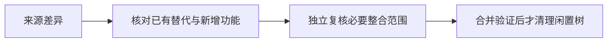

# T1124 当前来源 worktree 源码整合缺口

用户要求有问题及时建 task、代码整合到主分支并清理不用的 worktree。2026-10-09 本轮删除前只读审计在 main 7de72c56 发现两个 clean 来源分支仍有 main 不存在的路径，不能把此前 T1080 历史闭包用于代签这些后续新提交。

codex/t1101-canvas-binding，HEAD b1f0cc5462285e59531a329a42340abe84c8d0ac：17条新增源码/测试路径缺失，包括微信原生采集、0131迁移、原生报表契约/面板和本地平台绑定；41条来源修改路径与main不同。codex/t1106-chart-cover-labels，HEAD 454e9241a2adb107f3beb224914bc3273c063bee：封面比例标签 helper 缺失，其它17条不同。不同字节可能是主分支后续修复，不能直接全部覆写。实际逐路径结果见本目录 current-source-gap.json；私有原始清单保留本轮验收目录。

只读诊断先核来源 SPEC/独立评审、各来源三方 diff 和 main 后续修复，再由独立复核明确必要整合写集。有新增服务契约、迁移、归属范围必须先经当前整合 SPEC 独评，保留来源实际成功与失败；不得 -s ours 丢弃未经核对的源码，不回退主分支最新保存、归属与预算修复。真实产品缺口按精确子任务继续修复，真实公共链和原断言复测。代码与历史已保留、目录未占用且工作树干净后才普通 worktree remove，不删除来源分支。活跃 t188 和主目录保留。

本任务尚未整合、不签全部代码已入main。当前已复核修复包先供用户验收，冻结出包期间不修改代码；本任务新增功能不算入当前候选。无推送/tag/Release，无App或用户库备份，无凭据或原媒体清理。

## 最终来源闭包与实际清理（2026-10-09 UTC）

当前main 3d444493经过独立A来源闭包复核：80路径分别证明冻结移植、主线已审替代或当前有据差异，unintegratedProductPaths及unknownProductDifferences为空。新增微信、封面用途、排期布局各由T1159/T1149/T1136精确SPEC和当前审核实施。该证据证明源码整合，不能把来源旧业务PASS迁到当前树，也不代表来源HEAD成为main祖先或所有功能已通过。

两个闲置来源目录已普通worktree remove实际exit0，不使用force、不删来源分支；canvas末尾生成的对账统计先保于来源23c3bedc提交，来源293d历史对象仍可达。152份原忽略验收文件逐字节/SHA保留在私有验收目录。完整open-file占用为空，活跃主目录、main集成树和t188保持。实际收据见docs/verification/t1124/current-source-cleanup。不备份用户App/库、不清原媒体。

源码缺口和闲置目录闭合不代签T1159真人微信/安装启动；独立B确认真实profile启动暂未准入，离线构建和隔离验证仍可进行。全局canonical原40项失败保留，具体缺陷仍按原任务负责。
