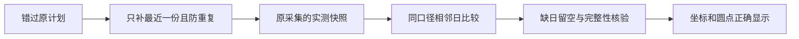

# T1127 当前主分支整合真实采样、错过计划恢复与图表孤立点

用户已要求全功能稳定性验证、有问题及时建task修复、所有代码整合到主分支后构建。本任务承接T1124独立来源审计，只整合来源T1106的分析/采样/cron/共享图表功能；封面比例、T1107排期布局及T1110微信原生报表各自登记，不借同一branch HEAD顺带覆盖。

## 现状与边界

当前main 6c35033e的12条本任务路径与共同基点d35f7d57逐字相同，来源454e9241的已复核增量确实缺失。逐路径main/source SHA见docs/verification/t1127/current-source-path-comparison.json。来源SPEC和真实原失败/成功及评审保持在来源Git，不复制其完成状态或事件为当前证据。当前安装d712包不包含本次新增修复。

沿原backend analytics/sync service/automation driver与frontend共享ChartFrame整合，无新领域实体、迁移、平台操作、数据归属、定时器或语义判断。用户希望的实际结果是同一口径实测能保留、未采集日期不会消失、错过计划只补最近一份，以及图表点不会被窗口拉成长椭圆；不补写真实历史、不自动重发失败任务。

## 必要整合语义

1. publication/day/source/nativePlatform优先或legacy平台/definition/window/有效metricKey组成可比系列，以结构JSON身份保留同系列最后有效样本；views优先含真实0，非法或无穷值不遮蔽早先有效plays。同一最新时刻不同系列delta冲突则unknown，相同delta只计一次，不跨来源或key比较，不把两份指标相加。
2. 查询仍取最近days+1个采样日作为窗口，在首个输出采样日至末日补日历空日期，仅填null、不猜数、不跨空档作差。覆盖不足、新增作品无昨日基线、负向修正均保留原unknown/correction；公众号阅读不混入播放。
3. 仅self.metrics简单每日与M */N * * *计划错过精确分钟时补最近真实slot，小时步长按cron每日0点重算，>=24步长也只每日0点。精确分钟与补跑共同检查本周期已有真实run尝试；持久owner、lease、attempt与幂等键、原在途结算保持。不扩复杂cron/停用/needsAuth，不批量回放历史，不新增timer。
4. 仅metrics的24小时档采用北京时间自然日已成功资格；retryAt优先，2/6小时与其他能力/旧未传capability保留经过时间规则。原externalId、真实归属与失败退避不变。
5. ChartFrame孤立点沿当前坐标/单位/tokens，使用不缩放圆端点；null不连线、真实0保留、坐标和可访问摘要不删。只局部精修，无风格或页面布局改版。

SEMANTIC_BOUNDARY_ALLOW：以上系列比较、时区/cron与有限数值校验仅实现实测口径/用户既定计划和机械安全，不理解内容或作创作取舍。

## 写集

- `backend/src/application/collection/self.test.ts`
- `backend/src/modules/ai-runtime/automation-driver.test.ts`
- `backend/src/modules/ai-runtime/automation-driver.ts`
- `backend/src/modules/analytics/analytics.repository.integration.test.ts`
- `backend/src/modules/analytics/analytics.repository.ts`
- `backend/src/modules/analytics/sync-policy.test.ts`
- `backend/src/modules/analytics/sync-policy.ts`
- `backend/src/modules/analytics/sync-state.service.test.ts`
- `backend/src/modules/analytics/sync-state.service.ts`
- `backend/src/modules/ingestion/ingestion.import.integration.test.ts`
- `frontend/src/components/analytics/chart-coordinates.test.tsx`
- `frontend/src/components/analytics/chart-frame.tsx`

另允许本任务SPEC/review-input/review、docs/verification/t1127/**、BACKLOG、PROJECT、modules.config、DECISION_LOG、events与review-events的当前真实记录；不修改来源worktree或源码以外的vendor/构建/版本/激活/凭据。不得直接merge/cherry-pick整个来源HEAD，移植前逐路径确认基点与main字节，任何差异先重新审。

## 验收与阶段

当前4-build maintenance；本任务有调度/查询行为变化，必须本SPEC独立初审PASS后才能移植。保留现有oil-ui-pro0.10.0、账号组UI_RULES和ChartFrame/tokens基线；取当前旧/新同数据1366和900宽度实际画面，主Agent实际看图，验证点像素、坐标、null断开与原摘要。不签来源图或未看截图。

- 先只移植7条测试路径，原产品5条字节保持，当前真实RED必须命中采样/cron/自然日/孤点缺口；早期夹具或初始化失败保留并分类，不能作为目标RED。不删原断言、放宽schema、启用retry或压短预算。
- 再移植5条产品增量，当前6个后端文件全部回归、正式self collector+持久sync/analytics、正式ingestion public service+DB和原调度公开装配组合；外部平台读取替身必须标明，不签真人采集或安装断档首因。
- 聚焦frontend chart、frontend/backend类型；LED-047、boundary、semantic、orphan与timeout-policy原入口。所有新执行/观察test/hook至少120秒，保更长既有预算。Next typegen与开发浏览器串行，不共享写生成目录。
- 必须当前独立实施复核绑定最终SHA，当前公共浏览器或组件回放及实际视觉证据；控制面状态只taskctl。pmem sync后运行完整reconcile，保原41逐字对照。范围内新增失败修复后才完成；既有范围外债务明确关联，不冒称全绿。
- 本任务源码验证完成与新包验收分开；父T1124负责其它三组源码整合及清理，T1062负责下一包。无模型请求/真实历史写入/推送/tag/Release，无App或库备份。

DEC-T1127-01：依据用户整合与问题及时修复授权、独立T1124来源审计，仅将来源T1106的已核分析增量移植到当前main；不继承来源验收。用户已授权本地构建安装，源码稳定并提交后由T1062重新冻结，不让未审代码进入当前已交付包。

