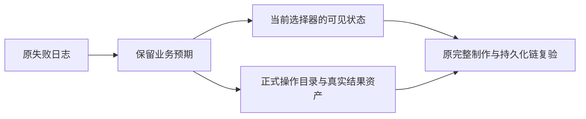

# T1133 修正制作回归测试的三处协议漂移

用户要求全功能验证，并于2026-10-09要求“有问题的创建 task 及时修复”。本任务保留原业务预期，校准测试与当前素材选择、操作目录及结果资产归属。产品、服务契约、数据归属与页面交互不变。

## 当场事实

main基点`45a52992087c5e6aaa09cb1929fa8ec16d6b4c64`。原顺序LED032前端两文件45例44PASS/1FAIL，LED040前端两文件36例33PASS/3FAIL；旧配置均实际retry x2，不能冒称0retry RED。

- 恢复在跑渲染例仍查询`[data-testid="broll-0"] select`，读取null.options失败。当前真实`VideoDecisionPreview`已使用`AssetPicker`按钮与已选卡；原素材名、不可用状态、原assetId、移除及确认保存断言保留。
- 当前backend目录32项，原持久化测试写死18。
- 导出完成传不存在的`asset-export-e2e`；当前正式组合先经`assetsService.getAsset`核归属，正确拒绝。不能取消该守卫。

原LED032实际13:56:54.437423至13:57:16.331715 UTC，exit1/21.894184416974895秒，logSHA `152b446468d40a86569f3c559bfb116b4b91ab78e7e206668e54904a7e0cbf02`；LED040实际13:58:09.453033至14:00:09.588869 UTC，exit1/120.13488670799416秒，logSHA `c025a403495526c4d2cf2871a91227456888c398ed552b6cb3706a366b61ebea`。原始日志留私有验收根，完整实际argv及收据在任务证据中保留。

## 精确写集与约束

1. `frontend/src/features/production/production-workbench.test.tsx`：仅校准“刷新恢复在跑渲染后，执行卡和已确认分镜共用同一运行状态”中的退役select观察。按实际按钮可访问名、已选卡及原确认调用证明恢复名称、素材已不可用、原`asset-saved`仍被保留、移除后B-roll/原inventory清空，以及同一在跑任务和原确认落参。不得添加旧select、mock掉真实子组件、造隐藏测试属性、静默换素材或把不可用素材当可用。全部其它原断言与用例保留。
2. `frontend/src/server/__module_integration__/production.persistence-client.test.ts`：保持全部注册操作缺ctx拒绝、完整get→put→segment→export→complete、素材包两次导出不增加素材。目录以独立contract `productionOperations`的全部ID与backend `PRODUCTION_OP_IDS`双向精确集合对照并查重，不只机械改18为32。通过原`assets.uploads.create`→`assets.uploads.complete`在隔离PGlite/mock对象存储创建同owner中性视频资产，用真实返回ID完成导出；保留ready/resultAssetId，并通过`outputs.get`回读primaryAssetId。增加不存在/异owner资产拒绝、拒绝后合法完成仍可继续、同一完成重放不重复改绑的证明。账户维和原归属门不改，不读用户数据或原媒体。

发生目录与contract真实不一致、合法结果被拒绝或保存ID变化等产品缺陷，保留失败，补精确SPEC独评后修产品，不能把预期改成失败来闭合。

## 只读源码绑定

| 路径 | SHA256 |
| --- | --- |
| `frontend/src/features/production/production-workbench.test.tsx` | `dc813c7c9469ac3d4b18a568b64353d4adcacef58cc9127a2a18ccfcb117de75` |
| `frontend/src/server/__module_integration__/production.persistence-client.test.ts` | `f736b788c017ac3e0860ffcfe1aea7a83f9ae34f2e2d007b0ed0e528a9f18353` |
| `frontend/src/features/production/video-decision-preview.tsx` | `2b8d90b56aeb0639128207ad0beec273f4ce372f8d72744edd3357ebeb964f4b` |
| `frontend/src/components/media/asset-picker.tsx` | `ab1b7323dc1947c6352b0ead2a0e2747b9d371406c30a641b4fbceaf831c04f3` |
| `backend/src/modules/production/production.service.ts` | `8d4606840c0640a340663cc81f41cdf8274652abdebbadecfc96657580589b26` |
| `backend/src/modules/production/production.transport.ts` | `076f07b1bd349fddec4ff3b4657f3fc08cdcbc6ad8e08c4fd9ba591ee88471d2` |

## 验证与完成

先独评准入；当前原顺序日志采集期间保持覆盖源码及reconcile配置冻结，结束后才实施。4-build维护任务，流程版本3.29.0一致。仅测试校准不改UI，验收“—”表示无新增整页旅程，不代签组件视觉、真实模型或安装版。

- 旧测试不变时，以原两个文件显式`--retry=0 --no-file-parallelism --testTimeout=120000 --hookTimeout=120000`取得当前完整RED。
- 修改后运行同命令，全部原33+3例及新增归属/幂等例真实通过；相邻`video-decision-preview.test.tsx`与`asset-picker.test.tsx`保完整验证。实际例数、argv、时间、退出码、logSHA记录，不预造PASS。
- frontend typecheck串行于开发浏览器；diff-check、boundary、semantic、orphan及完整reconcile保持原规则、退出码和新增/保留对比。
- 独立实施复核绑定实际diff/最终SHA及原断言映射；pmem sync、reconcile和taskctl真实完成事件。未闭合保持进行中，全局旧失败不得写成全绿。

控制写集：本SPEC、同名review输入/快照、`docs/verification/t1133/**`、BACKLOG/PROJECT、模块验证登记、DECISION_LOG与流程真实事件。不改reconcile规则、生产预算、任务/attempt/deadline、App或媒体。新包和T1062/T1124全功能验收另有证据要求。
