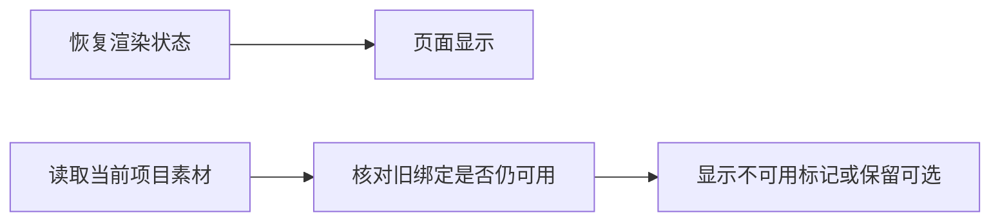

# T1134 核对恢复素材不可用提示的读取时序

用户要求“有问题的创建 task 及时修复”。T1133当前两文件第一次校准后，实际37例36PASS/1FAIL：恢复B-roll按钮此刻有原名称，却无“素材已不可用”。原日志SHA `70770e9061a3bcd5b7fa0e3b56f3653212d41bcb7205037c206023c6631c7ace`，2026-10-09T14:25:34.221933至14:26:03.921387 UTC，exit1/29.698022999975365秒，retry0。导出注册/归属/读回/幂等四例已通过，不代签恢复素材。

只读源码表明，`unavailableAssetLabels`仅在当前项目清单`ready`后计算，渲染状态恢复不等于此清单已结算；初始按钮名称没有标记不能先定为产品遗漏。T1133原断言先等渲染状态，随后同步读取按钮，尚未等真实素材状态。根对用户先称产品遗漏的判断在此纠正；当前根因UNKNOWN。

在T1133已审同一测试写集与原断言内，对实际按钮不可用标记增加明确120000ms有限观察；每次从当前DOM重新读取，不重发请求、任务或模型，不改归属/ID/预期。若真实标记持续缺失，则保存失败、明确必要产品SPEC并独评后修复；不把总提示替代逐素材标记，不删断言。没有发生的等待成功不得写成PASS。

本诊断不准入产品改动。控制写集仅本文件、`docs/verification/t1134/**`、BACKLOG/PROJECT及taskctl真实事件；T1133负责原测试校准与完整验证。原37例失败及最初36例RED保留，两任务不得代签安装版、视觉或全功能PASS。
