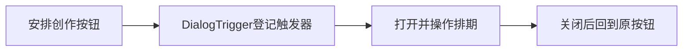

# T1137 核对排期弹窗关闭后键盘焦点丢失

用户要求发现问题及时登记并修复。当前 T1136 原代码真实 Chrome 诊断于2026-10-09T15:45:37.646198Z开始、15:48:57.252943Z结束，exit1、199.604197秒、0retry。首个1366×900弹窗真实选中项目与平台账号、截图后 Esc 已关闭，但原触发器在120秒观察期仍 inactive；不是几何断言失败，也不冒称四视口已执行。

证据：docs/verification/t1136/baseline-journey.json/log、原1366截图、当前私有 t1136-baseline-command.json/log。原产品两文件 SHA 与运行后一致。原因已从当前代码核实：GroupCalendarPlanningControl 直接 Button+setOpen，没有 DialogTrigger；共享 Radix 在关闭时按 triggerRef 回焦。修复纳入同一路径的 T1136 明确扩展 SPEC，先独立 recheck，不修改共享关闭逻辑，不删除 focus 断言。T1137 为缺陷诊断跟踪，产品实现与公共几何/保存/重选验收仍由 T1136 统一承接，不增加其他产品写集。

完成要求：T1136 当前修复后真实 Chrome 原焦点断言、Esc/取消和实际保存回读通过；保留最初失败、实际时序与新源码 SHA。不能用 unit 或手动 focus() 替代真实 UI 回焦，不加自动重试、不冒称原生安装或全功能通过。

