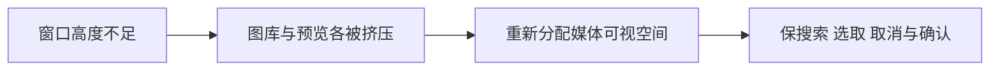

# T1140 优化低高度窗口的素材浏览与预览空间

用户要求发现问题及时登记并修复。T1136当前393ce00a Chrome3条真实旅程PASS，但主Agent于2026-10-09实际查看683×450低高度截图发现：缩略图区和预览区上下堆叠，各自可滚动，但可视高度太小，主体只能看到顶部，浏览体验欠佳。标题、搜索和确认/取消按钮均可操作，不能把该问题伪装为选取/保存失败。

证据：docs/verification/t1136/screenshots/shared-asset-picker-683.png、当前shared-consumer-observation.json、ROOT_VISUAL_CHECK.json。683×450只代表200%等效CSS视口，不冒称原生zoom；原生客户端最小窗口另有约束。

这是既有AssetPicker布局：当前素材选择器源码sha256 ab1b7323dc1947c6352b0ead2a0e2747b9d371406c30a641b4fbceaf831c04f3，T1136前后均未改；共享Dialog新增grid-cols-1不改变其原flex布局，排期控件修复也不调用预览。当前683样本不属于本轮新增保存/焦点/边距回归，不代签所有视觉已经优化。

下一步按oil-ui-pro局部优化：保原主题、图库搜索/全库分页、左右媒体真实加载、精确file选择、取消不写及owner/confirming边界；先核正式支持窗口与低高度空间分配，再给具体方案/产品写集作独立SPEC评审。方向不得改成名称select或隐藏预览；不得裁切媒体主体、缩小字体或移走底部主操作掩盖高度不足。布局实现前保当前截图与真实主体/滚动证据，复验正常、窄窗、低高度、长名、空/加载/错误及公共选择回读。

## 当前空间与精确修复范围

已只读核验当前原生宿主最小窗口为1024×680（frontend/src-tauri/src/lib.rs的min_inner_size）；683×450是等效放大后的浏览器压力样本，390是极窄兼容检查，不改变宿主约束。标题、搜索/类型、图库/候选预览、底部操作沿用现有组件与tokens。只修field弹窗的响应式空间分配，presentation=gallery嵌入页面的布局和即时加入流程保留原行为。品牌、导航、名称显示开关、动作次序不变，不开新风格方向。

根因已由当前源码和截图收敛：md（768宽）前两块上下堆叠且各自min-h-0/overflow-y-auto，同时候选预览固定h-48，主体高于可视滚动盒。683宽仍有足够横向空间给原256宽预览列，但上下分配造成双重裁切。图像本身已解码、object-contain有效，下载/格式/候选身份不是该问题根因。

产品写集仅frontend/src/components/media/asset-picker.tsx，允许以下局部布局修正：

- field弹窗从sm（640宽）起使用原双列和分隔线，各块有明确独立浏览职责；保留原16rem预览列，不改gallery网格和拖拽。
- 小于640或高度不超过480时，搜索/筛选、图库与预览共享一个正文滚动区，各子区不再各自收缩成小窗口；标题与底部取消/确认固定，筛选可在正文顶部返回使用。候选预览和缩略图在低高度按视口高度限制至min(12rem,24dvh)，图像保持object-contain完整呈现，用户可滚动到完整预览；不能把图片裁掉冒作适配。该高度条件同时覆盖640以上但高度不足的窗口，不仅改宽度断点。
- 双列预览区使用flex/min-h-0让媒体占实际剩余高度、上限12rem；身份/不可用原因保留且可读。正常高度原192px上限不变，低高度媒体完整缩入可视盒，不用固定高把主体撑出。
- field图库内边距可用既有12px档，确保低高度首行缩略图完整可见。showIdentity=false且无不可用提示或即时动作时，删除原空的20px文字容器；有身份/错误/动作时仍完整保留。不能删除有用文案、缩小字体或隐藏预览。

不改AssetMediaPreview、下载/校验/精确file与owner、useAssetPickerSource搜索/分页/过期回写、Dialog共享实现、确认单在途与sequence、切作品关闭、取消及原值、AI/绑定/视频导入、原生窗口/打包。SEMANTIC_BOUNDARY_ALLOW：仅落实视口空间与用户已选素材的可见性，不根据名称、画面或行业替用户选图。

## 实现与当前验收

4-build maintenance，沿用已授权“发现问题建task及时修复”。先正式SPEC独立审核，再开始同一局部优化；这是纯布局修复，原真实图已证明视觉问题，不伪造行为TDD RED。T1136严格旅程闭合前不修改其watched AssetPicker路径，也不与完整回归并行启动Next/typegen。

允许创建frontend/tests/e2e/t1140-picker-low-height.spec.ts及docs/verification/t1140/run-picker-journey.mjs、当前图/报告/评审、SPEC及review输入、BACKLOG/PROJECT/DECISION_LOG、modules/events/review-events；reconcile.config仅增加本任务真实前端验证命令别名，不删门禁。

真实Chrome、fresh私有库/auth，scheduler关闭、不连接外部平台/模型；经正式上传create/PUT/complete创建至少两件不同尺寸的中性图片，再创建当前组画布，通过原image_to_image参考选择器进入。1366×900、1024×680、683×450、390×900、390×450、512×340逐一查看左缩略图与右完整图片实际加载、媒体盒与裁切祖先边界、搜索、固定标题/底部操作和键盘焦点。512×340来自实际最小宿主1024×680的200%等效空间，不冒称原生zoom；低高度不得同时固定搜索/筛选而挤掉正文，正文顶部筛选仍可滚回并键盘操作。683下初屏第一张图及已选预览不被滚动盒裁断；390与512下正文单一主滚动区，滚动后整张预览能完整落在可视正文中；不得只断言naturalWidth>0或按钮可点。

继续原公共选择/回读：预览和取消后document/revision完全不变；确认第二张精确assetFileId后等待真正已保存，以canvas.get回读同一node.referenceAssetId/referenceFileId，reload/返回后仍相同；未确认不调用模型。错误/空/加载/长名称及媒体无预览时合法选择不被阻断，用原组件用例和明确一次读取失败夹具核验。gallery共享消费者采用现有真实入口走查预览/关闭，不签未走过的页面。原AssetPicker/unit与source/media tests、LED047、frontend类型、boundary/semantic/orphan/diff、timeout公共链、pmem及完整reconcile均需真实结果；原39全局失败不隐去，新增失败即时登记修复。

动作、请求、有限观察每次120秒以上；测试和外层覆盖冷启动、串行旅程、清理，0retry，原失败保留。报告绑定最终sourceSHA/head、原图与当前图、公开写后读/取消不写；独立实施复核绑定最终源码。只签本轮素材布局与列明行为，不冒充原生安装、视频导入性能、扫码、生图或全功能全部通过。

DEC-T1140-01：用户已授权现有素材选择交互优化和及时修复；本次只重分配原组件空间，不改产品方向、服务契约、数据归属或发布标准。

当前只有诊断与待审方案，产品未改、任务尚未开始。

