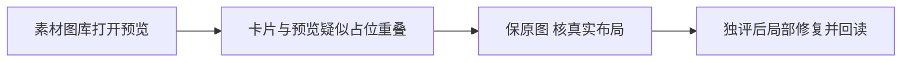

# T1145 核对素材图库预览与卡片重叠

用户要求发现问题及时建task并修复。主Agent实际查看T1140第二轮1024×680的unchanged-gallery-preview.png：gallery内预览顶部和图库卡片区域有重叠。该轮完整图片实际解码与object-contain边界通过，关闭预览/图库后画布文档与revision不变；不能据此签整体图库布局可用。素材field弹窗与gallery嵌入页是两种布局，T1140明确只允许field产品优化，gallery源原行为保留。

先保原图、当前AssetPicker/CanvasAssetPicker源码和原命令。只读核gallery父级flex收缩、最小高度和滚动责任；复现是否因卡片内容被强制压缩且预览占位不足。当前根因未确认，不能凭截图猜保存或选择身份出错。

产品改动前补精确局部SPEC、oil-ui-pro设计复核及独立审核。预期保同一丰富紫色基线、真实缩略图/完整预览、搜索/分页、即时加入与精确file/owner，正常窗口/低高度检查不重叠，预览关闭不写。不得隐藏预览、缩字体或恢复文件名select。此诊断暂不扩大T1140已审写集。

## 精确局部实施SPEC

当前源码可证：CanvasAssetPicker drawer父级为有限top/bottom的flex列并已有overflow-y-auto；其唯一AssetPicker根为flex min-h-80，默认可收缩。根被压缩后，内部gallery min-h-0/flex-1承担剩余高度，但固定搜索/筛选与固定192px预览占位总和超过分配高度。图库内部发生覆盖，不是图片解码或exact身份问题。

沿用oil-ui-pro现有tokens与紫色卡片基线，只让gallery根保持内容自然高度，由现有drawer外层滚动承担完整浏览。产品写集仅frontend/src/components/media/asset-picker.tsx，在presentation=gallery返回的根添加shrink-0，预览aside同样shrink-0使其有真实占位。其余field布局、搜索、内侧素材滚动、拖拽、即时加入、分页、candidate、owner/sequence与confirm均不变；不改CanvasAssetPicker父级/窗口约束，也不缩图或隐藏内容。page消费者保自然高度，完整页面由原外层浏览。

真实Chrome原T1140公开旅程继续覆盖field六视口与exact选用/保存回读，并扩展gallery在1366×900、1024×680、683×450、390×900、390×450、512×340的实际盒边界：搜索/筛选、素材卡及预览按文档流排序，不重叠；低高度滚动后完整预览可见，关闭预览后卡仍可操作，关闭图库后document/revision不变。至少两种已通过正式上传的中性尺寸图片，0retry，动作/有限观察120秒，未确认不调用模型。已有AssetPicker/media/source用例、LED047、type和static/timeout公共链继续运行。

允许测试/runner为frontend/tests/e2e/t1140-picker-low-height.spec.ts与docs/verification/t1140/run-picker-journey.mjs，图/报告保在docs/verification/t1145/**；最终浏览器证据同时标明T1140 field与T1145 gallery的适用范围，原第二轮失败和原图保留。最终独立实施复核绑定源码SHA与实际查看图。与T1140同一共享文件顺序修改、最终统一冻结运行，不用旧图签新字节。

SEMANTIC_BOUNDARY_ALLOW：仅修正既有卡片和用户已选预览的物理占位；不理解素材含义或代替用户挑选。4-build maintenance，SPEC独评PASS后实施；用户已授权及时修复，方向/契约/数据归属/发布标准不变。

## 当前低高度真证据后的局部补充（实施前recheck）

2026-10-09 17:24:45–17:27:49 UTC，当前真实Chrome正式选用/回读与1366、1024gallery预览/关闭均通过；683×450图库无卡片覆盖，但预览完整边界120秒持续false。实际看失败截图：图像被有限的画布drawer外层裁切。CanvasEditor画布为min-h-[50vh]，gallery drawer仍absolute top-16/bottom-16；即使gallery自然占位不收缩，低高度可用滚动盒仍小于固定媒体高。仅两处shrink-0不足，保原失败，不假称全部布局已修。

产品写集增加且仅增加frontend/src/features/creative-canvas/canvas-asset-picker.tsx：只在presentation=drawer且viewport高度不超过600px时，采用现有CanvasVisualGroups已经使用的fixed top-3/bottom-3/left-auto/right-3/z-40/w-[min(26rem,calc(100vw-1.5rem))]窗口内抽屉布局；继续原overflow-y-auto、padding和close/搜索/拖拽/选取数据路径。正常高度和presentation=page保持原CSS/行为。AssetPicker两处shrink-0保留；媒体仍object-contain/h-48，不缩主体、字体或隐藏预览。以现有画布侧栏的低高度规则修真实外层空间，不改CanvasEditor/宿主窗口。

原六视口gallery/field、真实exact选用/不写/保存回读及组件/LED/type/static/timeout/pmem/reconcile要求全部保留。PAGE_SPEC在docs/verification/t1140精确绑定已审六视口和原五个检查；原正式T1140 SPEC字节不改。当前worker失败清理正常只说明本轮结束，不证明原成功流程清理根因。新增列表重建观察另登记T1146；本补充不扩大其产品范围。
