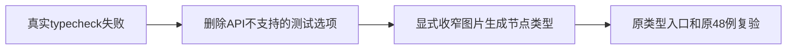

# T1150 核对当前画幅整合的类型检查失败

本次真实前端 typecheck 已完成 Next typegen，但 tsc exit2。原日志与receipt在私有 t1149-frontend-type，SHA 5d6553812783fa6810329b0afe80a7d6a66924ec3e881d45b49b47d6f7b8a594。不是 Next 并行竞争；执行时没有 dev/构建。

七处报错为新增 Testing Library getByRole 误带 Playwright exact 选项（六处）和 updateNode 中独立 group 变量不能让 TS 推导 target 为 image_generation（一处）。产品单测48PASS不代签类型通过。

大白话：交互已经通过，但新增测试和节点类型声明还不能编译，需要修正后再进入浏览器。

机械修正沿T1149已审三产品/两测试写集：getByRole保精确字符串name，删除不支持的exact，不放宽定位；mode比较补target.type===image_generation，不用any、ts-ignore或删除检查，不改变服务契约/权限/旧保存。

验收为原 typecheck exit0与原完整组件48例exit0，保原失败。全局canonical和正式Chrome仍由T1149闭合，此诊断不代签新安装包或全功能。
