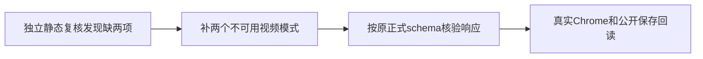

# T1151 校正新画幅浏览器旅程的能力响应

T1149独立实施复核在Chrome启动前发现IMP-001：新E2E只返回两种图片模式，而真实canvasGenerationCapabilitiesResource要求四种模式。原测试SHA fc3b1973261012ccd48d76d2dbea92d54dfd046aafaaab823d1a8ecb19750040，原审核JSON SHA 7111c92634e1271d4ce53171d9bba58dc6630ce9b7145be540c0837acd0d85fd。没有执行浏览器，不能冒作产品RED。

大白话：验收准备的能力列表不完整，页面会拒绝解析；需要把测试样本补全。

只改T1149已审新E2E文件：保原两种图片支持列表，补text_to_video/image_to_video不可用的合法记录，并用原schema验证fixture；不改产品、契约、领域成功写入、超时、断言、0retry或外网策略。保存原文件及审核，按同一IMP-001独立复核。

验收为当前typecheck和新旅程真实通过；只签调用准备，模型/native/旧receipt/fullcanonical另列。
