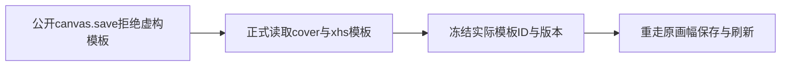

# T1152 校正画幅旅程初始页组的模板身份

本轮T1149真实Chrome两例在setup初始canvas.save均HTTP404，尚未进入画幅交互。外层42.780325秒exit1、logSHA 4f4f6ff314fff0169af8e40fb4ddf9f1e61299182f875010fbf0a454eacbeebe；七受测文件前后SHA一致。私有trace实际响应OwnershipError中文“收藏模板快照不存在或无权访问”。

代码追踪：当前公开service按templateSnapshot.id/version调用真实visual-template service核模板身份；测试原neutral-style/other-style是不存在的合成ID。asset、project、canvas创建均真实成功，不能因此冒称用户保存坏了。原失败trace、初始测试和原journey记录保留，未读用户库。

大白话：验收准备时随手起的模板ID不是真实模板，系统正确拒绝了；需要先从公开模板库读出实际ID和版本。

只校准T1149新E2E setup：同一fresh组通过assets.visualTemplates.list取得真实非真人模板，snapshot.id/version/name/prompt/visualMode/requiredIdentity取公开值，其余原nodes/groups/资产/成功写入/断言/预算/0retry不变；不删templateSnapshot、不种库、不伪造权限、不改产品。真实领域save/get继续原HTTP。

验收为新Chrome原两例和独立同源复核；真实模型/native/平台/全局旧债务不在此诊断PASS中。
