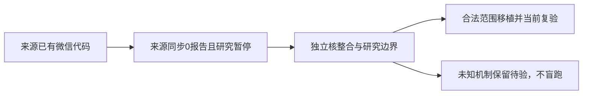

# T1158 核对微信来源研究暂停对当前整合的准入边界

T1124要求把确认缺失代码整合到main，用户继续全功能验证并要求发现问题创建task。当前main aa7de1e9已整合其它独立功能；来源293d4e98的微信闭包跨16新路径及34共享路径，不能复制缺文件冒充整合。

当场读取来源最新研究卡与独立结果复核发现：视频号隔离profile已真实绑定，但当前产品原生报表0份，两次区分实验已用尽；最后快照仍在官方首页，统计页入口为何未进入未知。公众号产品绑定仍未完成。来源T1110正式暂停、研究卡researching，未配置现场verify key、未取得完整真人UI或采集PASS。来源candidate取证补丁未合入生产。此不是当前main运行产生的失败，不继承来源ID对应本看板同名任务的状态。

大白话：微信的扫码与报表代码已写出来，但来源实机同步没跑通。先明确能否按原冻结代码移植，不能换任务编号重开试错，也不能把按钮显示当作同步成功。

4-build维护诊断；本任务产品/测试/runner写集为空。仅读当前与来源实际代码/研究/审计/Git，私有证据保存原字节与真实commit。当前独立流程复核判断：是否允许迁移已冻结生产字节而不改变未知导航机制、授权/期限/日期保护，哪些公共契约/归属/页面/调度可独立验收；若需要新的研究任务，怎样继承原family、两次实验和原失败，不能reset预算。明确当前整合SPEC必须保持main T1112纯组能力、T1123项目列表、最新素材/保存/超时、0130真实收敛与调度用户自定义状态；不覆写来源控制文件或旧审核/验收。

不在此任务启用生产adapter、修改vendor、放宽身份/path/date guard、不新建真实扫码/采集/模型任务、不复制Cookie、原账号库或私有图。用户当前在原来源浏览器空间的控制权不推断已交回。这里只确定准入，正式跨层产品移植另有当前SPEC与独评。现有已确认源码验证、当前包交付可以按原授权独立继续，但不得声称微信来源全部已合或全功能可用。
