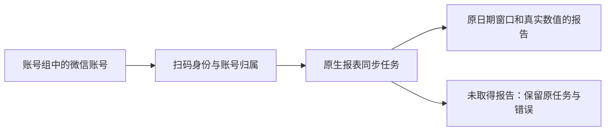

# T1159 当前main微信原生报表闭包整合

用户已授权汇总各会话代码到main、清理闲置worktree、出本地包并逐功能验收；最新要求发现问题及时建task修复。T1124核实微信闭包仍未整合，T1158独立准入允许冻结移植和隔离验证，真人执行继续研究暂停。本SPEC是4-build维护整合，不新增产品方向，不继承来源PASS。

大白话：账号组里能看到视频号、公众号的扫码入口和统计报告入口。报表按平台实际统计窗口保存，不能把30天报表说成全部作品或累计数据。当前同步没有拿到报告，必须显示真实0和恢复入口。

## 来源、精确写集与当前基线

当前main aa7de1e91183ec0236a82cd954a4f4bf9bb1aeb1；冻结来源293d4e98d2cedbd04eebce16a62f921711ee8079，共同基点d35f7d57ff952d306071eb40d34127956b067906。精确来源56路径及各SHA见 `docs/verification/t1159/SOURCE_MANIFEST.json`（33产品、21测试、2包文件，18路径main尚不存在）。整合前再核这份清单；private frozen副本只作出处，不能整树覆盖或直接merge/cherry-pick。来源BACKLOG、events、review-events、旧SPEC/审核/验收不搬入main。

逐段检查base/source/current：不改当前T1112纯组能力与T1123项目列表，不回退当前素材选择/引用保存/中文失败反馈、图表、统一画幅和执行超时。合同cli-policy与workspace-operation-scope已有当前增量，必须合并微信reports权限而非覆盖。其它当前等于base的共享文件仍须核来源语义；会员锁保留当前已有保护，仅追加native report执行归属。0130旧迁移字节不变，0131只追加，旧用户disabled/custom cron、任务ID、已有报告与历史记录保留。排除manifest中的6条已被当前代码替代的路径，不删来源原文件。

除manifest的56路径外，实施写集仅新增 `contract/tests/current-wechat-integration.test.ts`、`frontend/tests/e2e/t1159-wechat-native-report.spec.ts`、`docs/verification/t1159/run-report-journey.mjs`，任务自身SPEC/review/PAGE_SPEC/设计/当前证据，以及BACKLOG、PROJECT生成记忆、DECISION_LOG、modules/reconcile配置与本次真实事件。不修改vendor、原验证器、原allowlist、宿主启动或其他平台collector。若发现超出写集的必需产品修复，先登记task并精确独评，不洗掉原失败。

## 产品与服务行为

- 微信binding经现有local平台绑定服务/任务/owned browser profile，稳定ID由可信adapter获取，不能用昵称、手工ID、cookie或模型填值替代。原公众号/视频号绑定等待与真实身份授权期限、absolute parent deadline及取消归属不改变。无身份证明不得采集。
- contract增nativeReports能力与严格报表DTO、reports.list operation、CLI policy、workspace scope；backend独占0131/native report写库，worker仅通过service port交付候选源数据，UI经正式transport。五类报表记录原文件类型、SHA、日期窗口/统计口径、列/单位、真实0、unknown/null、允许的负增量、来源和采集时间；不按标题猜作品ID，不加入未经证明的全作品目录/累计指标。原下载及解析限额25MiB、10000行、32列保持。
- run创建时冻结user/group/account/member version；取claim、回读、取消、可信提交再次核当前权与租约，转组、跨组/跨用户、lease过期、旧generation均按原机制拒绝，拒绝不得写入另组。成员锁顺序与当前service边界不变。report幂等按源SHA和实际selection key，相同空表字节但不同窗口不相互吞掉。公开分页最多100条，读取旧组历史与当前成员归属按原已审权限，不把转组报告归新组。
- workspace启动/成功binding bootstrap支持五平台错峰0/5/10/15/20分钟、2小时默认；原custom cron/disabled/system标记保留，单账号在途受同一执行权约束。恢复nativeReports只延续原未过期任务ID及剩余30分钟绝对预算，不重新创建/续期；过期真实结束。scheduler入口资格、private collector admission和队列测试须走当前公共组合，不只helper。
- parser和DOM witness沿冻结来源：真实日期选择、官方origin/report path、请求hash、table witness、下载结果和身份归属确定性校验；不改变未知的首页导航机制，不添加关键词意图判断或宽泛页面兜底。SheetJS CE0.20.3使用来源官方CDN tarball/integrity锁定，不升级供应链或引入第二浏览器。诊断私有截图默认关闭，不复制真实凭据/截图/账号库。
- UI保留原丰富紫色工作台、AccountBindingPanel、能力表和组成员行。新增微信能力来自实际装配；可用不冒充已登录/同步成功。member提供真实“查看数据”入口，微信进入原生报告页，抖音/快手/小红书仍原目录。空报告明确0与扫码/同步恢复，单次同步有原task/status，失败保留输入、旧报告与原任务。重复/卸载/切组回执不得回写；单poll在途、epoch防旧结果。完整报表按需展开，长表局部横滚，保正常/空/加载/失败/部分/needsAuth/取消状态，不造趋势图。

## UI设计与证据

加载项目oil-ui-pro0.10.0与账号组UI_RULES，读existing-project、interaction-and-state、layout-and-viewport。对象是组内平台账号与原生报告；先看账号/同步状态，再报告窗口/数值。复用tokens、Button、Dialog、PlatformIcon，不重新探索主题。基线来自当前aa7真实binding旅程截图，保留原出处和SHA，不当成微信新页面。新增报告页初版稳定后独立现有规范视觉评审和真实任务走查，不能用来源截图代签。1366×900、900×900及390×900极限窗口核中文、长名、表横滚、焦点和返回；390并非真机缩放。

## 验证与验收

先登记当前任务、独立SPEC PASS，再用新增当前contract测试取得有意义的RED（nativeReports枚举/注册、微信调度资格/纯组权限），缺module/import不算行为RED。移植后运行manifest所有当前相关测试，原assert/预算/0retry保留；同步类型检查串行于Next开发服务。fresh PGlite迁移/owner/lease/身份/幂等/分页/转组拒绝、隔离clock调度及mock adapter成功/错误/取消、XLS/CSV/HTML合成解析明确声明为隔离测试，不签真实平台成功。

manifest中的smoke/t1110-native-report-private-files.ts是原实文件只读辅助入口，保留来源代码但本轮不执行、不把缺文件当作产品RED或将它传给vitest（实际vitest排除smoke目录）。其余20个原测试文件纳入各workspace当前验证。

自有Chrome旅程使用fresh隔离PGlite与auth、scheduler关闭、无外网：由正式dispatch创建中性组和手工微信账号（身份未验证），从绑定页面的成员“查看数据”进入真实原生报表页面，reports.list实际0，无伪造成功读写；refresh/repeat/back后仍同一真实账号/原0。测试实际“同步”被SCOPE_MISSING拒绝且不创建run、不打开浏览器/下载，借此验证恢复提示与未验证身份安全边界。实际公共domain读写不能route替换；loading/error/partial/stale和已有报告表内容由原组件/隔离service测试声明覆盖，不当真人旅程。

- AC-CONTRACT：nativeReports严格DTO/operation/CLI/scope注册；原pure-group与projects权限不回退，微信目录不冒作完整catalog。
- AC-OWNERSHIP：fresh迁移+真实service/transport回读、冻结归属/租约/跨组/转组拒绝、日期/字节幂等和分页原断言通过。
- AC-ADMISSION：原scheduler/public组合支持微信绑定资格与五平台错峰，禁用/自定义/原任务恢复/取消不回退；mock无真实微信执行。
- AC-REPORT-ENTRY：当前Chrome从组成员进入真实账号0报告，刷新/重复/返回一致；同步真实拒绝且无run或浏览器调用，中文恢复提示可见。
- AC-UI：新页面和能力表在三窗口可读，长内容、按需表、轮询/过期回执状态有证据；独立视觉/任务检查与真实行为分开报告。
- AC-LIVE：真人公众号/视频号稳定ID、统计页就绪、真实日期选择/五报告、原profile调度和真实页面5报告回读；**来源目前0报告、尚未通过，不用上述隔离门代签**。

正式implementation命令含契约/backend/worker/frontend相关原测试、类型、T1101/T1136/T1140原Chrome旅程、新Chrome、LED047/timeout公共入口、boundary/semantic/orphan、pnpm锁/bundle、pmem/full canonical和diff。全局既有失败单列并登记，不能删门。最终所有共享源码冻结后，T1148各旧任务分别生成绑定最终HEAD新报告、跑原allowlist并正式resume/complete；中间aa7候选不代签。T1159可以提交经过独评/隔离门的实现，但AC-LIVE未通过时本任务验收仍待验，不complete为全绿。

## 继承研究暂停与出包边界

固定source293d、family `wechat-statistics-visible-section`，EXP-1与EXP-2已消费、remaining=0、研究researching；视频号已绑定/0报告、公众号未绑定、官方首页未进入统计页原因UNKNOWN。新T1159只负责当前main整合，不能重置研究budget或把main旧T1110当来源状态。原研究卡和失败摘要以原SHA存引用，不重放旧事件。

禁止真人binding/nativeReports同步、真实scheduler/下载或安装启动触发真实微信采集，直到来源研究resume criteria满足。原space20浏览器由用户控制，已提出交回问题；交回后只读核实际菜单入口，不新建任务/扫码/下载或第三实验。只读仍不能解释机制则暂停。离线构建/包内容/隔离启动可以继续，但安装真实profile触发须先解除原研究；不能隐藏按钮、删能力或默认假成功绕过此门。本次不备份App/DB、不推送/tag/Release、不清理原媒体或活跃树。
