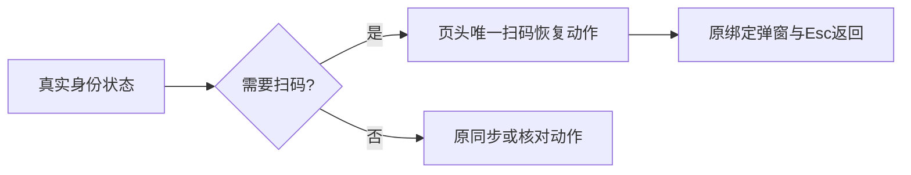

# T1168 统一原生报表身份恢复态的文案与主操作

用户要求全功能验证发现问题建task及时修复。当前T1159正式Chrome两账号×三窗口真实报告读取0、身份拒绝SCOPE_MISSING已通过，但身份失败截图和独立oil-ui已有界面评审发现：上方要求先扫码绑定，空态仍要求点击已禁用的“同步数据”；可执行恢复按钮继承红色提示色且为次级描边，禁用同步仍占主动作。来源原8图保存在docs/verification/t1159/fixed-beforecommit，不覆盖历史。页面h1使用text-2xl，当前globals/token映射32px，而账号组规范页面标题24px；该项先按实际映射校正，修后在浏览器读取computed style确认，不凭截图估值。

阶段4-build维护，局部UI修正；范围不改变平台能力、身份核验、公开合同、用户/组归属、任务/请求ID、期限、采集或扫码的执行行为。产品写集仅frontend/src/features/platform-account/native-report-panel.tsx：真实bindingRequired或needsAuth时，页头唯一主操作改为原有“扫码绑定账号”或“重新扫码登录”，复用原Dialog/AccountBindingPanel及当前焦点返回；删除原提示行/状态区重复恢复按钮，保留原失败文字、取消和核对状态。普通同步/未知响应/能力关闭/期限结束保持原执行路径。空态文案随真实状态一致：绑定/过期说明完成扫码后同步；能力关闭不要求点不可用同步；正常空态保留原同步引导。恢复按钮不继承错误色，不新增主题或组件；h1改用现有text-xl（24px）。窄屏正文保留14px与自然换行，不靠缩字塞入。

测试写集仅同目录native-report-panel.test.tsx、frontend/tests/e2e/t1159-wechat-native-report.spec.ts。先独立SPEC并start，再新增原空态/拒绝恢复的行为RED；同步拒绝与needsAuth两族保留原key/真实ID/能力关闭/返回聚焦等已有断言，仅把旧禁用同步按钮观察改成唯一真实恢复主操作，不能删除身份拒绝、未知结果、取消或已有报表保护。验证原面板全测试及当前真实Chrome：两平台入口、真实0、refresh/back/repeat、单次400SCOPE_MISSING及0run/0binding/0report/0profile副作用均保留；新增身份空态无冲突文字、页头唯一恢复按钮和h1实际24px，恢复弹窗只打开后Esc且焦点返回，不点最终扫码。原120秒、有限外层、0retry不变，不真人扫码/下载/模型。

按项目oil-ui-pro0.10.0与UI_RULES复用已选原丰富紫色工作台、tokens/Button/Dialog，不重新探索方向。这是一轮独立已有界面评审的修正，修后由主Agent在同视口/数据/状态比图，不为小改再启动审美评审。真实任务走查与截图分开，未见真实报表/扫码结果/真机不签通过。聚焦组件、frontend类型、原Chrome、LED047、boundary/semantic/orphan和diff执行。全局旧27超时静态欠债及旧审核漂移如实保留。

控制/证据写集仅本SPEC/review/当前证据、BACKLOG、modules、DECISION_LOG及真实events/review-events、生成PROJECT；原T1159 SPEC/来源manifest和历史失败不改。T1159来源研究暂停仍有效，修复不创建第三实验/新扫码或放行安装真实微信执行。

