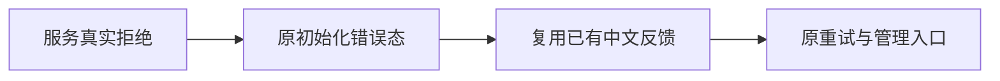

# T1175 修复工作区恢复反馈直接暴露英文权限错误

用户要求全功能验证发现问题建task及时修复。d414新包随包Node和Chromium的隔离启动实际成功，但未注入宿主握手的负向检查真实收到403；截图工作区恢复态直接显示英文forbidden请求来源错误。该权限拒绝本身正确，不能把它当新App启动失败，也不能绕过拒绝来消除错误。实际图及原失败归T1174/T1175保留。

阶段4-build维护、已有Oil丰富紫色方向局部反馈修正。产品写集仅frontend/src/components/shell/workspace-initialization.tsx，测试写集仅同名.test.tsx。只在WorkspaceInitializationBoundary展示已有error的地方复用现describeUserError，以现中文fallback显示未知技术信息；原共享helper、原错误状态、初始化、ready/fail-open、timeout、Abort、epoch、同根保护及所有按钮处理器保持。保安全的中文业务短句，英文权限/网络或未知技术码走现映射/fallback，不新增词表或猜失败根因，不改backend、握手、owner、模型或任务API。

先独立SPEC与taskctl start，再当前组件新增真实403 raw envelope的反馈RED：显示已有中文权限反馈、原英文不出现、重试按钮有效，重试公共list成功才开放；另未知技术错误fallback和已有可读中文保留。原所有初始化/分页/超时/切组/脏稿与恢复页回归断言保持。GREEN后运行组件、现helper和frontend类型，LED047、boundary/semantic/orphan及diff检查，独立窄源复核。按原截图尺寸用真实页面截取相同恢复态核对中文与重试，不能只靠helper单测。

此次不另换布局或设计方向，不重复审美探索。精确旧图、源码与公共调用当前复验；包重建前提交当前已审修复并按固定打包入口重新冻结，本轮d414包和原失败不可改签。当前真人profile研究限制继续，复验用fresh隔离data/auth和新随机宿主注入；不真实扫码/采集/下载/付费模型。不把此反馈修复称全局40项失败已修。

