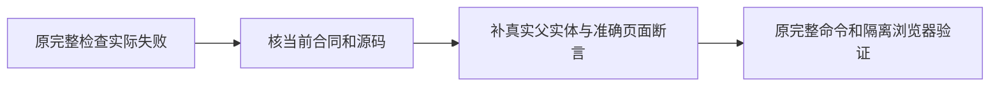

# T1176 校准导航与封面恢复回归的过期前置条件

用户要求继续全功能可用性、稳定性验证，发现问题建task及时修复。当前main335b的完整检查32项失败保留。T1015逐条原命令核因：LED049当前实际3FAIL/76PASS，失败仅shell.test.tsx漏掉现有创作画布、旧导航数量12、contentFill要求不存在PageScrollArea；LED048原完整命令实际219.2516秒退出1、209PASS/1FAIL，封面恢复用例在进入补采前因不存在output-1被原assertOutputParents拒绝，原栈、log与收据保留。

这属于stage4-build维护中的既有合同测试校准，不变方向、公共契约、页面、数据归属或安全门。T1069 SPEC“实际Tab丢稿根因与精确容器补充”已明确同一个PageScrollArea和app-page-content，只切CSS以保未保存状态；不得为迎合旧测试恢复卸载。导航继续既有创作画布入口，不删入口。封面测试必须有同user/account的真实project→contentOutput父链，不允许生产服务绕过所有权或改source为ingestion来蒙混。

精确测试写集：frontend/src/components/shell/shell.test.tsx、backend/src/application/collection/cover-file-repair.test.ts。产品运行时代码、其他测试、shared fixtures、reconcile配置、预算与守卫不改。文档/控制面仅本SPEC、当前独立评审、BACKLOG、该task事件及docs/verification/t1176的当场证据。

实施前独立SPEC评审及taskctl start。已有真实RED保原log/exit，不制造伪红测。shell测试写出固定的13个真实入口标签与href、各入口prefetch=false（展开/收拢均验），不从产品数组派生期待值。填满模式保唯一滚动容器和content实例，验证外层viewport及直接scrollbar禁滚/隐藏约束、原满高/内部滚动要求；双向切contentFill验证容器DOM与未保存child状态保留。普通页维持外层滚动。原其他用例不删。

封面测试复用现seedAdjacentContent仅在fresh隔离库建立真实同归属的output-1/output-2。原实文件删除→缺图列表→补采→版本回读、好封面不动的完整断言均保留。追加不存在父稿件、其它user与其它account父稿件被拒绝且无publication写入的负测；保第二个未知封面只延后该项的用例，不用stub绕过服务。该测试是实际本地文件/隔离持久库，但网络下载仍原stub，不能称真实抖音采集。

原LED048和LED049完整命令（含后段backend）在同两显式隔离PG环境复跑，保原命令及预算；新增原public发布guard相关完整服务回归、现稳定宿主回归和frontend/backend类型，边界/语义/orphan、diff。不改短预算，LED053债仍属原任务。独立实现复核必须核精确diff与实际收据，不借旧PASS。用当前新包的实际Node/full Chromium、新随机data/auth/握手，验证普通页→contentFill页→返回的真实导航、13入口及浏览器计算样式/滚轮/内层滚动、容器身份保持，留截图和真实测量；无mock页面、真实用户profile、扫码、模型或付费平台。

当前新包产品源码5a未变，不因测试校准重新打包。当前真人微信研究限制保持，不替换/启动新原生App。收尾pmem与完整reconcile，范围内新增失败必须修，范围外历史receipt及其他LED保真实失败及原owner；T1015整体不可因本片关闭。仅此片完成后taskctl complete并提交main，不push/tag/Release，不备份安装版。

