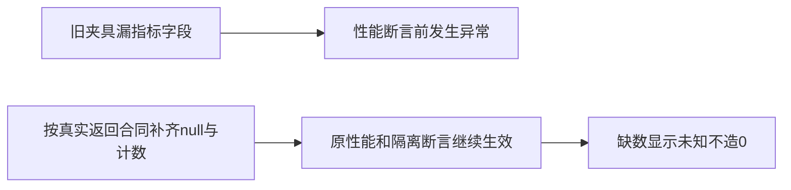

# T1177 修复首页性能回归的稀疏指标夹具缺字段

用户要求继续全功能可用性稳定性验证，发现问题建task及时修复。T1015本轮原LED050命令实际125.0313秒退出1；前端7PASS，后端45PASS/3FAIL，失败仅dashboard-read-performance.test.ts的三例；原日志SHA及receipt所记logSha256均为fe316b0286d3656c9418af7704379d25e49650ad284060c4f9371fd755db4f84，原字节保留。

当前真实DashboardRollup接口要求finishAvg:number|null、ctrAvg:number|null及其它聚合字段，analytics.repository真实返回这些字段；旧测试把不完整对象经unknown强转为整个port，两个rollup mock省略finishAvg，dashboard对undefined调用toFixed，导致原性能/粉丝断言尚未抵达。不能把这称实际稀疏数据回归，也不得为迎合假返回把未知指标当真实0。

阶段4-build维护，既有合同的测试前置校准，精确写集仅backend/src/application/queries/dashboard-read-performance.test.ts。产品、其它测试、合同、shared fixture、预算、reconcile配置及归属守卫不改；控制面仅本SPEC、当前独立评审、BACKLOG/task事件及docs/verification/t1177当场证据。独立SPEC初审与taskctl start后才修改。

在本测试内用实际AnalyticsService.getDashboardRollup返回类型建立完整合法稀疏夹具，未知均null、实际无快照或计数为0；保本例明确snapshotCount=1/plays=12/likes=2/shares=1与指定followerGain=0或9。两个mock复用该typed fixture，避免下次合同字段增加仍经unknown漏过。原四用例全部保留：120项目批量/空集合短路、同请求共享而后续/跨账号不共享、慢项目摘要不阻塞日历和执行读取、账号基线失败未知而恢复显示真实期内增量。新增断言稀疏完播率未知仍显示—，不是0%；验证真实已测finishAvg能显示实际百分比，不靠放宽error断言洗绿。

保原真实RED，不制造过去没有发生的红测；新增正常边界首跑PASS可以直接记录。原LED050完整命令前端与后端（含publishing原全部服务测试）复跑，两显式隔离PG环境保原完整串行预算；backend类型和boundary/semantic/orphan/diff，独立实现复核实际diff及原log/receipt。pmem与当前完整reconcile由本轮共同收尾，旧receipt/其它LED失败保原归属；T1015整体不因单片销账。测试不代表真实安装、真实平台/模型或全功能。运行时代码未变，无须重建同产品安装包，不push/tag/Release、不备份安装版。

