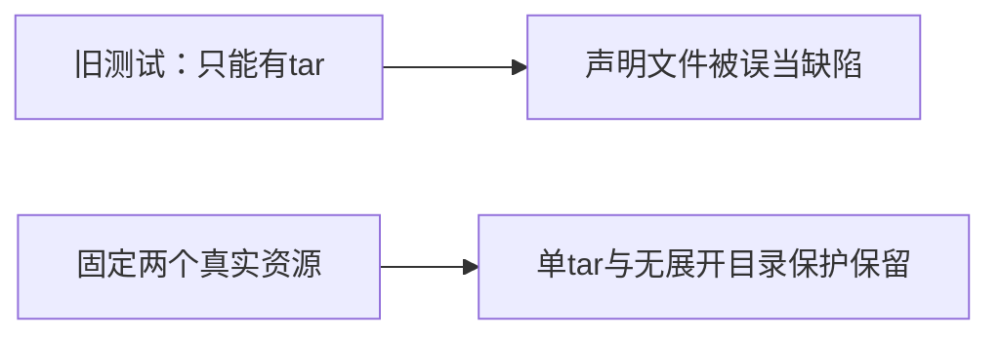

# T1178 校准双端打包资源回归的第三方声明前置条件

用户要求继续全功能可用性稳定性验收，发现问题及时建task修复。T1015逐条执行原LED006完整命令，当场2.026秒退出1、42 PASS / 1 FAIL：windows-runtime-config.test.mjs第一例期待bundle.resources仅sidecar.tar.gz，当前shared和Windows实际均还含THIRD_PARTY_NOTICES.md。当前两配置已由65781a81引入声明文件，原日志SHA cb48cdced5769f5cf02b956ccc86b6017d471227909747957835d1424606bdfb保留。其它启动安全与发布流程测试已执行通过，不能将这个旧断言失败称新包不能启动。

stage4-build维护中的既有合同测试校准；精确代码写集仅frontend/scripts/desktop/windows-runtime-config.test.mjs。不改变产品、tauri配置、打包/发布流程、资源文件、构建预算、reconcile检查或原守卫。控制面仅本SPEC、当前独评、BACKLOG/task事件及docs/verification/t1178当场证据。先独立SPEC审核通过，再taskctl start，才改测试。

第一例表述改为单个runtime tar与第三方声明。分别对shared与Windows配置固定精确期待两个资源sidecar.tar.gz、THIRD_PARTY_NOTICES.md；明确保留两个配置均不含sidecar/，单个tar不能变展开runtime或增加其它资源。原其它五用例全部保留，安装期物化、NSIS currentUser/hooks、真实SHA、指针优先/兼容兜底及原错误透传不变。不得删除声明文件以迎合旧测试，也不得用contains取代精确资源集合洗绿。

原RED保原字节与退出码。改后精确文件与原LED006完整命令复跑；当前边界/语义/orphan/diff与独立实现复核保真实证据。原资源配置与打包脚本字节未变，不重打同产品包，不代签Windows真实安装或原生App启动。pmem与完整canonical共同收尾，其它旧失败保原任务，T1015整体不因本片销账。仅局部完成后taskctl complete并提交main，不push/tag/Release、不备份安装版，不触微信原研究和当前真实数据。

