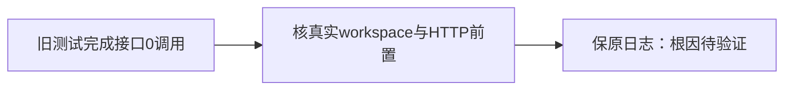

# T1179 素材上传回归完成接口未调用

T1015执行原LED022完整命令当场6.677秒退出1、18 PASS / 1 FAIL，原日志SHA `311a66a99c29aad1c54907878d4c36ced8b8720177180852dd9e3ab8ad3d25bd`保留。失败仅assets-interactions.test.tsx E2上传用例：completeUpload mock期待1次，实际0。原文件字节、PUT和完整文件名/type/size断言不删除。

当前AssetUploadButton已经使用真实workspace.capture返回的冻结client与signal，旧用例只mock全局contract-client并直接渲染没有设置workspace。这是当场源码差异，尚未证明是否全部原因，也不据此声称实际视频导入失败。先核真实CreationScope、HTTP请求/回执、有效组与过期/取消归属及旧fixture链，当前只读诊断和证据写入；不改产品、其它测试、权限或预算。

若需要修改，先在本任务追加精确写集、既有合同及原完整命令/公开链/负测验收，独立SPEC复核后才执行。不能为迎合旧mock绕过scope或把相对路径字节PUT改回跳过；既有真实数据和微信原研究边界保持。

## 当前合同核对后的精确校准

已读真实createCreationWorkspace及contract的上传返回/envelope：组与旧账号都缺失时assertCurrent在请求前拒绝；合法纯组不要求平台账号，旧账号工作区仍按原范围验证。capture生成独立typed client，经fetchCreatorApi→dispatch执行，不消费旧全局client mock。旧fixture还缺上传assetId、真实ISO期限以及complete的完整AssetResource和meta.requestId。只补组选中仍不足以使旧fetch mock返回合法合同，不能放宽schema或stub真实workspace。

精确代码写集仅frontend/src/features/assets/assets-interactions.test.tsx。先独立审核本补充，再改测试；不改任何产品、其它测试、共享fixture、合同、配置、守卫或预算。原11例保留，E2继续验真实File的文件名/MIME/size、相对路径真实字节PUT、complete和refresh；局部typed合法上传/素材/envelope夹具经实际冻结client与transport消费，HTTP只在本测试stub，不stubuseCreationWorkspace/assertCurrent。原mockClient调用仍由HTTP adapter记录实际dispatch input，不能直接伪造组件完成。测试局部设置明确组、无平台账号，清理恢复原storage与fetch stub。

补测无组/账号不发请求；PUT待确认时切组、组件卸载均使原signal真实aborted，晚到成功不调用complete、不回写成功、不refresh。成功链三段同signal，创建/完成header均冻结原group且无account header。补充不是改变产品语义；缺数与文件字节不伪造。

原LED022完整命令和该文件复跑，原CreationWorkspace/HTTPtransport守卫回归、frontend类型、边界/语义/orphan/diff与精确实施独评。使用当前未改产品包的实际Node/full Chromium、新随机data/auth/握手，UI建纯组并导入本轮生成的中性图片/短视频；实际创建→PUT→完成返回、素材列表和刷新回读，并进入第二纯组核未混入。无route/mock替换真实dispatch/PUT、不直接写库、不用真实媒体/扫码/模型/真实用户profile；保实际截图与网络/结果/日志。本测试不代签剪辑工程导入或原生安装。共同pmem与完整canonical后仅本片关闭，原历史失败及T1015整体保留，不重打相同产品包、不push/tag/Release，不触原微信研究。
