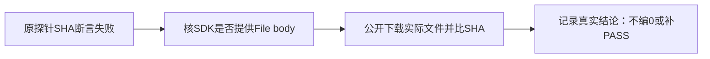

# T1180 隔离上传探针请求体字节失败

T1179精确测试14 PASS，原LED022完整22 PASS、frontend类型通过；随包Node/full Chromium首轮21.851652秒退出1，原日志SHA `e2dedba1db02934f74b46854129dac6b081d1590cb8c1fa6a83a583b97e1dafa`。原私有驱动第57行在PNG创建、相对路径PUT、完成均200且真实UI显示完成后，比较Playwright request.postDataBuffer所得bytes/SHA与本轮中性文件失败。该失败早于最终result写入，不能补造首轮完整结果或称首轮通过。

当前只能证实探针断言失败，尚未判断是否实际文件损坏。先保原驱动、receipt/log及sidecar日志；核已安装SDK对File/Blob请求体的实际消费者、数据可用性和公开fileDownloadUrl→GET→文件SHA。不得把拿不到body当真实0，或只删SHA断言洗绿。不得动产品、原数据、上传权限、旧驱动、预算或真实微信研究。

只读诊断与证据写入；如果校正私有驱动，先记录确定机制及独立复核，再新路径执行，原失败不覆盖。落盘文件的实际公开下载SHA及尺寸必须与原中性媒体逐字相等；两种媒体、刷新与第二组隔离仍按T1179原验收，不代签工程导入或原生App。

## SDK消费者核对与精确探针校正

已读当前Playwright1.60.0实际coreBundle.js：Chromium InterceptableRequest只从postDataEntries里带bytes的条目拼Buffer，无可用bytes则保持null；客户端postDataBuffer也直接返回null。原驱动却用`??0`/空Buffer将未提供数据记成0字节及空串SHA，不能代表真实上传字节。首轮未保存该原始Buffer值，不能补造首轮值为null的证据；最终是否不可观测必须由新轮实录。

精确写集仅本SPEC、独评、BACKLOG/task事件、docs/verification/t1180当场证据以及私有N/t1180-upload-probe-corrected.mjs。原N/t1179-asset-upload-packaged-probe.mjs和首轮receipt/log/sidecar字节冻结，产品/测试/SDK/config/预算不改。先独立核本补充，再写新路径驱动，使用新随机隔离data/auth，不重发首轮同组未知写。

新驱动记录requestBodyAvailable、nullable的bytes/SHA；Buffer实际存在时保原严格比较，缺失只标未知，不造0。两种媒体无论是否拿到请求体，都必须完成原UI创建→PUT→complete/刷新/跨组/返回旅程，并由原公开assets.get/fileDownloadUrl/GET下载当前确切文件，size和SHA与本轮FFmpeg生成中性原文件严格相等。原PNG首轮失败保留，新轮失败不代签为绿，不降低预算、不route替换/写库、无真实数据/平台/模型或原生App。T1179仍待本原公共旅程与独立实施复核，二者由本轮pmem/canonical收尾；仅探针机械问题闭合才关闭T1180，不销账产品范围。
