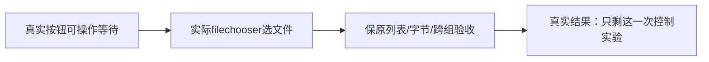

# T1182 真实上传按钮最小控制实验

T1181重复filename可见性失败，正式Research Gate已开启；T1182研究卡只允许两次：已有隐藏input注入观测1，剩余真实按钮控制2。已读真实AssetUploadButton消费者：按钮disabled=pending，hidden input无disabled/handleFile pending拒绝；完成提示setUploadStatus后立即router.refresh，不代表画廊已经更新。当时按钮disabled布尔值未保存，只能记UNKNOWN，截图颜色不能替代属性证据。尚无产品根因结论或修补。

精确写集仅新私有N/t1182-real-button-control.mjs、本SPEC/独评/研究卡/看板事件以及docs/verification/t1182当场证据。独立审核后复制冻结的N/t1181-upload-list-navigation-corrected.mjs，新随机data/auth及所有观察JSON、PNG、失败、sidecar、final result均新前缀t1182-real-button-control-，创建前核不存在；原驱动/旧失败wx字节冻结。

唯一行为校正：每个文件先记录上传按钮真实isDisabled，监听filechooser（120秒），再真实button.click（120秒，不force，不evaluate click，不直接hidden input赋值），等待实际chooser后chooser.setFiles中性文件，记录该调用和按钮属性。按钮默认可操作等待保证不绕过pending；最后原两文件可见后再有限等按钮恢复enabled并记录当前属性。保原上传toast、文件名可见、create→PUT→complete顺序/200/冻结group无account、requestBodyAvailable且Buffer存在时严格size/SHA、两媒体公开exact-file下载size/SHA、刷新、真实菜单建第二纯组为空、返回原组和页面错误断言。不得删断言、降低120秒预算、修改SDK/product/tests/config/归属或route/mock真实接口。

实验无真实用户数据、模型、平台、App替换或原生验收，只使用随包Node/full Chromium和已生成的中性PNG/MP4。无第三次同族实验或盲重跑；失败则卡内记录真实失败并保持研究暂停，成功只证明正常UI这条旅程，不补造原超时机制已证实。当前完整canonical源文件与config冻结，研究verify keys尚未注册，禁止手写validated或跳过恢复门。T1179/1180完整旅程结论须由此轮实际结果及独立实施复核另行签，不代签全功能。

