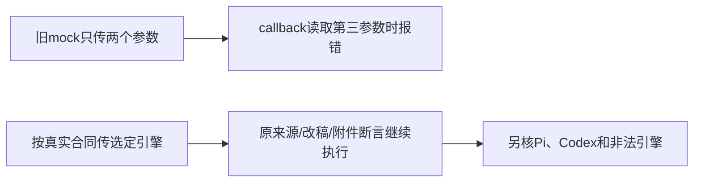

# T1184 核对聊天路由回归的装配参数夹具

用户要求全功能可用性稳定性验证，有问题建task及时修复。T1015原LED014完整串行命令当场28.6712115秒exit1，前端147 PASS/29 FAIL；失败集中route.test.ts的54例，日志class=TypeError、phase=context_preparation。后段backend因前段失败未执行，不能签局部改稿业务或全链通过。原日志SHA 9998244e979afc2acd37ea0f3ce5d5ec6d42ed377a2bf051ae542eeb167d2519保留，包含实际retry x2。

源码已读：真实backend/src/modules/ai/chat-turn-submission.service.ts的assemble第三参数ChatPrepareOptions必有executionEngine，真实submit将request.executionEngine缺省为pi并传该对象；route.ts提交callback读取options.executionEngine。旧route.test.ts公共durableSubmit mock只调用assemble(ctx,snapshot)，第三参数缺失，因此在模型准备调用前出现TypeError。这是已确认夹具不合法，不是已证实正常安装聊天不可用；其它29例是否都因这处、以及后段失败仍待当场复跑。

stage4-build维护，精确代码写集仅frontend/src/app/api/chat/route.test.ts。先独立SPEC审核、taskctl start，才校准该mock：按实际第三参数合同传executionEngine=input.executionEngine??pi，使用真实submit/assemble类型派生选项类型或本测试明确pi/codex联合类型，不从产品输出反推期待值。保原54例、历史快照构造、来源消息绑定、attachments、权限、去重、流错误、局部改稿锚点、原消息/任务恢复等断言和预算，不修改生产callback来容忍不合法mock。

补真实路由的默认Pi、显式Codex和非法引擎三种输入验证（默认可在原首个200例补断言）。显式Codex要核durable.submit请求和prepareChatReply输入均codex，不能默换Pi。非法引擎必须400/CHAT_ENGINE_INVALID，createConversation/createMessage/durableSubmit/prepareChatReply均0调用。原鉴权/跨号、已保存消息装配、宿主审批只续原任务等断言保留；若复跑暴露不同根因，不顺手放宽或删除，登记真实失败再收敛精确范围。

保原RED，不补造新负测先红。精确route文件及原LED014完整串行命令，两显式隔离PG环境、原预算；必要真实backend chat-turn-submission.service与chat-host-context.service回归确保实际三参数及引擎冻结链，frontend/backend类型和boundary/semantic/orphan/diff。源码和服务归属守卫不变，公开持久服务回归不代表真实付费模型/Codex进程、原生安装或全功能。独立实施复核精确diff和实际收据，完整Gate仍原失败则保T1015/T1018/原owner，不洗绿。

本范围不改UI、产品、服务contract、SDK、共享fixture、guard、预算、reconcile config，不触真实数据/App/微信或T1181已暂停的素材刷新。不重打相同产品包，不push/tag/Release。pmem并保存当前完整canonical27 ERROR/1 WARN和本范围逐项公共命令结果；任务仅在本范围验证闭合后由taskctl完成并提交main。

