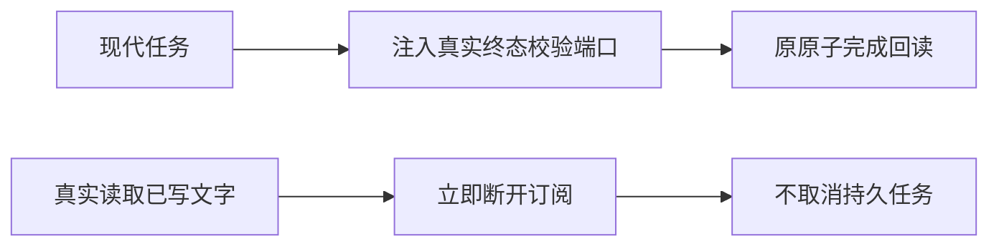

# T1185 校准聊天完成与断开连接回归的实际前置条件

用户要求发现问题建task及时修复。T1184单文件校准后的真实首轮14.946611秒exit1、54 PASS/2 FAIL；原54例未删除，Pi/Codex/非法引擎验证已通过，两项不同失败保留。原日志SHA da63264f3f58aeb3916e8808e8ed7db13b3f1fa0477dd9cc219d0df885416a86。源代码未改；本任务只处理被前置TypeError遮住的两项过期测试准备。

真实完成例提交现代持久任务，payload.terminalPlanFailurePolicyVersion=1，实际createChatTurnCompletionService对该版本要求真实validateTerminalPlanFailures与validateTerminalToolFailures端口。旧例直接无deps调用，因此commitResult因校验端口未装配拒绝。真实backend完成测试已从execution/workbench-plan.service注入这两实际校验函数。不能移除生产校验、删除payload版本或注入总返回空/通过的假validator。

断开连接例在Response.body首次pull前就abort，然后期待读到“已写”。实际chatExecutionResponse是highWaterMark=0、只在pull迭代有限页；断开连接立即释放订阅，不会凭空发尚未读取的文字。应先通过真实response.getReader逐块读到该中性文字，再abort；已读文字仍在本次消费者缓冲，后续读取done、订阅signal即时aborted、durable.command零调用。不能恢复后台抢读或延迟取消，只为旧测试制造文字。

stage4-build维护。精确代码写集仍只frontend/src/app/api/chat/route.test.ts，上游T1184三参数mock与引擎断言冻结。本任务唯一修改两例：真实完成例动态import当前实际两validator并传入原completion factory；断开连接例增加实际reader有限读到第一段文字的同步，再abort与结束/不发cancel断言。保原56例及真实数据库/请求提交→任务账本→checkpoint→assistant正文、用量、原任务/业务终态、结果和流finish原子回读，保无重复消息/任务和用户输入源绑定。不得改原model budget、测试预算、其它mock、shared fixture或产品。

先独立SPEC审核、taskctl start，才改。保真实RED与源SHA，不补历史红测。精确route与原LED014完整两段命令、原显式隔离PG；实际backend chat-turn-submission、chat-host-context、chat-turn-completion及当前相关stream宿主回归、frontend/backend类型与boundary/semantic/orphan/diff。独立实施复核必须核注入真实函数没有绕过guard、确实已读后取消且保持即时结束。其它旧backend失败按真实log和原owner保留，不顺手扩大改动或删除断言；本文件完整验收未闭合前不得称T1184/T1185完成。

没有UI/方向/契约/归属/安全/发布标准变更，不触SDK、预算、reconcile config、真实数据、当前App、微信或T1181研究暂停。当前包runtime未改，不重建相同产品包，不push/tag/Release。收尾保存b344上实际完整canonical27 ERROR/1 WARN及本轮所有公共命令，不用新局部PASS重写旧完整输出；pmem、taskctl及main提交真实记录范围内结果和未解决项。

