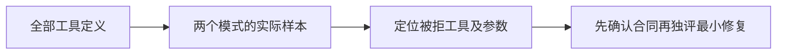

# T1186 核对全部工具宿主参数回归的两项当前失败

用户要求全功能可用性稳定性验证，发现问题及时建 task 修复。T1184/T1185 的当前原 LED014 完整串行回归仍在执行时，前端七文件实际 178 PASS；后段 backend/src/modules/ai-runtime/chat-tools.test.ts 已观察到 226 例中两项失败，分别为 selected 和 project 的全部工具宿主参数遍历。完整命令尚未结束，因此不签最终后端数量、退出码或只剩两项失败。原日志路径为独立隔离验收目录 t1184-t1185-led014-complete-current.log，结束后保存原字节、receipt 与 SHA。

完整原命令已于02:12:44 UTC结束：96.762120秒、exit1；前端178 PASS，后端264 PASS/2 FAIL。两例具体被拒工具均为 canvas.propose，parameters.safeParse(legal).success 为 false；其它失败未出现。真实后端仅发现三个测试文件，保原四路径命令而不补拍第四文件。原log SHA 4fffe363cea4e4fa07c03f0f9a27c22a568db1bd7226d754f092748994c583ee，receipt/原gzip/结构汇总冻结于 docs/verification/t1186/；上述执行中记录保留其当时事实，不改原日志。具体 schema/样本拒绝原因仍需读取证实。

只读取证范围：核当前 buildChatTools/allChatTools 的工具定义、prepareChatToolDefinitions/prepareChatToolParameters 的真实消费者，以及该测试最后两例产生的样本与具体拒绝工具。现有通用样本生成器按 schema 基础 type/enum/minimum 等机械构造，已对四个 typed 作品工具跳过并有 redfox.query 的动作样本特例；这仅提示样本有能力边界，不能据此把实际失败判为夹具过期。先取得最终工具名和原拒绝详情，核 schema、端口类型和真实参数合同，再确定最小实现或测试修复范围并独立 SPEC 审核。

诊断不改源码，不跳过新增工具、不删除 selected/project 变体、不注入放行 validator、不放宽 required/additionalProperties/归属或非法输入校验，不修改预算、SDK、reconcile 配置或其它测试。产品修复若涉及实际服务合同，需记录原有确认与适用用户决策，不能把本诊断当作合同变更许可。没有付费模型、真实平台、微信、新上传实验或真实安装 App 操作。

T1184/T1185 的路由 56 PASS、真实提交/宿主 31 PASS、完成服务 61 PASS、stream 宿主 23 PASS 及双端类型检查只证明各自实际范围；完整命令的本失败保留并归属本任务，不替换原完整 canonical 27 ERROR/1 WARN，不冒充全功能通过。

## 当场源码判断与待独评精确修复

实际 chat-tools.ts 的当前 canvas.propose inputSchema 是 strict Zod 对象，operations 使用 contract/resources/creative-canvas.ts 的六种 type 判别联合。prepareChatToolParameters 在真实 Zod 分支复用原 validator。旧测试 sample 只处理 enum/type 基础节点，不处理 const/判别联合或 positive 的排他下限，联合 operations 项落为 null，因此这个样本本来不满足当前操作合同。原宿主已有 delete 操作的受控端口调用、新旧定义恢复及来源/归属/取消负测；端口夹具不是实际安装或模型证据，不能把本次样本拒绝称为用户画布功能坏了。

相同通用样本能力边界还覆盖当前 system.read 的 request 判别联合与 window 续窗约束、system.action.propose 的 action 判别联合、canvas.create.propose 的 document schemaVersion:1/可空projectId、canvas.generate.propose 的正数baseRevision。它们在本失败循环中尚未执行，不声称已经观测了这些后续失败。system.features 的基础字段仍沿原生成器，不顺手扩大；四个 typed 作品工具的原跳过不变，不新增任何跳过。

stage4-build 维护，待独立初审通过和 taskctl start 后，精确写集仅 backend/src/modules/ai-runtime/chat-tools.test.ts 的这两个 it.each 模式用例。保原226例和默认生成器，增加五个具名中性合法输入样本：canvas.propose 的 baseRevision:1 和合法 moveNode（operationId/nodeId/position{0,0}）；system.read 的 accountGroups.get/groupId 明确输入并显式 offset:0/limit:20（无续窗与额外默认变换）；system.action.propose 的 group.create/name；canvas.create.propose 的 title/projectId:null/完整空 schemaVersion:1、viewport{0,0,1}、nodes/edges；canvas.generate.propose 的 baseRevision:1/nodeId。只校准测试输入，不从产品返回值反推期待、不调用工具执行器，不为真实领域 ID 冒充归属已验证。原 redfox 动作样本保持。

每个工具的合法 strict safeParse/parse相等、非对象拒绝、空对象按真实 required 判断、additionalProperties=false 拒绝多余字段和全工具定义覆盖原样保留。另在已有同一循环内对 canvas.propose 核 baseRevision:0、未知操作 type、空 operations 拒绝；对 system.read/action 的未知 kind 拒绝，保持判别联合实效。它们是参数保护的真实负例，不移除消费端校验，不更改其它源码、mock 或运行时合同。不新增反射式任意schema放行器，也不把工具名分支放到产品语义代码。

验收先真实两模式 focused，再整个226例chat-tools；真实 chat-tool-parameters、chat-canvas-tool-host、chat-system-tool-host，以及 contract/assistant-system、画布合同和 backend 当前 assistant-system/application服务相关公共链（以实际文件定位，不编路径）；双端类型、boundary/semantic/orphan/diff。原 LED014 完整串行命令当场重跑，原 LED017/020 的未变其它失败按实际结果保留，不凭工具样本PASS销其它门。发现不同不明机制保原日志、另task/独评，不跟随失败修改其它样本或生产策略。独立实施复核精确diff、所有原断言/工具无新增跳过、当前 receipts 和实际公共链；pmem/控制审计/taskctl/main提交只完成该测试校准，canonical27/1原字节仍保留。原native/付费模型/平台/研究暂停均不变，无产品包变更不重建。

