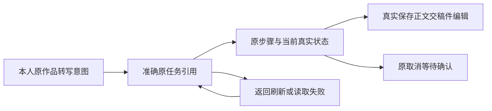

# T-1188 原转写入口任务查看与恢复

Root/Growth T214 DEC204；准确维护原T230/T243/T1066/T1070与正式Mother已批入口，不改方向、架构、数据归属、DTO、API、状态、费用/预算或partial。

操作者为当前工作区本人创作者，已有导入作品与原转写意图；从原稿面或助手工具回执查看准确原task引用、原步骤、当前状态和实际保存结果，交原稿件编辑。返回/刷新沿原意图；取消仅沿原控制并等待真实stop，未知不重新识别。读失败保稳定意图并有只读重读；正文存在仍能看准确任务；不得把旧稿件说成本次新结果。

Root已审v3候选0fd38e8864ae/独立报告f6a4ebbb180e，四原before与五after见Root evidence。只5生产：frontend/src/features/draft-workbench/transcribe-now-button.tsx、draft-workbench-data.ts、draft-workbench-page.tsx；copilot/ai-copilot-content.tsx、新transcribe-task-progress.tsx。只5测试：同目录transcribe-now-button.test.tsx、draft-workbench-transcript-state.test.ts、draft-workbench-page.bug8.test.tsx；copilot/ai-copilot-content.test.tsx与新transcribe-task-progress.test.tsx。额外路径先准确报，不改旧规范/配置/export/timeout。

复用项目oil-ui-pro 0.10.0和账号组UI规范；维持既有工作台方向。功能文案至少16px/点击44px，状态与动作清楚，无术语/小字塞内容。声明6视口：1440×900、1366×900、1280×800、native1024×680、390×844、360×800；200%与键盘焦点回返。本人真实UAT走意图→反馈→稳定结果→下一步→返回/刷新/失败恢复；合成unit/static不代实际视觉/UAT。

真实contract client到HTTP transport/envelope受控测试，保旧busy/nonce/已有稿/owned source保护；完整101+分页、短页/空页/重复/总量漂移/悬空指针未知零POST；首读失败重读、SSRdone不能覆盖已确认false；坏storage和POSTunknown原key重挂、不用GET拒绝反推POST未发生；已知身份/组失效立即撤旧task/steps/href/控制、旧慢响应不得回写。准确task canonical、同作品当前版本锚、cancel_requested不冒stop、剪贴板异步准确对象/失败反馈、Copilot工具output/error/缺taskId。T215回执恢复尚未交付，unknown写保护不是整任务闭环。

Node25.9/pnpm10.32.1，前端原20s，相关unit/typecheck/build、LED047/timeout-policy/boundary按原要求真实核验。零生产/provider/用户目录、安装/部署/浏览器接管（14/p1待用户归还）；不新正式审核周期或伪PASS；Root管理新任务治理。
