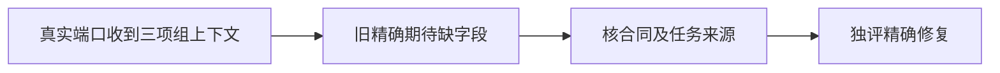

# T1190 核对定位生成服务的请求上下文断言

当前原LED058三段命令实际20.407567秒exit1：Worker六文件54 PASS，后端五文件117 PASS/1 FAIL，前端未执行。唯一失败为execution-chat-generation.service.test.ts的定位专属normalizer/前采候选身份用例；模型端口收到上下文额外groupId:null、groupVersion:undefined、membershipVersion:undefined，旧精确对象未包含三字段。原日志SHA6fe139805f351d91feb9bf7a0afe0a1bc8bbc0b3b38bb7003ac70983fdfd0434。

当前仅只读诊断：核真实RequestContext合同、任务存档上下文和构造消费者，确认组权限与版本是否正确传递。不得用objectContaining代替全部原上下文期待、删除组字段或禁用保护来转绿。若只是已确认合同的旧夹具期待，补精确SPEC并独立审核后仅校准该测试；若产品上下文错误则按真实归属契约修复，不能把组值猜为null。保原前采候选身份、normalizer、工具/来源/账号隔离和整串行命令；不改预算/guard/产品或原研究暂停，不做真实平台/模型/安装操作。

## 来源已核后的精确测试校准，待独立初审

只读来源诊断见[诊断报告](../verification/t1190/DIAGNOSIS.md)与READ_SET.json；原日志/receipt/gzip字节一致。合同contract/src/request-context.ts已定义groupId:string|null及两可选版本；execution-lease.service.ts按持锁原任务赋groupId，两个持久nullable版本变undefined。原fixture只创建单账号ctx/会话/源消息，没有真实账号/组/member，membership锁保持legacy空组/空版本。正常normalizer/前采候选身份结果第316行先通过，第317行完整凭据端口期待缺三字段而失败。旧断言来自2026-09-06的3e9a0069，组合同与lease赋值来自2026-10-05的125bc864，不以commit自述当验收。

产品写集为空，唯一测试写集backend/src/modules/execution/execution-chat-generation.service.test.ts。在原定位用例的完整toHaveBeenCalledWith对象中仅补groupId:null、groupVersion:undefined、membershipVersion:undefined；保...f.ctx、source:ai、原execution请求ID、positioning.generate/ref/undefined四参数、第316行normalizeSuggestion/discovery身份及全部原17例。补后撤去三字段必须逐字节等于改前文件。不用objectContaining、不从mock actual构造expected、不抹undefined、不造新组夹具；不改RequestContext、组/成员保护、normalizer、模型回执、执行/父任务/取消/期限或配置。

空组来自当前真实legacy提交/租约消费，不代表全局可见。当前assertFrozenWorkspaceMembership核真实owned active组与member版本；groupVersion沿冻结task透传，但没有全局比较当前group.version的CAS，不能补签或在本次校准新增质量门。跨组、member变化、来源/父任务凭据、attempt/fence、cancel/pause、unknown/rejected和同请求并发保护保原值。

实际验收：保当前原54PASS/后117PASS1FAIL/前未执行的exit1；精确校准后完整原17例、原LED058完整三段串行命令，真实group-task-scope/execution-lease与前端request-context.server原反例；双端type、boundary/semantic/orphan/diff，并由独立实施复核核diff/SHA/真实收据。前端旧雷达三项活动任务呈现期待已有T1188，若原完整串行仍有它们的范围外既有失败，明确保原退出码/日志/owner，不称整串PASS；本任务自身全部Gate实际完成才可按AGENTS证据限定完成。产品不变不另重打同一安装包；代码与证据本地主分支提交、不push/发布，不碰真实用户库/App/模型/平台/上传研究。
