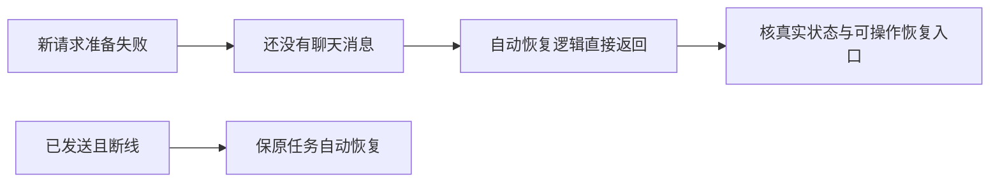

# T1191 核对编导发送前准备失败与恢复入口

用户要求AI助手操作各功能的可用性稳定性及缺口及时修复。T1187只补已审定测试control/currentTaskId与acquire隔离接口后，本文件完整原20例实际23.003779秒exit1，14 PASS/6 FAIL；原日志SHAb542617c27a355879f6cb050a43a778b01e59fd573206ffeeea20f321bc35263。失败涉及autoSend保存UNKNOWN、无sourceID原会话恢复、sourceID冻结稿重接、新回合保存失败、真实SDK重接、引擎不可用零提交。缺文字/手动重试不能直接证明产品错误，因为新版有自动恢复合同。

当前只读证据：AICopilotContent的composerLifecycleError分支默认autoRecover:true/canRetry:false；自动恢复effect在messages.length===0时直接返回。因此新请求严格准备或引擎就绪检查失败、尚未发第一条消息时，不能按该effect继续；必须核实际submissionAttempt状态与当前用户可操作入口，不能只把测试“重试”改名或伪造消息让其恢复。已发送断线的原任务自动恢复与有限无进展预算属于不同实际状态，保同源sourceID/冻结target/附件/引擎，不自动重发未知副作用。

本任务当前仅定位：读真实准备/引擎检查/提交与恢复消费者、T1070/T1022/T1053/当前有限恢复SPEC和现有测试。需形成明确可信状态与恢复动作的精确SPEC并独立评审后，才改产品与测试；任何UI修复必须加载oil-ui-pro并保现有tokens/组件。不得暴露原供应商或凭据细节，不改模型语义、保存归属、任务控制、预算和原研究暂停。T1187完整20和LED020当前失败保留，未通过不宣称完成编导组件验收。

## 当前精确修复范围，待独立初审

本任务落实T1070已确认的严格准备/原请求恢复和T1022/T1023有限自动恢复，不新增服务、任务、权限或数据所有者。源码缺口来自把尚未开始transport.fetch的准备失败与已提交断流混为一个自动恢复状态；无消息的effect直接返回是当场源码事实，不是模型或安装验收。唯一产品写集为frontend/src/features/copilot/ai-copilot-content.tsx；测试写集为同目录ai-copilot-content.test.tsx，T1187已审定五项接口替身补充独立保留。

按可信UI生命周期处理，不分析错误文案来猜状态：

1. submissionAttempt增加建立时的liveSession对象与epoch、原attachmentIds快照、可空的preparationFailure枚举engine_unavailable/preparation_failed。当前attempt必须同时满足ref身份、当前liveSession与未变的epoch；显示、继续、fetch开始标记及异步prepare后的提交/错误/输入与附件恢复回写都用此可信边界。引擎检查失败时直接记engine_unavailable；catch仅在同一当前attempt未开始fetch时记准备失败。每次用户新发送/继续重新创建原attempt，默认null，不伪造服务器receipt或executionTaskId。切换scope/账号组后旧attempt不显示或提交到新身份；新会话沿原epoch递增清除准备失败与旧恢复入口，晚完成的旧prepare不得继续发送，也不能覆盖新请求状态。原已提交后台任务与lease不因此取消或改属主。
2. chatError优先显示当前composerLifecycleError对应且networkStarted=false的明确准备失败，避免上轮SDK error覆盖这次未提交状态。未准备好显示“稿件尚未准备好”，提示原请求保留/处理保存状态后继续；引擎未就绪显示“编导引擎尚未就绪”，提示未发送并检查引擎，已就绪后仍由用户继续原请求。不展示任意原异常/供应商/凭据串。这两态autoRecover=false，可操作“继续本轮”；引擎确实不可用/正在检查时继续按钮禁用并有明确设置入口，不能假自动执行。
3. 引擎设置入口使用当前已存在且实际被settings-interactive-region消费的/settings?highlight=assistant-engine，文字“检查编导引擎”，复用原Link/错误卡tokens，不另造弹层/导航路径/全局组件。已发送临时断线仍按原autoRecover/三次无进展/继续恢复处理，原1/2/4秒间隔、任务期限和真实后台状态不改。
4. retryLastTurn对任何当前有效、networkStarted=false且明确preparationFailure的原attempt重新准备同一text/request/attachmentIds，保preparationPending防并发；不要求旧strict布尔值，也不能regenerate上一轮source、不擅自提交旧冻结稿。仅凭networkStarted=false不能把无准备失败标记的SDK恢复认作新的preflight失败；该状态保原SDK恢复路径，不从消息存在/文案/SDK替身推断fetch已开始或伪造networkStarted。原引擎/编辑器状态在执行当下重新读取；editorTarget/creationTarget仍走原严格准备和服务端guard，UNKNOWN保存由原编辑器处理，不以UI标记当作保存成功。只有用户点击继续才重试准备。原submit立即清picker并在finally清transport附件ref的消费者已读，attempt保存原IDs、继续时只重武装该快照，不读用户后来新选的附件，不改附件上传或服务归属校验，也不把旧请求的finally清理回写到新attempt。
5. 已开始fetch且原冻结receipt缺sourceMessageId，在读取原对话后composerLifecycleError存在时，显示“原请求结果待确认”和可操作“核对原请求”，autoRecover=false。该动作只走现有listMessages/原receipt恢复：没有明确source仍不regenerate、不重prepare、不创建新模型任务；mapped空时仍保入口，不能因messages变空继续显示虚假自动恢复。有真实source的原断流仍自动重接同一source、附件、执行引擎与冻结稿。
6. 自动恢复effect及其定时回调在当前preparationPending存在时不发恢复调用，不消耗无进展次数来抢正在合法保存的请求；不缩预算或创建新循环。仅补同文件当前attempt的session/epoch保护，原任务的正执行预算、source身份检查、既有scope/epoch/卸载保护、lease/owner、取消、账本与服务合同均不改。
7. 200%真实浏览器走查在实际OverlayController与AICopilotDialog宿主复现：1280物理视口对应640×400逻辑，panel592×352/bottom376，输入框bottom380.5，真实Tab后仍被裁切；900对应450×300逻辑，panel402×252，输入区初始完全超出裁切边界。私有夹具标签位于面板外，不占产品高度，原失败截图/命令/实际DOM保持。源布局中content根h-full/min-h-0，消息区min-height120与composer shrink0，宿主overflow-hidden；只在同文件content根复用overflow-y-auto为有限高度提供纵向滚动兜底，保原消息区下限、自身滚动、composer/字体/间距及正常视口布局。不能缩小文字、删除消息下限、改宿主/全局样式或用测试force/脚本scroll冒充可达。以正常浏览器键盘/滚轮在同源原状态、100%和200%核输入及所有允许操作可完整到达，不要求所有长内容同时占首屏，不以隐藏产品裁切的夹具滚动签PASS。没有根滚动可行性的候选证据或独评准入时，不先改产品。

界面为原错误卡的状态补齐，保已确认丰富紫色工作台、原布局/字体/颜色/按钮和账号组身份；不探索新风格。已读oil-ui-pro0.10.0、existing-project、interaction-and-state及账号组UI_RULES。私有实际React组件harness在改产品前取同数据/1280×800与900×600基线，实际source/替身边界和命令留证；修后同视口看图、键盘、200%与真实按钮走查，独立现有界面视觉评审与任务走查。该harness只用中性EditorPort/引擎/空只读宿主替身及禁止对外网络的fetch，不是安装、真实保存服务、真实Codex或模型验收，也不消耗上传研究的第三实验。

测试不删除20原例或安全期待。三项准备失败用真实当前用户状态检查零SDK/原请求，补保存未确认→用户继续→同target一次提交、引擎未就绪→设置深链→确实就绪→原creationTarget一次提交、新回合继续不重接旧source。明确断言旧SDK error同时存在时优先显示新准备失败；切组/切scope/新会话后旧attempt不能显示恢复入口、触发旧SDK/regenerate或将旧原话送到新目标；延迟prepare在epoch/会话改变后不提交且不回写新输入/错误；带附件准备拒绝后继续的真实SDK body保原附件而不读后来新picker附件。自动恢复定时器已排队而prepare仍pending时，断言零恢复调用、零无进展次数消耗，原三次/1/2/4秒预算不改。三项旧手动重试期待按现行自动恢复合同，从真实自动动作观察listMessages/再生原source或SDK提交；原text/附件/engine/冻结版本/prepare调用次数与零非法再提交仍断言。无source读回空后明确检查核对入口、零regenerate和不重新prepare；明确source SDK恢复必须读回正确source及完成流。原有限无进展/有真实任务回执/切页会话公共链保持。

2026-10-10范围内扩大回归：首轮新增8例后的完整28 PASS，原LED020后274/前92 PASS；原LED047173PASS/1FAIL与LED059后20PASS/前66PASS/1FAIL都指向旧T716普通SDK恢复。实际旧替身仅捕获sendMessage而不调用transport.fetch，随后注入messages/error，attempt无preparationFailure；第4项原“任何nofetch”会重send，使原regenerate期待失败。保两原失败日志，未改它们的断言/替身或以此伪造fetch。当前澄清只收紧有可信准备失败标记的重新准备入口，其它SDK恢复不改；正式追加独立初审后实施这一条件。在同名测试补无准备失败的普通SDK恢复和无编辑器的引擎明确失败→一次原话提交，防止为strict夹具洗绿。此前正式初审与RED/首次28 PASS都绑定各自真实SHA，不补签这次澄清的前置审核。

验收：当前原失败14PASS6FAIL和LED020原失败先冻结；精确改动后完整本文件、原LED020串行、真实chat-task-control/live-session/consumer/interactions、严格准备/作品请求公共链、原LED047与LED059、双端types、boundary/semantic/orphan/diff/timeout-policy。其它原全局失败不删除；独立实施复核核实际SHA与公共链/替身范围。产品变更先main真实提交，再按packaging-creatoros-release构建新本地包及隔离随包启动/公开smoke，用户已要求构建不备份；不安装或启动真实用户App、不碰真实库/模型/平台，未完成的原生全功能验收如实保留。pmem/reconcile/taskctl只按实际结果，T1187不提前签完整20PASS，T1191也不以组件harness代签全部产品可用。
