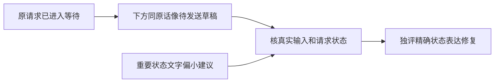

# T1193 核对结果待确认时的重复发送暗示与恢复状态可读性

用户要求全功能可用性稳定性验证、有缺口即时建任务修复。T1191 final-source fresh独立视觉评审实际看18张当前图，不读代码/旧图、不操作浏览器。当前prepare提交未知图上方已出现原话气泡及“原请求结果待确认/等待原会话回执”，底部仍同原话且紫色发送外观；creation未知图则空输入。报告将它明确认定为可见状态歧义，尚不能证明实际重复请求或按钮可用。报告/READ原SHA2f224707…/830ec506…归档docs/verification/t1191/FRESH_VISUAL_REVIEW。

另有两项建议：重要状态正文画面估算约12逻辑px，需核实际组件/字号，而非凭截图签CSS；global200短高承载恢复原因与动作需分段阅读，当前正常滚轮可达，不认定行为阻断。不得以这些建议推翻已选原丰富紫色工作台、删除状态信息或擅改宿主/布局。

当前只读诊断：核真实未知来源/会话receipt、原输入保留消费者、显式新发送与核对路径、in-flight边界及当前字号。区分原请求草稿、用户后来新草稿、尚未发送失败与已开始提交未知；确认会话回执缺失时准确说明等待原因。不得清除用户未发送新稿、不抹原话/附件/target、不自动重发、不把UI状态当成功、不以禁止合法新创作掩盖歧义。必须在当前实际公共链复现状态及请求次数后，精确SPEC、独评和taskctl准入才改产品/测试。

T1191当前源60fe11f9的准备/原恢复修复与根滚动证据保留。本任务不倒签其视觉全绿、不改已发生测试或将视觉猜测当产品根因。若采用更大正文和重复介绍减法，继续oil-ui-pro既有页面规范与当前tokens，先复看同数据100/200自然换行/允许动作/身份。真实模型/native/平台/上传研究2/2原暂停与真实数据边界保持。

