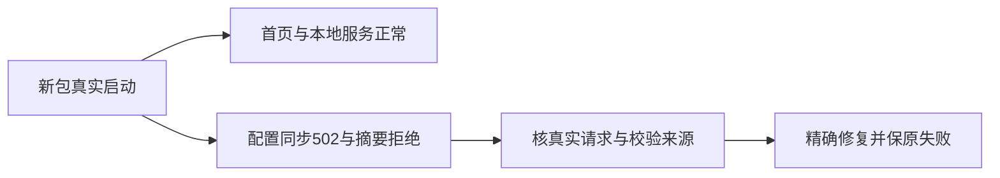

# T1196 排查安装版启动配置同步502

用户既有全功能稳定性验证、有问题建task及时修复授权。本轮T1194安装包SHA `d91079d6542407a6f5c3232f35cd815cfaff259c51fa9e40e5ccf030eb10a1d1`，代码源4b10e89e。真实启动日志同时记录：`CHANNEL_RUNTIME_DIGEST_MISMATCH`、同步展示副本到sidecar失败HTTP502、`phase=config_sync reason=unknown trigger=startup status=blocked http_status=502`。本地服务启动核验完成，公开CLI connected=true/access=full，真实HTTP首页完成；激活校验仍为已激活且验签通过。不得把这些失败混为启动超时、失去激活或数据丢失。

原日志和当场安装/公开读结果保留于 `docs/verification/t1194/REPORT.md` 引用的私有证据。根因尚未知，不能从502直接推断代理、远端服务或摘要策略错误。下一步只读核真实同步消费者、当前包/已确认摘要来源及对应HTTP返回归属；涉及激活/数据/服务合同或产品代码的精确修复SPEC须独立初审后执行。不能禁用摘要校验、放宽验签、重置激活、读凭据或以清历史洗掉失败，不主动重新触发采集/生成。

同轮还有 `scheduled.intelligence.sync` 自动任务失败，归原T1098启动后定期同步诊断，保真实原ID；并不建立替代任务或将该历史任务重发。此任务登记是有限诊断，不是根因或修复完成，不影响用户使用已加载首页的新客户端，也不恢复微信与上传研究预算。

2026-10-11 T1209新包4e82ba9690a85de58a86b3965ffdaf241df526beb00f3bddd1e4fd9155f04e0e的安装版再次实际记录同样摘要/502；之后还有phase=refresh failed及config_sync security_error blocked，errorCode=CLIENT_CONFIG_ACCESS_CHANGED。公开CLI仍connected/full、实际HTTP首页已加载。原观测startup-verification.json及native日志在docs/verification/t1209；此新增错误仍需核实际消费者，不推断失去激活、泄露或当前409原因。

