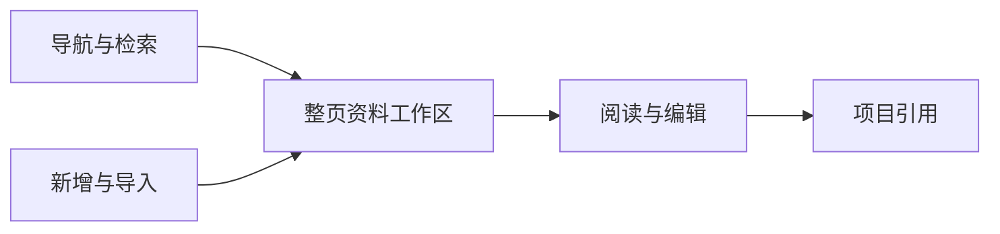

# T-1200 知识库整体工作区重设计

用户明确指出当前知识库新旧UI拼接、排版没有合理铺满、整体体验奇怪，要求重新设计。不是加一个顶部面板或调整几处间距；本任务重新组织整页对象、导航、浏览、阅读及操作入口，最终迁移所有本页消费者并删除被接管的旧界面。

品牌方向沿用户此前确认的原版丰富工作台与[账号组页面规范](t1022-account-group-workspace/UI_RULES.md)，不更换全局导航、字体或紫色主题，不重开已停止的风格A/B。必须使用项目 oil-ui-pro 0.10.0，先盘点tokens/真实组件并保存同视口基线，随后以知识内容为主体设计完整工作区。具体骨架在看过当前真实页面及数据结构后确定，不能只凭猜测拼静态卡片。

用户任务：快速找到可引用的资料与经验；按现有资料组织方式浏览；打开全文阅读；新增/导入与编辑；从现有真实入口引用到项目。原功能保留，通过统一操作位置与层级呈现，旧数据没有迁移/删除授权。不要为了填满页面虚构统计、素材或功能，不把所有正文压成小字号，不让大面积空白挤走内容。

范围为本知识库工作区及必要现有消费者；不重写其它页面、不改知识的user/group/account所有权或AI候选采纳规则。模型语义仍由Skill/模型决定，代码只实现明确分类/筛选和权限、真实ID、时间、分页、保存版本。现有服务契约若缺操作，先明确缺口并独评后补，禁止假按钮。

在当前页面与调用图盘点之后补设计说明、完整页面操作合同、精确写集和必要回归。整体重排需独立SPEC评审；初版可运行后按oil-ui-pro做独立视觉评审及另一次真实任务走查。至少1366×900、1280×800与宽屏；正常/空/加载/失败/长标题/长正文、200%缩放、键盘焦点、筛选分页及组切换不回写都验证。保存、导入和引用以重新读取的真实结果为准，不能用截图或候选假称成功。

阶段：当前项目4-build；本任务补DESIGN与必要CONTRACT后进入实现。用户已确定品牌与整体重设计目标，可逆排版细节自行决定；发现改变数据归属或核心操作范围时先给出具体可审查结果，再征求实际缺失决策。当前未声称视觉或操作已经通过。

## 现状与此次设计裁决

当前 main 的默认路由使用 KnowledgeLibrary；`view=advanced` / `tag` 又进入 KnowledgePage 的旧黑色胶囊导航、倾倒场、评论回流、指标卡和三栏关系视图。CodeGraph 已核两者唯一产品入口为同一路由。资料区固定 `100dvh-230px`，没有服从 AppShell 的可用高度。旧资料文件工作区虽然隐藏，页面仍保留开关和组合代码。旧查询分页还可能返回默认资料页而离开经验视图。

统一成一个知识库目的地、同一标题和横向导航：**资料库 / 经验与关联 / IP 实战课**。这三个是内容任务，不是新旧版本选择。删除“更多知识视图”和旧黑色胶囊导航。资料库默认三栏（目录、可检索列表、全文）铺满父工作区，头部压成两行；经验页默认可检索的知识与已验证经验列表，关系图/观点地图切换置于该页工具栏。课程保留既有课时和进度，在同一工作区正文滚动。原页的录入和评论操作收进可展开的“录入与整理”，保留实际功能，默认不挤占阅读区。统计改成一行真实计数，不继续堆四张大卡；分类与标签在整理侧栏中，不再复制一套主导航。

资料正文是主角，宽屏中正文保持可读行宽，面板本身铺满剩余空间；窄屏目录可收起，列表和正文按顺序展开，200%缩放不会被固定桌面三栏裁掉。详情标题、来源、编辑与项目引用固定在同一阅读面，不额外开一套旧详情页。没有选中文章时给真实的选择/添加下一步，不自动选择或虚构资料。

已有绑定继续用 T1075 的全部 read/write/import/reference/navigation 合同；新增的仅是导航与呈现，不增加服务操作。`view=advanced`、`tag`、`page`、课程 `lesson` 深链仍兼容；经验列表分页保留 advanced，清标签返回经验页。其他内容页的“添加资料”链接 `add=1` 打开现有录入表面，实际成功仍须读回。数据、权限、版本、原文件、采纳与错误输入保护不变。

`add=1` 是此次新增的界面路由消费，不是已经存在的操作。仅调用现有添加资料表面，不发请求或自动写入。共同页头链接与默认页内按钮使用相同视觉层级。

| 既有能力 | 新界面去向与边界 |
|---|---|
| 原文阅读、编辑版本、原文件、项目引用、移动与归档 | 资料库的阅读面与更多菜单，仅 knowledge 实体；服务回读、版本和文件完整性守卫保留 |
| 已验证经验的全文与来源 | 经验与关联列表；learning 保持只读，不使用其 ID 调知识修订/归档/引用，不把知识操作套到经验上 |
| MemoryInsights、未整理、复用片段、类别真实数量 | 经验页整理侧栏；次级汇总可折叠，原条目与空态仍可查看，不新增假按钮 |
| AI 混合检索 | 经验页常驻搜索；输入筛选与回车 AI 搜索保原协议/结果/降级和错误 |
| 标签浏览、创建、改名、删除、查看挂载与移除挂载 | 整理侧栏原标签管理入口；点击标签保原筛选，清除与分页留在经验页 |
| AI 找关联、候选确认采纳、已有边删除 | 经验页关系图视图；复用原图面真实能力与确认门，不自动落库 |
| 观点地图与节点详情 | 经验页观点地图切换；保聚类、未归类与实际节点选择 |
| 文件导入、全文手录、AI 提炼与候选采纳、记一条经验 | 资料库添加表面保原导入/手录；经验页“录入与整理”展开原知识录入器，原记经验入口仅一次且继续本地打开Copilot |
| 评论回流 | 同一个“录入与整理”展开区的评论入口；保规则/疑问候选/人工采纳，展开本身不启动任务 |
| 课程、课时深链与进度 | 同一导航下 IP 实战课，内置课程无需选平台；既有 local progress 不变 |

“录入与整理”用保留挂载的 details 收起，仅隐藏内容；草稿、候选、错误和busy不能因收起丢失或重新发送，实际提交及切scope继续原保护，回归包含收起再展开。关联/经验中的就地详情仍用原 Dialog；不存在也不新增 `/knowledge/:id`。跨导航链接清除不属于目标的筛选参数；经验分页保留q/tag/advanced，清标签留在经验页。add=1首次只打开表面，打开后从URL消费掉该参数，关闭和刷新均不再次打开或重复写入。

## 精确实现写集与验证

产品路径：

- `frontend/src/features/knowledge/knowledge-workspace-header.tsx`（三个消费者共同页头）
- `frontend/src/features/knowledge/knowledge-library.tsx`
- `frontend/src/features/knowledge/knowledge-page.tsx`
- `frontend/src/features/knowledge/knowledge-interactive-region.tsx`
- `frontend/src/app/(creator)/knowledge/page.tsx`
- `frontend/src/app/(creator)/shell-router.tsx`（仅知识页加入已有填满布局，不改其它路由）
- `frontend/src/features/knowledge/knowledge-page.test.tsx`
- `frontend/src/features/knowledge/knowledge-workspace-header.test.tsx`
- `frontend/src/features/knowledge/knowledge-experience-merge.test.tsx`（分页留经验页URL，保其真实混排数量与只读边界断言）
- `frontend/src/features/knowledge/knowledge-tag-filter.test.tsx`（清标签留经验页URL，保过滤/权限断言）
- `frontend/src/app/(creator)/shell-router.test.ts`（知识工作区布局断言）

验证：当前知识域 Vitest（保存、原文/经验详情、标签分页、课程、关联、采纳、引用）及 shell-router；独立隔离数据的真实公开读写旅程（沿 T1075，证据另存 T1200，不覆盖旧证据）；1366×900、1280×800、1920×1080及200%视口操作/截图；LED047、boundary/orphan、typecheck 与 git diff --check。既有测试中旧“两导航/四大卡/三栏顺序”只按本次实际授权的呈现合同更新，真实操作、数量与权限断言不得删。

安装版浏览器不带原生授权会话，当前外部 IAB 所见是未授权提示，不能冒充知识库基线。设计/操作先在关闭调度、全新私有数据目录的真实源代码服务上验证；当前安装用户资料只读查询继续走公开CLI。原流程 T1083 的旧glob使 context-compile/progress generate 失败，本任务主会话串行改产品；子代理仅辅助只读独评，不伪造任务包或放宽控制守卫。

## 实际视觉评审后布局细化

第一次独立视觉评审整体7.8/10，经验页五层控制挤走正文。收拢成两行工具栏：视图、搜索、录入与整理同一行；类型和真实计数同一行。录入details展开仍保留挂载并占完整行，内容可滚动；列表与整理侧栏共用一个工作区边框，保各自真实操作。此为已审工作区方向的排版细化，没有新服务/权限或功能范围变化；需新截图再评，不把首评当通过。

第三轮结束后只核已提出的字号规范：实际computedStyle证明text-2xl是32px，项目tokens的text-xl才是24px。共同页头改用现成text-xl，落实UI_RULES的页面标题24px，不改tokens、构图或功能、不新开第四轮视觉评分；最终实图与computedStyle另存，不用第三轮旧图代签最终字形。
