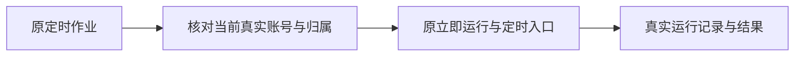

# T-1209 自动化真实账号归属409

用户2026-10-11实际反馈 `scheduledJobs.runNow` 返回409「采集作业与当前真实账号归属不符」，自动化任务不能运行。

目标：合法的当前组、当前真实平台账号采集作业能经原立即运行及定时触发入口执行；明确不改变跨用户、跨组、成员版本冻结、任务幂等或归档权限。保原job ID、排期、启用状态和历史，不删任务重新建，不在真实账号上自动批量触发采集。

阶段为BUILD故障诊断。先查公开任务真值与实际调用链，获取隔离RED；根因确认后补精确修复范围并独立复核，再实现。现有错误来自私有采集准入，不能把所有409吞掉或当作成功。源码验证与安装版修复分别报告。

## 已确认根因与限定修复

安装版公开读req-f394bff8-1525/1527：两个真实抖音账号各6条作业，全部groupId已写入，groupVersion/membershipVersion为null；公开成员版本均为1。0128只回填scheduled_job.group_id，未填两个冻结版本，私有准入严格比对null与1导致409。

追加0132数据迁移，不改0130/0131或原准入守卫。只补已有group_id='grp_legacy_'||account_id、同user真实账号/组、唯一初始成员version=1且无其它成员历史的作业（其它历史按account ID全局查，不加user过滤）；membership_version必须为空、group_version为空或与现组一致。缺失证明、转组又转回、错误版本、跨user、跨组、无号作业均不补。归档组/账号允许补元数据但保留原执行权限：归档组私有采集已有allowArchived豁免，归档账号仍拒绝。仅补两个版本，不改group/account/job身份、内容、排期、开关、updatedAt，不触ai_tasks/execution_tasks/job_run旧冻结记录。迁移原子锁住账号/成员/组/作业，NOWAIT整轮退让不持半套锁等待，避免与转组交错。

精确写集：backend/drizzle/0132_legacy_scheduled_job_membership.sql、backend/drizzle/meta/_journal.json、backend/src/migration-convergence.ts（新增精确hash/when/tail注册和前置检查，不放宽未知迁移）、backend/src/legacy-scheduled-job-migration.test.ts；相关既有迁移测试只按新增真实尾更新完整journal长度/实际新增回执数量，保原前缀/hash/业务断言。可新增真实PG并发测试。文档与BACKLOG/events为证据。

验证：原105/106历史隔离库开库自动迁移，迁移前真实runNow重现409、迁移后公开transport生成原job的run并经AI/execution准入；四私有kind、新job、共享kind、cron driver冻结及幂等；矩阵缺证明/转组/错版本不补且拒绝、历史不变、重开幂等。PG真实迁移与转组并发，当前迁移身份门、调度回归和边界检查。

验收：同组合法历史作业、当前新作业，立即运行及定时触发；跨组/跨用户/错误版本仍拒绝，转组后旧执行不续用新身份；原ID/排期/历史/幂等不变，真实公共service/transport链验证。先用隔离数据，当前真账号只读诊断；任何外部采集缺登录等另如实报告。

