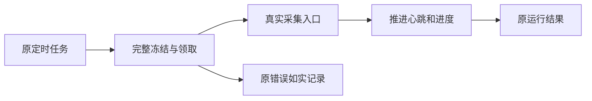

# T1210 采集入队后没有推进

用户要求自动化能执行、发现问题及时修复。T1209旧job冻结版本的409已修并安装；实际原定时器自动创建两组self.metrics运行。但第三空间exec_90e4dc58-d3ee-4b9f-8a8d-5a91afdaf729/ai-task-0f0dcc73-152公开执行观察attempt由2到3，checkpoint=null，心跳只在领取时改变，status=running/error=null，不能签外部成功。另一组run-4f1bbadf-5506-4090-ae34-12a727fb60ac也running。原记录在t1209验证目录；未手动重发或取消采集。

先沿公开诊断与代码索引核scheduled-flywheel consume、withLease/bindScheduledFlywheel、父子绑定、冻结Skill/input、真实collector入口，使用隔离PGlite/PG和原公共调度→AI snapshot→prepare→claim→consume链重现。有真实组/成员且旧迁移后的合法任务必须进入collector、推进心跳/进度、落原run终态；错误归属、错fence、停止/归档权限不能放开。旧t951裸fixture无真实组，不能代替此回归。

诊断阶段只读源码/真实公开状态与新增隔离测试；不读真实用户DB/凭据，不修改生产任务或配置，不调用真实runNow，不增加默认权限。根因未知不把空checkpoint或running直接推断为死锁。取得RED与实际错误后，补精确产品写集并独立复核，再实现；不吞异常或无限重试，不以降低安全门、重置预算/attempt、替换任务和清历史洗绿。若原任务缺证明，保原事实并显式显示原错误，不能猜补冻结执行身份。

阶段BUILD故障修复，不改变产品方向、数据归属、公开合同或平台外部能力。完成需要公共完整消费链、转组/停止/错版本拒绝、恢复原ID及资源清理回归，后端类型/边界/超时预算检查与安装版当场观察；源码通过、安装准入和外部采集完成分别报告。产品写集与所需发布调整在定位后补审。T1098原历史失败继续保留，此任务限定本轮实际消费不推进。

