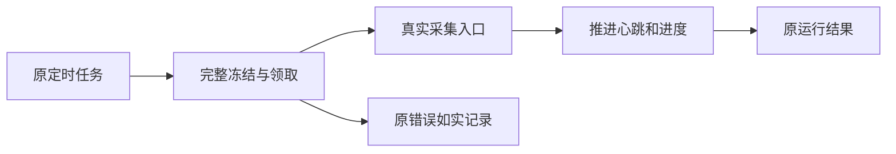

# T1210 采集入队后没有推进

用户要求自动化能执行、发现问题及时修复。T1209旧job冻结版本的409已修并安装；实际原定时器自动创建两组self.metrics运行。但第三空间exec_90e4dc58-d3ee-4b9f-8a8d-5a91afdaf729/ai-task-0f0dcc73-152公开执行观察attempt由2到3，checkpoint=null，心跳只在领取时改变，status=running/error=null，不能签外部成功。另一组run-4f1bbadf-5506-4090-ae34-12a727fb60ac也running。原记录在t1209验证目录；未手动重发或取消采集。

先沿公开诊断与代码索引核scheduled-flywheel consume、withLease/bindScheduledFlywheel、父子绑定、冻结Skill/input、真实collector入口，使用隔离PGlite/PG和原公共调度→AI snapshot→prepare→claim→consume链重现。有真实组/成员且旧迁移后的合法任务必须进入collector、推进心跳/进度、落原run终态；错误归属、错fence、停止/归档权限不能放开。旧t951裸fixture无真实组，不能代替此回归。

诊断阶段只读源码/真实公开状态与新增隔离测试；不读真实用户DB/凭据，不修改生产任务或配置，不调用真实runNow，不增加默认权限。根因未知不把空checkpoint或running直接推断为死锁。取得RED与实际错误后，补精确产品写集并独立复核，再实现；不吞异常或无限重试，不以降低安全门、重置预算/attempt、替换任务和清历史洗绿。若原任务缺证明，保原事实并显式显示原错误，不能猜补冻结执行身份。

阶段BUILD故障修复，不改变产品方向、数据归属、公开合同或平台外部能力。完成需要公共完整消费链、转组/停止/错版本拒绝、恢复原ID及资源清理回归，后端类型/边界/超时预算检查与安装版当场观察；源码通过、安装准入和外部采集完成分别报告。产品写集与所需发布调整在定位后补审。T1098原历史失败继续保留，此任务限定本轮实际消费不推进。

## 当场诊断与精确修复写集（2026-10-11）

独立只读复核确认：真实组合法链在内存数据库可以完成；故意破坏隔离旧 Skill 冻结组后，prepare 接受、首次 consume 校验拒绝，却没有结算原任务，租约过期使同 ID 再次领取。首次拒绝、心跳拒绝和失败结算再次依赖 admission 均有错误不收口缺口。另 comments 漏在调度父子来源解析；这是独立可复现同链缺陷，不能解释安装版 self.metrics。安装版具体校验原因仍 UNKNOWN，不能把故意损坏当真人数据事实。

产品精确写集：`backend/src/modules/ai-runtime/scheduled-flywheel-execution.service.ts`、`backend/src/modules/execution/scheduled-flywheel-binding.ts`（仅明确机械错误来源）、`backend/src/modules/execution/execution-scheduled-child.service.ts`（仅补真实 comments 来源）。新增隔离回归唯一文件 `backend/src/integration/scheduled-flywheel-consumption.test.ts`。证据写于 `docs/verification/t1210/`，任务/SPEC/事件/记忆按既有工具收尾。无前端、公开合同、schema 或平台外部行为变更。

消费拒绝采用当前 attempt/fence 的 settlement 事务：只更新原执行及由 user/account/group/AI execution双向绑定唯一证明的原 AI/run 生命周期，不启动动作，不依赖已经拒绝的采集 admission 再次放行。不匹配的业务记录不触碰，保日志；已换 fence、已终态、用户停控、宿主退出不能覆盖为失败。已有 started/unknown 调用保 unknown_result，对账后继续原任务，不能转自动重发。无未知调用的明确机械拒绝记录原具体原因、收口原 run/执行，保 ID/attempt/budget/history/已有结果。心跳仍限单在途且卸载清理；心跳拒绝中止对应采集并记录同一原因。错误日志使用 allowlist，仅带原 task ID、attempt、阶段、稳定机械 reason 与 errorClass；不打印原始异常 message/stack、SQL、snapshot、target、prompt、凭据。明确机械错误用固定人话保存在原任务；未分类外部异常只显示固定阶段错误。

新增回归需真实组 resolver+controls+driver+scheduledChildren+runner 的成功与 comments，全链首次/中途错误、不覆盖 fence/停控/unknown、保旧 ID 和计数/预算，至少实际隔离 PG。安装版续跑原已排队任务，不人为点击 runNow 或调外部平台。先取得 RED 与独立精确范围复核后改产品。

### 正常链 RED 确认的阻断原因

新增真实组完整定时链首次执行（未改产品）实际发现 `每日子任务缺少唯一调度父任务`，collector 未进入。`findScheduledParent` 将带 `kind=ai_task` 的整行 child 传入 `workspaceFilter`；后者以 `kind` 是否存在辨认 WorkspaceKey，误把 execution.kind 当工作区类型，最终用 child.id 当账号 ID 查询父任务。实际父子已经 attach，但仍查不到。安装版公开原父任务 blocked、原子任务 running 且从未进入 collector，与该正常链的当场错误相符；安装版内部异常此前无日志，不能冒充直接观测到其错误文本。

精确修改上述已审写集内的 `execution-scheduled-child.service.ts`：父任务查询只传显式 `{groupId:child.groupId,accountId:child.accountId}`，保原 user/job/time/唯一父、停止和 reverse 绑定校验；不改 workspaceFilter 全局语义，不放宽其它 scope。comments 同函数既有来源注册补齐。先正常链 RED→GREEN，再错误收口族验证。该定位是真实冻结正常任务，不靠破坏 snapshot。
