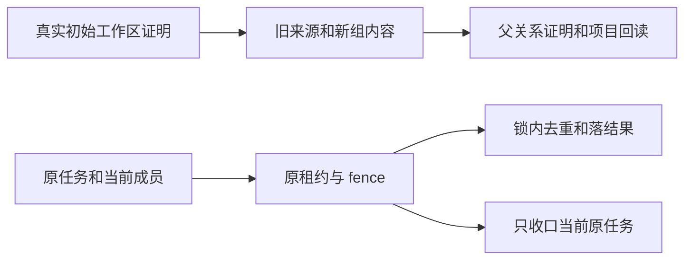

# T1217 内容雷达来源任务的工作区归属一致性

用户要求继续全功能验证、发现明确 bug 及时修复。2026-10-11 端口3901复跑现有 content-radar-one-click-project.spec.ts，来源创建公共请求成功，但原 run 持续等待，后台实际记录 source_sync 恢复失败 OwnershipError。只读追踪显示旧账号请求把 source/run 写为 groupId=null，execution enqueue 通过现有成员冻结到 grp_legacy_<accountId>；消费者按冻结组读原 run 查不到。该机制尚需真实隔离公共组合 RED 确认，不能仅凭日志猜生产用户归属。

当前 BUILD 诊断写集仅 backend/src/integration/intelligence-source-workspace.test.ts 和 docs/verification/t1217/。经公开账号登记与真实 intelligence/execution 服务组合创建来源、原run、入队、claim和drain，证明正确 legacy账号请求与显式账号组请求都能进 adapter，旧原ID/计数/状态一致；测试adapter只返回中性空内容，不访问RSS或模型，不写真实库。错误组、转组、归档、停止/错fence仍拒绝，不能放宽归属或造结果。定位 RED 后补精确产品写集并独评才编辑产品。

必须复用原成员/执行/来源真值，不迁移真人数据、不自动重发、不新建第二执行权、不改公开契约/数据库 schema。候选方案需分别说明来源所有权与执行安全上下文如何一致；不能因旧调用方缺 group 就在恢复查询里使用无界 OR 或删除 guard。现有旧 source/run 必须可读、原 task 可结算；迁组/权限变化仍按当前事实拒绝并如实收口，不能续期/覆盖新fence。若引入数据归属或新迁移变化，先走独立 SPEC 评审。

验收：真实隔离服务完整链 RED→GREEN、合法两种上下文及错误归属族；backend type、边界；当前浏览器来源到项目公共链复跑、截图和失败证据保留。原用例外部RSS及本地模型fixture分别标注，不以测试替身签真实模型/平台。当前未实现产品变化，无 PASS 签名。

## 2026-10-11 实际 RED 与选定窄模块方案（待当前独评准入）

当场隔离九例为 2 FAIL / 7 PASS，日志 source-workspace-red.log 保留。初版 candidate-review.md 结论 FAIL，不能继承为准入。现选择 repair-candidate.md 的“独评后修订”节及 DEC-T1217-001，旧前文保留为诊断历史。本节在当前独立复评 PASS 前不授权产品编辑。

同一初始工作区的 NULL 内容表示与 canonical 组表示，仅在行自己的真实账号、唯一版本 1 初始成员、同用户拥有组及可信历史边界证明成立时兼容。普通组不得借 NULL 支路；真实账号缺成员/重复初始历史不可降级。纯组 RSS/web 不强加平台账号，历史读取和执行权分开。无创建时间的关联依据真实父 ID 关系证明，不把 capturedAt/updatedAt 当创建时间。旧数据不回填、不改所有权、ID/hash/创建时间；新根采用本操作或原任务真实组。

精确产品写集：backend/src/modules/intelligence/intelligence-workspace-scope.ts（新内部 helper）、intelligence.service.ts、transcript-execution-binding.ts、project-reference.service.ts、source-sync-runner.ts；测试仍为 backend/src/integration/intelligence-source-workspace.test.ts，证据 docs/verification/t1217/**。模块逐操作矩阵、父关系矩阵、原 fence 收口、A–H 测试族依修订候选执行，不做数量驱动的全文替换。全局 workspaceFilter、migration/schema、公开契约、execution 控制模块、frontend、真实用户数据库不变。

写入按已有账号→成员→组→execution 锁顺序，真实组锁覆盖旧别名 identity 查询与新 insert，PG 多事务验证避免 NULL/canonical 双份。来源锁事务提交后才调用原 enqueue，不在成员锁内开第二 enqueue 事务。迟到 adapter 写入重验当前成员、原 worker/attempt/fence 与 lease；source claim 确定拒绝只通过原 finish/acknowledgeControl CAS 收口该 execution，不可信绑定不写别人 run，unknown/新 owner/原控制优先保留。share_import 两次 apply/finalize 原合同保留，不套 source_sync 专属 owner。

验收必须保原九例及旧日志，增补 A–H 对实际公共/服务消费、老版本真实 NULL 内容、PG 并发、坏父关联、真正 transcript admission 与项目引用/hash、转组/归档/控制/新 fence、无账号 RSS/web、共享导入两段的测试。隔离 ASR/adapter 不签真人平台或模型。backend type、boundary、timeout 及当前来源→项目浏览器截图实际结果独立复核后方可完成；intelligence-snapshots.ts 的其它纯账号正文口不列为已覆盖。

### DEC-T1217-001 收口选择补充（2026-10-11，独评后的明确决定）

当前独评查到 finish(failed) 对 source_sync 允许 pause_requested/cancel_requested 特例，因此前置 get 不足以守控制优先。本次选择确定性准入拒绝通过原 finish **blocked** 收口，传原 fenceToken；该端口本来只允许 running，update 同时 CAS 状态和原 worker/attempt/fence。当前 lease 到期/身份改变不调 finish，保原恢复状态；控制先提交时 blocked CAS 拒绝，回读仅同原 claim 的控制请求走 acknowledgeControl，竞争再次拒绝就保原状态，不换 failed 重试。unknown、新 owner、终态不改。已有 run 终态对账支持 blocked，原任务 ID/预算不变，不自动重发；不可信业务关系只结算原 execution，不写别人 run。这是 blocked 的真实状态，不声称已成功/普通 failed。

不新增 execution 文件写集或公共参数，五产品文件边界保持。原候选中 finish failed 的提议保留为历史，由本补充替代；控制先提交、get/update 之间竞争、旧 fence 与过期 lease 必须实际回归。正式 SPEC 已选择本段，待独立准入复核。

## 受保护引用的永久删除闭包补充（2026-10-11，待独立准入）

实际 protected-provenance-delete-red.log：deleteSource 返回 deleted，原 ref ID/hash 在，但真实 getSourceContexts 因父 source/run 被物理删除而拒绝。原 FR-CR-017/AC-CR-022 要求已确认选题、Project 来源关系及最小 snapshot 不丢，原 UI 也承诺项目内容不被破坏。本补充兑现该已授权保护，同时保持永久删除后的业务可见语义，不把永久删除改成普通归档。

选定 deletion-provenance-review.md 的最小不可执行证据壳：仅本 source 实际受保护 snapshot 及其正确 run/source 父闭包留下。源 ID/user/account/group/createdAt、snapshot/item/transcript/transform/ref 的 ID/hash 保留；adapterConfig 清为精确内部结构 `{__creatorosProvenanceOnly:1, originalExternalKey:<原值>}`，清执行配置、browserSessionRef/采集指令，monitor=false、nextRunAt=null、collectionId=null、status=archived，正常增 version。syncPolicy 不用来藏标记。证据壳 externalKey 退役到由真实 source.id 唯一派生、与所有合法 SourceConfig identity 不相交的内部命名空间；原 identity 只作为证据保留，不能复活旧源。没有受保护 snapshot 的来源维持物理删除。

业务 readSource、workspace.sources/health/memberships、全部/archived 来源列表及计数、run/events 读取、改/删/attach、手动/重试/调度和 worker 输入排除壳；原 ID 的再次业务访问保持原 OwnershipError，同 identity 可正常新建新 source。普通 archive/pause 不改变。严格 snapshot/项目引用的父证明允许同用户、同逻辑组的证据壳作为只读父，仍拒绝缺父/错 source/run/item/跨组；不能以标记绕过归属。只保引用所需 run，不保无关事件/执行权；其余原删除族继续清理。

删除与保护集、active run、当前成员在同一真实组锁事务内重验，和 reference attach 共用原锁顺序，避免并发引用后误删。原在途拒绝、confirmToken、原 fence/未知状态不改。逐操作矩阵中的 update/deleteSource、update/deleteCollection 等已有写入口也须按原选定 withIntelligenceWrite 完整接线并测试，不能仅以 helper 存在签全部完成。

新增精确测试写集仅 backend/src/modules/intelligence/intelligence.service.test.ts：原 T665 物理删除源断言与证据壳确有冲突，保真实旧失败，将该内部存储断言校准为最小壳/必要 run 且业务源不可见；原共享 item、确认选题、snapshot/transform/ref 保护和其它删除断言全部保持。五产品文件及原 integration 测试不扩张，不改 schema/index/公开契约/前端/真实库。独立准入 PASS 前不编辑此删除策略或 T665。

实际验收新增：旧 NULL 与 canonical 两种完整 Project 删除前后公共回读相同 ID/hash；仅 confirmed topic、混合 protected/unprotected run、跨来源共享及保护 snapshot 仅在另一来源；默认/all/archived/health/run 业务隐藏、worker 不可执行、普通归档仍可见、再次原 ID 拒绝；同 identity 真正重新创建新源与 PG 并发唯一；PG attach/delete 竞争保持闭包、错误确认/错组/在途零部分删除。保原 RED、原 T665 实际冲突及所有未跑族，不能拿实体存在或部分通过签整体 GREEN。

授权依据是用户“继续验证、明显 bug 及时修复”与上述已批准来源保护合同；本选择不新增公开删除模式或保留全部历史。不选择额外公开 archived、复活 ID、schema 或执行历史保留方向，未把独评当用户新增授权。

### 防丢保护与内容消费的证明分工（待独立准入）

真实既有7文件回归为71 PASS/5 FAIL，见related-existing-regressions-second.log与transcript-conservative-guard-candidate.md。旧T603/T622的已输出transform自身与真实item在同组，但snapshot父缺失；完整内容证明把它过滤后解除手稿锁并把列表待处理信号改成未生成。T665同类保护集又将已确认/项目引用内容视为可删除。原断言不改，不能因部分父损坏扩大覆盖或删除。

仅防丢guard与不返回正文的listItems workflow进度使用保守证明：稿件锁及无正文workflow进度仅需transform自身根同用户同逻辑组，真实item根也通过归属证明且其ID与transform.itemId一致；它们不强加source/observation存在。删除防丢保护另要求transform/reference自身根和真实item证明，并与本source的已证明observation集合相交。transform已有真实output/task状态只用于拒绝覆写/重复转录、显示已有候选待处理或保护删除集合。snapshot缺失、reference与transform/topic不一致不授权内容消费，只保原输出和已建立引用不被坏父触发删除。不得把“待处理”当可确认授权，getItem完整candidate列表/getTopicPreview/AI/getSourceContexts仍要求完整父链/hash/定位，坏ref明确拒绝。来源最小证据壳的run保留只能从确实存在且属于本源的完整snapshot推导，不能把坏字符串当新父。

helper分出明确仅供保护的root+item谓词，不能改变通用完整父filter。五产品写集不扩；integration新增实际负族，原T603/T622及T665其它断言保留：损坏snapshot父仍手稿锁/保护，列表真实候选待处理但坏candidate正文不可读；坏ref保输出却不被AI/Project读取授权；错组/跨用户/坏item仍拒绝。边界是确定性ID/归属/已存状态保护，不由代码做创作选择。独立准入PASS后才接线该保守guard。

### 最终复核发现的拒绝分类与删除执行绑定

仅已核真实消费者的 shared OwnershipError、intelligence 模块 IntelligenceConflictError（租约/冻结组/物理绑定及内容实体歧义）、platform-account membership ConflictError 是确定拒绝。source runner 的未知 SQL/transport/其它未分类异常不能写成 admission blocked；保原 claim/task/lease/状态，由原恢复流程处理。不同模块同名错误、配置/模型/adapter 异常不凭字符串并入此集合，adapter 沿原 failureEnvelope。确定拒绝收口仍先核原 fence/attempt/owner/lease/control；用户取消即时生效。

永久删除在真实组锁内重验当前 execution，不能只看旧 run.status：原 failed/blocked run 显式重试后的 queued/running/paused/unknown 或控制未完成均挡删除。run/transcript/transform 指针必须与 execution 的 user/account/真实逻辑组、kind/ownerType/ownerId/payload 逐族双向机械证明，错指他人或其它内容任务不得删除。真实账号及 canonical 工作区须完整 payload 绑定；裸无平台账号兼容仅限全局无该真实 platform account、源/内容/任务同原 user/account、task.groupId 为 NULL 或精确原 legacy 表示、真实反向 kind/ownerType/ownerId 与指针一致，payload 若有绑定字段矛盾仍拒绝；不能以 T665 空 payload fixture 冒称真实旧产品缺 payload。

share_import 真实执行只有 shareInput/collectionId 与 item_import/hash owner，无反向 sourceId；来源 run 单指针不足以证明可删。只有已证同工作区且确定终态、无在途/unknown/未完成控制时允许删除来源并保该无法证明可删的原 execution；不新增绑定或执行权，不复活任务，不保全部来源历史。其它可证明任务按原永久删除语义清理。任何错绑定/在途族零部分删除，并实际验原任务 ID/状态保持、显式重试保护、跨用户/组/内容指针负族与合法分享来源删除。

share_import 无法证明可删的原终态 execution 保留后，既有 execution.tasks.get/list 可能仍显示该历史。这是避免误删的授权安全校正，不新增端点/权限/执行权；不能声称所有公开查询逐字不变。源列表、源 run/events、原 source ID 仍保持永久删除语义，保留任务不能复活、续期或自动重试。

### 合法执行账号分离与终态审计父（最终实测补充）

真实 RED 已证明不能强制 task.accountId=run.accountId：run 保存 source 的历史内容账号；startRun 的执行账号取明确 collector 或请求真实账号，纯组 RSS/web 可 NULL，也可由同组另一真实账号执行。creator_profile 的源/run 可 NULL，而 task 冻结真实 collector。任务删除证明改用原 execution.user/group/account/membershipVersion 与唯一真实历史 member 同 user/account/group/version 且可信 task.createdAt 在 joinedAt..leftAt 范围，再核 source_sync kind/ownerType/sourceId/payload.sourceId 与 run.executionTaskId 双向。纯组 task.account=NULL 不造 member；真实账号缺/错历史 member 不 bare。确定终态后原成员转出不要求重新成为 current；groupVersion 不强等当前组版本，不猜不存在的组版本历史或冻结 collector 配置。错 user/group/kind/owner/payload/成员版本仍整单拒绝且零变更，active/unknown/未完成控制仍挡删除。

当前 updateSource 公共输入不能改 config/collector，不能把“用户公开切 collector”编成真实例。历史配置变化只有明确隔离注入才可验证；不以当前可变内容字段反推原执行账号。

真实正常候选 reserve/start/settle 后，execution_calls FK 会阻止删除其 execution 父；不能删除计费/审计账本或关闭 FK 洗绿。已证 scope/双向绑定并确定终态的任务若有真实审计/产物引用，只保所需原 execution 父，来源业务与原可删内容仍清理；无引用且证明可删才删 task。引用盘点必须覆盖 execution_calls、execution_stream_events、execution_evidence，以及 ai_tasks.execution_task_id、workbench_artifact_lineages.pending_task_id / lineage_versions.task_id 等真实 FK，按实际 schema 命名，不声称前三表已穷尽。只读这些真实引用作保原判断，不改 execution/AI/产物模块、不删其历史，不新增字段/schema/执行权。已结算调用可保原，reserved/started/unknown 等未结算依旧挡删除。

原保留的任务/账本/产物历史仍可能被既有公开查询读到；这是避免误删及 FK 整单失败的最小安全修复，不新增访问权或复活/续期。新增实际族：纯组 RSS 空执行账号与同组 B 执行 A 旧内容、profile 空内容账号/真实 collector、终态后成员转出、错成员版本/跨组零变更、未确认候选真实 settled/rejected 账本以及实际 stream/evidence/AI/产物引用保父。原 RED 和失败夹具日志保留，待实现/完整回归/独立复核/公共浏览器完成才签验收。

### 真实结算但token用量未知的删除保护（本轮RED）

historical-execution-and-unresolved-ledger-first.log 实际6族5通过/1失败：真实ledger reserve/start/settle(status=settled, usage={})、accountingBasis=tokens，inspect仍unknownUsage，原任务终态后来源删除却返回deleted。这里只复用 execution-call-ledger.service.ts assertResolved 的既有机械判据：未结算status集合之外，加 settled 且 totalTokens IS NULL 且 accountingBasis != requests，继续拒绝并零部分删除，原任务/来源/账本/ID保持。请求计量无需token用量，真实requests正例request-metered-delete-before-fix.log已通过，仍允许合法删除业务来源且保审计父，不能按inspect unknownUsage一刀切反杀请求计量。独立准入见final-independent-review；只改原intelligence.service.ts unresolvedCalls查询，原五源写集、不改executioncore/schema/产品deadline。新增两合法账号正族及reserved/started/unknown/token缺量/requests正负族、最终全量67和原76及公共浏览器旅程仍须自然终态后再验收。
